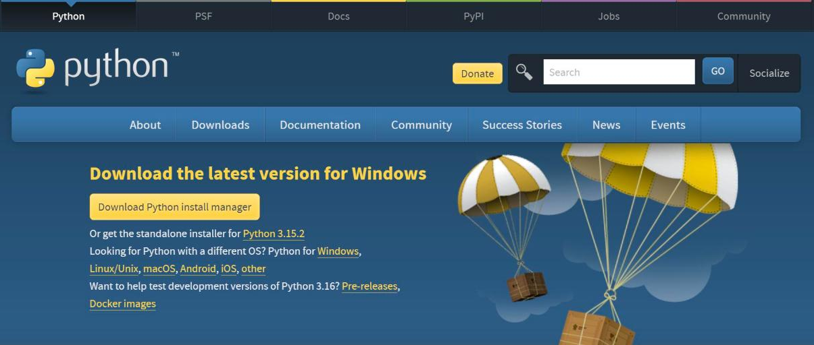

# A. 개발 환경 설치

이 책의 실습은 세 가지 환경에서 진행한다. 온라인 주의 분석·학습 실습은 웹 브라우저의 Colab에서, 기기 프로그램은 mBlock에서 작성하고, 팀 서버는 PC에 설치한 파이썬으로 실행한다. Colab과 mBlock 웹 버전은 설치가 필요 없다.

| 환경 | 용도 | 사용 장 | 설치 |
|---|---|---|---|
| Colab | 파이썬 분석·학습·서버 시험 | 1~3장, 5~7장, 9~16장 | 불필요(Google 계정) |
| mBlock | 블록 코딩, 기기 프로그램 작성·업로드 | 1장, 4장, 7·8장, 12장 | PC 버전 설치(기기 연결 시) |
| PC 파이썬 | 팀 서버 실행, 기기 시험 프로그램 | 14~16장 | 설치 필요 |

## Colab

1. Chrome 브라우저에서 <https://colab.research.google.com>에 접속해 Google 계정으로 로그인한다.
2. 각 장 첫 페이지의 「Colab에서 열기」 단추를 누르면 그 장의 노트북이 열린다.
3. 노트북을 수정해 보관하려면 「파일 → Drive에 사본 저장」을 선택한다.
4. 자료가 필요한 장은 노트북 첫 셀의 자료 내려받기 명령을 먼저 실행한다.

화면 구성과 셀 실행 방법은 1.3절에서 다룬다. Gemini API 키의 발급과 Colab 보안 비밀 등록은 13.1절에서 다룬다.

## mBlock

| 버전 | 접속·설치 | 용도 |
|---|---|---|
| 웹 버전 | <https://ide.mblock.cc> (Chrome 권장) | 기기 없이 블록 작성, 블록→파이썬 변환 확인 |
| PC 버전 | [mBlock 내려받기 페이지](https://mblock.cc/pages/downloads) | USB 연결, Live 모드, Upload 모드 |

PC 버전은 설치 중 장치 드라이버 설치를 묻는 창에서 설치를 허용한다. 드라이버가 없으면 PC가 사이버파이를 인식하지 못한다. 설치·연결·펌웨어 처리 절차는 4.2절에서 다룬다.

## PC 파이썬

### 설치

[Python 내려받기 페이지](https://www.python.org/downloads/)에서 운영체제에 맞는 설치 파일을 내려받는다.

<figure markdown="span">
  
  <figcaption>그림 A-? Python 내려받기 페이지</figcaption>
</figure>

Windows 설치 프로그램의 첫 화면에서 **Add python.exe to PATH**를 선택한 뒤 설치한다. 이 항목을 선택하지 않으면 명령 창에서 `python` 명령을 찾지 못한다.

<!-- PHOTO: appA_cap_python_installer — Windows Python 설치 프로그램 첫 화면(Add python.exe to PATH 선택 상태), G14에서 캡처 -->

설치가 끝나면 명령 창(Windows는 「명령 프롬프트」 또는 「PowerShell」)에서 다음 명령으로 설치를 확인한다.

```text
python --version
```

### 패키지 설치

이 책에서 사용하는 패키지를 한 번에 설치한다.

```text
pip install pandas matplotlib scikit-learn fastapi uvicorn httpx google-genai
```

| 패키지 | 용도 | 사용 장 |
|---|---|---|
| pandas | 표 형식 자료 처리 | 5~16장 |
| matplotlib | 그래프 | 6장 이후 |
| scikit-learn | 머신러닝 모델 학습·평가 | 9~12장 |
| fastapi, uvicorn, httpx | 수신 서버 작성·실행·시험 | 14~16장 |
| google-genai | Gemini API 호출 | 13장 |

### 설치 확인

다음 코드는 파이썬과 패키지의 버전을 출력한다. Colab에서도 같은 코드로 버전을 확인할 수 있다.

```python
import importlib
import sys

print("Python", sys.version.split()[0])
for name in ["pandas", "numpy", "matplotlib", "sklearn", "fastapi", "pydantic", "uvicorn", "httpx"]:
    try:
        print(name, importlib.import_module(name).__version__)
    except ImportError:
        print(name, "미설치")
```

**실행 결과(저자 PC, 2026-11-09)**

```text
Python 3.14.7
pandas 3.1.1
numpy 2.5.2
matplotlib 3.11.1
sklearn 1.9.1
fastapi 0.141.1
pydantic 2.13.4
uvicorn 0.52.4
httpx 0.28.1
```

본문의 텍스트 실행 결과는 위 환경에서, 화면 그림은 2026-11 Colab 기본 환경에서 산출했다. 패키지 버전이 다르면 일부 수치가 다를 수 있다. 깊이 제한이 없는 결정트리처럼 동점 분기가 많은 모델에서 차이가 나타난다(10.4절).

!!! tip "학교·회사 노트북"
    관리자 권한이 없는 노트북에서는 설치 프로그램이나 장치 드라이버 설치가 차단될 수 있다. 이 경우 Colab과 mBlock 웹 버전으로 실습하고, 기기 연결과 서버 실행은 실습실 PC를 사용한다.
