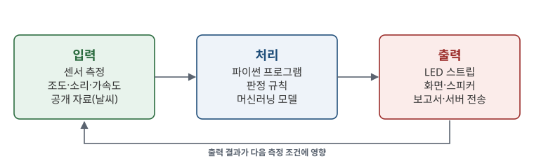
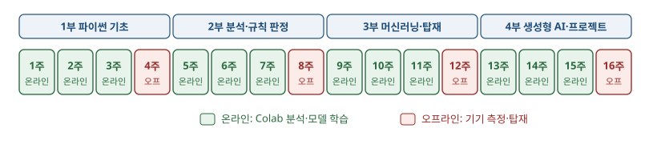

# 1.1 피지컬컴퓨팅과 이 과목의 구성

## 피지컬컴퓨팅

피지컬컴퓨팅(physical computing)은 센서로 실제 환경을 측정하고, 측정값을 프로그램으로 처리한 뒤, 그 결과를 빛·소리·움직임 같은 물리적 출력으로 변환하는 컴퓨팅이다. 스마트폰 화면 밝기 자동 조절, 공장의 설비 이상 경보, 건물의 조명 자동 점등이 모두 같은 구조로 동작한다.

<figure markdown="span">
  
  <figcaption>그림 1-1 피지컬컴퓨팅의 입력-처리-출력 구조</figcaption>
</figure>

| 단계 | 이 과목에서 사용하는 요소 | 처음 다루는 곳 |
|---|---|---|
| 입력 | 사이버파이 내장 센서(조도·소리·가속도), 공개 기상 자료 | [3.3절](../ch03/3-3.md), [4.6절](../ch04/4-6.md) |
| 처리 | 파이썬 판정 규칙, 머신러닝 모델, 생성형 AI | [7장](../ch07/index.md), [9장](../ch09/index.md), [13장](../ch13/index.md) |
| 출력 | LED 스트립, 사이버파이 화면, 서버 전송, 점검 보고 | [4.7절](../ch04/4-7.md), [8장](../ch08/index.md) |

그림 1-1의 아래쪽 화살표는 출력이 다음 측정에 영향을 준다는 의미다. 예를 들어 조명이 켜지면 조도 센서의 측정값도 변화한다. 피지컬컴퓨팅 프로그램은 이처럼 출력이 다시 입력에 반영되는 상황까지 고려해 설계한다.

## 16주 진행 구조

이 과목은 온라인 3주와 오프라인 1주를 4회 반복한다. 오프라인 주에는 실습실에서 사이버파이로 자료를 측정하거나 모델을 기기에 탑재하고, 온라인 주에는 측정한 자료와 공개 자료를 Colab에서 분석한다.

<figure markdown="span">
  
  <figcaption>그림 1-2 16주 진행 구조(4·8·12·16주차 오프라인)</figcaption>
</figure>

## 이 과목에서 완성하는 결과물

| 주차 | 결과물 | 내용 |
|---|---|---|
| 4주 | 조도 막대 표시기 | 밝기에 따라 LED 스트립 점등 개수 변화([4.7절](../ch04/4-7.md)) |
| 7주 | 소음 단계 신호등 | 소리 크기를 정상·주의·경고 색으로 표시 |
| 9~10주 | 날씨 예측 모델 | 서울 날씨 자료로 다음 날 기온·강수 여부 예측([9장](../ch09/index.md), [10장](../ch10/index.md)) |
| 12주 | 날씨 신호등 | 예보와 직접 학습한 모델의 판정을 LED 스트립에 비교 표시([12.1절](../ch12/12-1.md)) |
| 16주 | 팀 프로젝트 | 측정-판단-보고-반응을 연결한 현장 문제 해결 시스템 |

## 이 책의 절 구성

각 절은 개념 설명, 코드, 실행 결과, 확인 문제 순서로 구성한다. 코드는 장 첫머리의 「Colab에서 열기」 단추로 같은 내용의 노트북을 열어 바로 실행할 수 있다. 본문의 실행 결과는 저자가 같은 코드를 실행해 얻은 값이므로, 직접 실행한 결과와 비교하며 학습한다.

## 확인 문제

1. 주변의 자동화 기기 1가지를 선택해 입력·처리·출력을 각각 쓰시오.
2. 이 과목의 오프라인 주차 4개와 각 주차에 기기로 수행하는 작업을 그림 1-2와 결과물 표에서 찾아 정리하시오.
