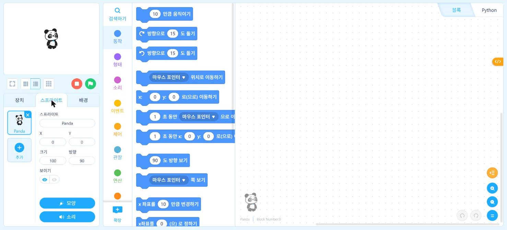
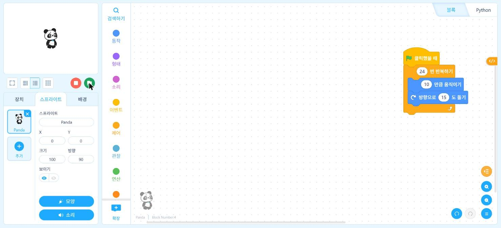

# 1.2 블록 코딩 체험

<span class="chip on">온라인</span> <span class="chip">기기 불필요</span>

프로그램은 명령을 정해진 순서로 실행하는 구조다. 이 절에서는 문법 입력 없이 블록을 조립하는 블록 코딩(block coding)으로 프로그램의 기본 구조 세 가지인 순차·반복·조건을 먼저 실습한다. 같은 구조를 1.4절 이후 파이썬 코드로 작성하고, 4.4절에서는 사이버파이 블록 프로그램을 파이썬 코드로 변환해 대조한다.

## mBlock 웹 편집기 접속

mBlock은 사이버파이 제조사인 Makeblock이 제공하는 블록 코딩 편집기다. 설치 없이 웹 브라우저에서 사용하는 웹 편집기가 있으므로, 온라인 주에는 웹 편집기를 사용한다.

1. 크롬 브라우저에서 mBlock 웹 편집기(<https://ide.mblock.cc>)에 접속한다.
2. 화면 왼쪽 가운데의 「장치」·「스프라이트」·「배경」 탭 중 「스프라이트」를 선택한다. 무대 위의 판다 캐릭터가 기본 스프라이트(sprite)다.
3. 가운데의 분류(동작·형태·소리·이벤트·제어·관찰·연산 등)를 누르면 해당 블록 목록이 표시된다. 블록을 끌어 오른쪽 스크립트 영역에 배치한다.

<figure markdown="span">
  
  <figcaption>그림 1-3 mBlock 웹 편집기의 스프라이트 탭과 동작 블록 목록</figcaption>
</figure>

화면 위쪽에 사용 데이터 수집에 관한 안내 띠가 표시될 수 있다. 「동의」를 누르지 않아도 편집기는 사용할 수 있다.

!!! note "장치 탭과 스프라이트 탭"
    「장치」 탭은 사이버파이 같은 하드웨어를 제어하는 블록을, 「스프라이트」 탭은 화면 속 캐릭터를 제어하는 블록을 제공한다. 1주차는 기기가 없으므로 스프라이트 탭만 사용한다.

## 순차 구조

순차 구조는 명령을 위에서 아래로 한 번씩 실행하는 구조다. 다음 순서로 블록을 연결한다.

| 순서 | 블록 분류 | 블록 |
|---|---|---|
| 1 | 이벤트 | (깃발) 클릭했을 때 |
| 2 | 동작 | 10 만큼 움직이기 → 값을 100으로 변경 |
| 3 | 형태 | 안녕! 을(를) 2 초 동안 말하기 |
| 4 | 동작 | 방향으로 15 도 돌기 |

무대 위의 초록 깃발 단추를 누르면 스프라이트가 100만큼 이동하고, 말풍선을 2초 동안 표시한 뒤 회전한다. 블록 순서를 변경하면 실행 순서도 변경된다는 점을 확인한다.

## 반복 구조

반복 구조는 같은 명령을 정해진 횟수만큼 또는 조건이 성립하는 동안 다시 실행하는 구조다. 「제어」 분류의 「10 번 반복하기」 블록 안에 「10 만큼 움직이기」와 「방향으로 15 도 돌기」를 배치하고 반복 횟수를 24로 변경한다. 15도씩 24번 회전하면 360도가 되므로 스프라이트는 원에 가까운 경로로 이동한 뒤 처음 위치와 방향으로 돌아온다.

<figure markdown="span">
  
  <figcaption>그림 1-4 「24 번 반복하기」 안에 이동·회전 블록을 배치한 프로그램</figcaption>
</figure>

## 조건 구조

조건 구조는 조건의 참·거짓에 따라 실행할 명령을 선택하는 구조다. 「제어」 분류의 「계속 반복하기」 안에 「만약 ~ 이(가) 참이면」 블록을 배치하고, 조건 칸에 「관찰」 분류의 「마우스 포인터 ▾ 에 닿았나요?」 블록을 넣은 뒤 목록에서 「벽」을 선택한다. 조건 블록 안에는 「180도 돌기」를 배치하고, 조건 블록 밖에는 「10만큼 움직이기」를 배치한다. 실행하면 스프라이트는 이동하다가 무대 가장자리에 닿을 때만 방향을 전환한다.

## 블록 구조와 파이썬 문법의 대응

세 가지 구조는 파이썬에서 다음 문법에 대응한다. 2장에서 각 문법을 상세히 다루므로 이 절에서는 대응 관계만 확인한다.

| 구조 | 블록 | 파이썬 |
|---|---|---|
| 순차 | 블록을 위아래로 연결 | 명령을 한 줄씩 작성 |
| 반복(횟수) | 「10 번 반복하기」 | `for i in range(10):` |
| 반복(무한) | 「계속 반복하기」 | `while True:` |
| 조건 | 「만약 ~ 이(가) 참이면」 | `if 조건:` |

블록 안에 들어간 명령은 파이썬에서 들여쓰기(indentation)로 표현한다. 블록 코딩에서는 블록의 테두리가 명령의 범위를 표시하고, 파이썬에서는 들여쓰기가 그 역할을 한다.

```python
for i in range(24):
    print("10만큼 이동")
    print("15도 회전")
print("반복 종료")
```

마지막 줄은 들여쓰기가 없으므로 반복 범위 밖에 있으며, 24번의 반복이 모두 끝난 뒤 한 번만 실행된다.

## 연습 문제

1. 반복 구조 실습에서 반복 횟수와 회전 각도를 조정해 정삼각형 경로를 구성하시오. 회전 각도와 반복 횟수의 관계를 식으로 쓰시오.
2. 조건 구조 실습에 「만약 ~ 이(가) 참이면 / 아니면」 블록을 적용해, 벽에 닿으면 회전하고 닿지 않으면 「이동 중」을 말하도록 수정하시오.
3. 위 파이썬 코드에서 마지막 줄을 들여쓰면 실행 결과가 어떻게 달라지는지 예상한 뒤, 1.3절에서 Colab으로 실행해 확인하시오.

!!! note "화면 기준"
    메뉴와 블록 이름은 2026-11-08 mBlock 웹 편집기 화면 기준이다. 편집기가 갱신되면 이름이 일부 달라질 수 있다.
