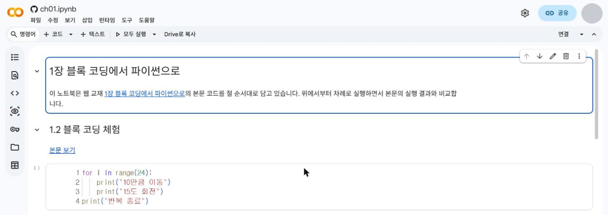
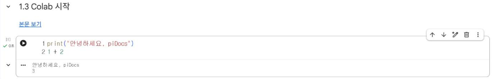
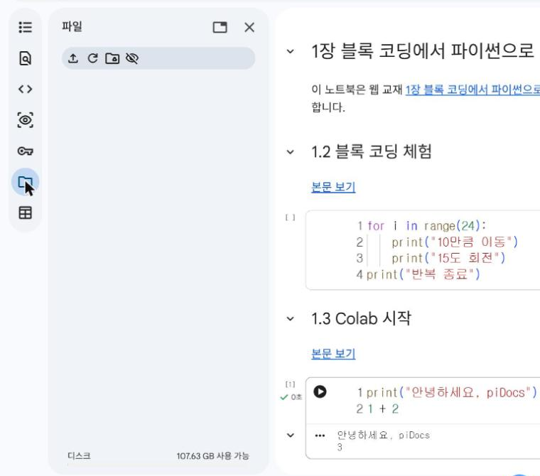
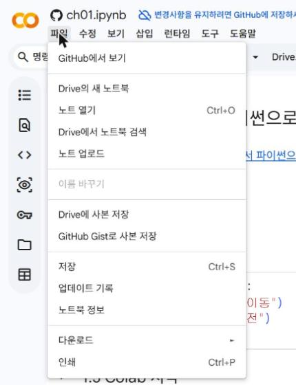

# 1.3 Colab 시작

Colab(Google Colaboratory)은 웹 브라우저에서 파이썬 코드를 작성하고 실행하는 구글의 노트북 서비스다. 프로그램 설치 없이 구글 계정만으로 사용할 수 있고, 이 과목에서 사용하는 pandas·matplotlib·scikit-learn이 미리 설치되어 있다. 온라인 주의 실습은 모두 Colab에서 진행한다.

## 이 책의 노트북 접속

각 장 첫머리의 「Colab에서 열기」 단추를 누르면 그 장의 코드가 담긴 노트북이 Colab에서 열린다. 1장 노트북을 열어 본다.

[1장 노트북을 Colab에서 열기](https://colab.research.google.com/github/sumilee-phd/pidocs/blob/main/notebooks/ch01.ipynb){ .md-button }

<figure markdown="span">
  
  <figcaption>그림 1-5 Colab에서 연 1장 노트북</figcaption>
</figure>

노트북은 셀(cell) 단위로 구성된다. 회색 상자가 코드를 작성하는 코드 셀이고, 제목과 설명이 있는 부분이 텍스트 셀이다.

| 셀 | 용도 | 실행 결과 |
|---|---|---|
| 코드 셀 | 파이썬 코드 작성 | 셀 바로 아래에 출력 표시 |
| 텍스트 셀 | 제목·설명 작성(Markdown) | 서식이 적용된 문서로 표시 |

## 셀 실행

코드 셀을 선택하면 셀 왼쪽에 원 안의 삼각형 모양 실행 단추가 표시된다. 실행 단추를 누르거나 ++shift+enter++ 를 누르면 셀이 실행된다. 처음 실행할 때는 구글 서버의 실행 환경인 런타임(runtime)에 연결하는 데 몇 초가 걸리고, 연결되면 오른쪽 위에 「연결됨」이 표시된다. 실행이 끝난 셀 왼쪽에는 실행 순서 번호(`[1]`)가 표시된다.

```python
print("안녕하세요, piDocs")
1 + 2
```

**실행 결과**

```text
안녕하세요, piDocs
3
```

<figure markdown="span">
  
  <figcaption>그림 1-6 코드 셀 실행 결과</figcaption>
</figure>

`print`로 출력한 값과 함께, 셀의 마지막 줄이 식(`1 + 2`)이면 그 계산 결과도 자동으로 표시된다.

GitHub에서 연 노트북의 셀을 처음 실행하면 다음 경고 창이 표시된다. 이 책의 노트북은 본문과 같은 코드만 담고 있으므로 「무시하고 계속하기」를 선택한다. 출처를 알 수 없는 노트북에서는 경고 창의 안내대로 실행 전에 코드를 먼저 확인한다.

<figure markdown="span">
  { width="520" }
  <figcaption>그림 1-7 GitHub에서 연 노트북의 실행 경고 창</figcaption>
</figure>

## 자료 파일 업로드

3장 이후의 실습은 CSV 자료 파일을 사용한다. 왼쪽 세로 막대의 폴더 모양 아이콘을 누르면 파일 창이 열리고, 업로드 단추로 내 PC의 파일을 올릴 수 있다.

<figure markdown="span">
  { width="560" }
  <figcaption>그림 1-8 왼쪽 파일 창과 업로드 단추(위쪽 첫 번째 아이콘)</figcaption>
</figure>

업로드한 파일은 런타임이 종료되면 삭제된다. 다음 날 다시 실습할 때는 파일을 다시 업로드한다.

## 노트북 저장과 제출

GitHub에서 연 노트북은 내 구글 드라이브에 저장되어 있지 않다. 화면 위쪽에도 「변경사항을 유지하려면 GitHub에 저장하세요」라는 안내가 표시된다. 실습한 내용을 보존하려면 도구 모음의 「Drive로 복사」 단추를 누르거나 「파일」 메뉴의 「Drive에 사본 저장」을 선택한다. 사본은 구글 드라이브의 `Colab Notebooks` 폴더에 저장된다.

<figure markdown="span">
  { width="360" }
  <figcaption>그림 1-9 「파일」 메뉴의 「Drive에 사본 저장」</figcaption>
</figure>

실습 결과는 사본의 오른쪽 위 「공유」 단추에서 링크를 복사해 제출한다. 링크 권한은 「링크가 있는 모든 사용자」의 「뷰어」로 설정한다.

## 확인 문제

1. 위 코드 셀의 마지막 줄을 `1 + 2 * 3`으로 변경해 실행하고, 출력값으로 연산 우선순위를 확인하시오.
2. 1장 노트북을 내 드라이브에 사본으로 저장하고, 사본의 공유 링크를 복사하시오.
