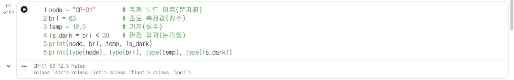

# 1.4 변수·자료형·입출력

## 변수와 자료형

변수(variable)는 값에 이름을 붙여 저장하는 공간이다. `=` 기호는 오른쪽 값을 왼쪽 이름에 저장하는 대입 연산이다. 파이썬은 저장한 값에 따라 자료형(data type)을 자동으로 결정하며, `type` 함수로 자료형을 확인할 수 있다.

```python
node = "CP-01"        # 측정 노드 이름(문자열)
bri = 63              # 조도 측정값(정수)
temp = 12.5           # 기온(실수)
is_dark = bri < 30    # 판정 결과(논리형)
print(node, bri, temp, is_dark)
print(type(node), type(bri), type(temp), type(is_dark))
```

**실행 결과**

```text
CP-01 63 12.5 False
<class 'str'> <class 'int'> <class 'float'> <class 'bool'>
```

<figure markdown="span">
  
  <figcaption>그림 1-7 Colab에서 실행한 변수·자료형 예제</figcaption>
</figure>

| 자료형 | 의미 | 예 | 이 과목에서의 용도 |
|---|---|---|---|
| `int` | 정수 | `63`, `-55` | 조도값, 신호 세기(dBm), 측정 횟수 |
| `float` | 실수 | `12.5`, `-6.1` | 기온, 평균값 |
| `str` | 문자열 | `"CP-01"`, `"밝음"` | 노드 이름, 판정 결과 |
| `bool` | 논리형 | `True`, `False` | 조건 판정 결과 |

`is_dark = bri < 30`에서 `bri < 30`은 비교 연산이다. 63은 30보다 작지 않으므로 결과는 `False`이고, 이 논리값이 `is_dark`에 저장된다.

## 산술 연산

```python
total = 63 + 58 + 71
avg = total / 3
print(total, avg)
print(17 // 5, 17 % 5, 2 ** 10)
```

**실행 결과**

```text
192 64.0
3 2 1024
```

| 연산자 | 의미 | 예 | 결과 |
|---|---|---|---|
| `/` | 나눗셈(결과는 항상 실수) | `192 / 3` | `64.0` |
| `//` | 몫 | `17 // 5` | `3` |
| `%` | 나머지 | `17 % 5` | `2` |
| `**` | 거듭제곱 | `2 ** 10` | `1024` |

나눗셈 `/`의 결과는 나누어떨어지는 경우에도 실수(`64.0`)다.

## 형식 문자열 출력

f-문자열(f-string)은 문자열 앞에 `f`를 붙이고 중괄호 안에 변수나 식을 넣어 값을 문자열에 삽입하는 표기법이다. `{avg:.1f}`처럼 쌍점 뒤에 형식을 지정하면 소수점 아래 자릿수를 조정할 수 있다.

```python
print(f"{node}의 조도는 {bri}, 세 측정값의 평균은 {avg:.1f}")
```

**실행 결과**

```text
CP-01의 조도는 63, 세 측정값의 평균은 64.0
```

## 입력과 형 변환

`input` 함수는 키보드로 입력한 내용을 반환한다. 반환값은 숫자를 입력해도 항상 문자열이므로, 계산에 사용하려면 `int`나 `float`로 형 변환(type conversion)한다.

```python
text = input("조도값을 입력하시오: ")
value = int(text)
print(type(text), type(value))
print(value + 10)
```

**실행 결과**(45를 입력한 경우)

```text
조도값을 입력하시오: 45
<class 'str'> <class 'int'>
55
```

<figure markdown="span">
  
  <figcaption>그림 1-8 Colab의 입력 칸에 값을 입력하는 화면</figcaption>
</figure>

Colab에서 `input`을 실행하면 셀 아래에 입력 칸이 표시된다. 값을 입력하고 ++enter++ 를 누르면 다음 줄이 실행된다. 형 변환하지 않은 문자열에 숫자를 더하면 오류가 발생하며, 이 오류는 1.5절에서 생성형 AI 활용 예로 다룬다.

## 확인 문제

1. `temp = 12.5`를 `int(temp)`로 변환하면 어떤 값이 되는지 예상한 뒤 실행해 확인하시오.
2. 기온 3개(4.1, 13.7, -6.1)의 평균을 소수 둘째 자리까지 f-문자열로 출력하시오.
3. `input`으로 섭씨온도를 입력받아 화씨온도(섭씨 × 9 / 5 + 32)로 변환해 출력하는 코드를 작성하시오.
