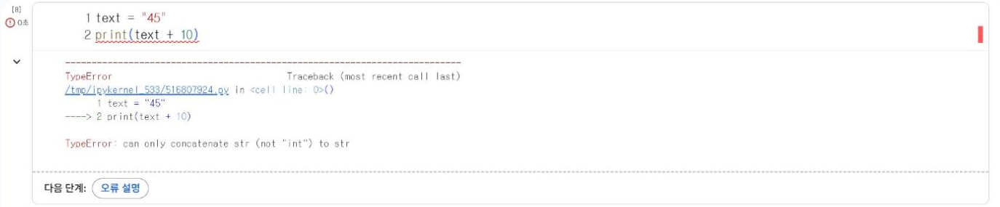

# 1.5 생성형 AI 활용 원칙

생성형 AI는 코드 작성과 오류 분석에 유용한 학습 보조 도구다. 다만 AI가 작성한 코드를 그대로 제출하면 프로그램의 동작 원리를 학습하지 못하고, AI가 제시한 오류 있는 코드를 검증 없이 사용하게 된다. 이 과목에서는 Colab에 내장된 Gemini를 표준 도구로 사용하고, 다음 순서를 지킨다.

## 활용 순서

| 순서 | 내용 | 확인 사항 |
|---|---|---|
| 1 | 문제와 요구 조건 확인 | 입력·출력·조건을 문장으로 정리 |
| 2 | 직접 코드 작성·실행 | 본문 예제를 참고해 먼저 작성 |
| 3 | 오류·결과 확인 | 오류 메시지의 마지막 줄 확인 |
| 4 | AI에 질문 | 코드, 오류 메시지, 기대한 결과를 함께 입력 |
| 5 | 답변 실행·대조 | AI가 제시한 코드를 직접 실행해 결과 검증 |
| 6 | 제출·출처 표기 | AI 도움을 받은 부분에 주석으로 표기 |

## 오류 메시지 해석

1.4절의 입력 예제에서 형 변환을 생략하면 다음 오류가 발생한다.

```python
text = "45"
print(text + 10)
```

**실행 결과**

```text
TypeError: can only concatenate str (not "int") to str
```

오류 메시지의 마지막 줄은 오류의 종류(`TypeError`, 자료형 오류)와 원인(문자열에는 정수가 아닌 문자열만 연결할 수 있음)을 표시한다. 오류 메시지를 먼저 읽고 원인을 추정한 뒤 AI에 질문한다.

<figure markdown="span">
  
  <figcaption>그림 1-12 Colab의 오류 출력과 「오류 설명」 단추</figcaption>
</figure>

Colab은 오류가 발생한 셀 아래에 「다음 단계: 오류 설명」 단추를 표시한다. 단추를 누르면 Colab에 내장된 Gemini가 원인과 수정 코드를 제시한다. 제시된 코드는 반드시 직접 실행해 결과를 확인한다.

## 질문 작성 형식

AI에 질문할 때는 다음 세 가지를 함께 입력하면 정확한 답변을 얻을 수 있다.

```text
[코드]
text = "45"
print(text + 10)

[오류 메시지]
TypeError: can only concatenate str (not "int") to str

[기대한 결과]
55가 출력되기를 기대했다. 원인과 수정 방법을 설명해 주세요.
```

## 출처 표기

AI의 도움을 받아 작성하거나 수정한 코드에는 주석으로 출처를 표기한다.

```python
text = "45"
print(int(text) + 10)   # 참고: Gemini 오류 설명(2027-03-06) 기반으로 int 형 변환 추가
```

## 금지 사항

- 회사 내부 자료, 고객 정보, 동료의 개인정보를 AI에 입력하지 않는다.
- 실습 과제의 문제 문장 전체를 입력해 답안 코드를 요청하지 않는다. 막힌 부분의 코드와 오류만 질문한다.
- AI가 제시한 수치나 설명을 확인 없이 보고서에 옮기지 않는다. 13장에서 생성형 AI 출력을 자동으로 검증하는 방법을 다룬다.

## 확인 문제

1. `int("4.5")`를 실행하면 어떤 오류가 발생하는지 확인하고, 오류 메시지의 마지막 줄을 해석하시오.
2. 확인 문제 1의 오류를 위 질문 작성 형식에 맞춰 Gemini에 질문하고, 답변의 수정 코드를 실행해 결과를 기록하시오.
