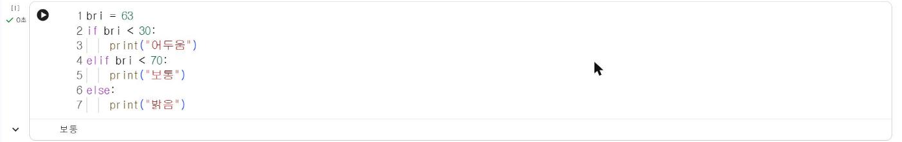

# 2.1 조건문

## if·elif·else

조건문은 조건식의 참·거짓에 따라 실행할 코드를 선택한다. 조건식 뒤에는 쌍점(`:`)을 쓰고, 조건이 참일 때 실행할 코드는 들여쓰기(공백 4칸)로 작성한다. 1.2절의 「만약 ~(이)라면」 블록 안에 들어간 명령이 들여쓰기한 코드에 해당한다.

```python
bri = 63
if bri < 30:
    print("어두움")
elif bri < 70:
    print("보통")
else:
    print("밝음")
```

**실행 결과**

```text
보통
```

<figure markdown="span">
  
  <figcaption>그림 2-1 Colab에서 실행한 조도 판정 조건문</figcaption>
</figure>

조건은 위에서부터 차례로 검사하고, 처음으로 참이 되는 조건의 코드만 실행한다. `bri`가 63이면 첫 조건 `bri < 30`은 거짓, 둘째 조건 `bri < 70`은 참이므로 "보통"을 출력하고 나머지 조건은 검사하지 않는다. `elif`의 조건에 `bri >= 30`을 다시 쓰지 않아도 되는 이유가 이 순차 검사 방식 때문이다.

| 키워드 | 의미 | 개수 |
|---|---|---|
| `if` | 첫 번째 조건 | 1개(필수) |
| `elif` | 앞 조건이 모두 거짓일 때 검사할 조건 | 0개 이상 |
| `else` | 모든 조건이 거짓일 때 실행 | 0개 또는 1개 |

## 비교 연산자와 논리 연산자

| 비교 연산자 | 의미 | 논리 연산자 | 의미 |
|---|---|---|---|
| `==` | 같다 | `and` | 두 조건이 모두 참 |
| `!=` | 다르다 | `or` | 두 조건 중 하나 이상 참 |
| `<`, `<=` | 작다, 작거나 같다 | `not` | 참·거짓 반전 |
| `>`, `>=` | 크다, 크거나 같다 | | |

`=`는 대입, `==`는 비교다. 조건식에 `=`를 쓰면 문법 오류가 발생한다.

## 여러 측정값을 함께 판정

조도와 소리 크기를 함께 사용해 야간 소음을 판정한다. 두 조건을 동시에 만족해야 하므로 `and`로 연결한다.

```python
bri = 18
loud = 85
if bri < 30 and loud > 80:
    print("야간 소음 경고")
elif loud > 80:
    print("소음 경고")
else:
    print("정상")
```

**실행 결과**

```text
야간 소음 경고
```

조건의 순서가 결과를 결정한다. 위 코드에서 `elif loud > 80`을 맨 앞에 두면, 어두운 상태의 소음도 "소음 경고"로 판정되어 "야간 소음 경고"는 출력되지 않는다. 구체적인 조건을 앞에, 일반적인 조건을 뒤에 배치한다.

## 확인 문제

1. 첫 예제에서 `bri`를 30, 69, 70으로 변경하며 실행하고, 각 값이 어느 단계로 판정되는지 기록하시오.
2. 기온 `temp`가 33 이상이면 "폭염", 25 이상이면 "더위", 그 외는 "보통"을 출력하는 조건문을 작성하시오.
3. 두 번째 예제의 `if`와 `elif` 순서를 바꿔 실행하고, 결과가 달라지는 이유를 설명하시오.
