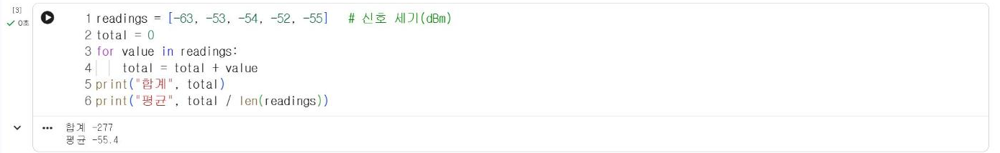

# 2.2 반복문

## for 반복문

for 반복문은 목록의 값을 하나씩 꺼내 같은 코드를 반복 실행한다. 다음 목록은 2026-11-04 정보통신학과 수업에서 측정 노드 S02가 D1 지점의 Wi-Fi 신호 세기를 5초 간격으로 5회 측정한 실제 값이다(단위 dBm, 0에 가까울수록 강한 신호). 대괄호로 묶은 목록인 리스트(list)는 3.1절에서 상세히 다룬다.

```python
readings = [-63, -53, -54, -52, -55]   # 신호 세기(dBm)
total = 0
for value in readings:
    total = total + value
print("합계", total)
print("평균", total / len(readings))
```

**실행 결과**

```text
합계 -277
평균 -55.4
```

<figure markdown="span">
  
  <figcaption>그림 2-2 Colab에서 실행한 신호 세기 합계·평균 계산</figcaption>
</figure>

반복할 때마다 `value`에 목록의 다음 값이 저장되고, `total`에 누적된다. `len(readings)`는 목록의 값 개수(5)를 반환한다. 합계를 저장하는 변수는 반복 전에 0으로 초기화한다.

| 반복 회차 | `value` | 실행 후 `total` |
|---|---|---|
| 1 | −63 | −63 |
| 2 | −53 | −116 |
| 3 | −54 | −170 |
| 4 | −52 | −222 |
| 5 | −55 | −277 |

## range

정해진 횟수만큼 반복할 때는 `range`를 사용한다. `range(1, 4)`는 1부터 3까지(4는 제외)의 정수를 생성한다.

```python
for i in range(1, 4):
    print(i, "회차 측정")
```

**실행 결과**

```text
1 회차 측정
2 회차 측정
3 회차 측정
```

## continue와 break

`continue`는 이번 반복의 나머지 코드를 생략하고 다음 반복으로 진행한다. 첫 번째 측정값 −63은 나머지 값보다 약 10 dB 낮다. 이런 값을 집계에서 제외하는 경우 `continue`를 사용한다.

```python
count = 0
total = 0
for value in readings:
    if value < -60:          # 약한 신호는 집계에서 제외
        print("제외", value)
        continue
    total += value
    count += 1
print("평균", total / count, "(", count, "건 )")
```

**실행 결과**

```text
제외 -63
평균 -53.5 ( 4 건 )
```

`total += value`는 `total = total + value`의 축약 표기다. `break`는 반복 자체를 종료한다. 찾는 값을 발견하면 나머지 값은 검사할 필요가 없을 때 사용한다.

```python
target = -54
for i in range(len(readings)):
    if readings[i] == target:
        print(i + 1, "번째 측정에서 발견")
        break
```

**실행 결과**

```text
3 번째 측정에서 발견
```

`readings[i]`는 목록의 `i`번째 값이다. 파이썬의 위치 번호(색인)는 0부터 시작하므로 사람이 읽는 순서로 출력하기 위해 `i + 1`을 사용했다.

## while 반복문

while 반복문은 조건이 참인 동안 반복한다. 반복 횟수가 미리 정해지지 않은 경우, 예를 들어 단추를 누를 때까지 측정을 계속하는 기기 프로그램(4.7절)에서 사용한다.

```python
count = 0
while count < 3:
    print("측정", count + 1)
    count += 1
```

**실행 결과**

```text
측정 1
측정 2
측정 3
```

반복 본문에서 조건이 거짓이 되도록 변수를 변경하지 않으면 반복이 끝나지 않는다. Colab에서 반복이 끝나지 않으면 셀 왼쪽의 정지 단추로 실행을 중단한다.

## 확인 문제

1. `readings`의 최댓값을 `max` 함수 없이 for 반복문과 조건문으로 산출하시오.
2. −55 이하인 측정값의 개수를 산출하시오.
3. 1부터 100까지의 합을 while 반복문으로 산출하시오.
