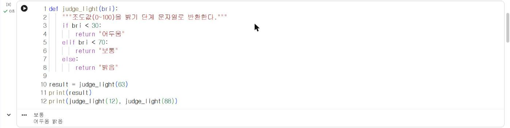

# 2.3 함수

## 함수 정의

함수(function)는 자주 사용하는 코드에 이름을 붙여 묶은 것이다. `def` 다음에 함수 이름과 괄호 안의 매개변수(parameter)를 쓰고, 처리 결과는 `return`으로 반환한다. 함수를 정의한 뒤 이름과 인자(argument)로 호출하면 반환값을 받을 수 있다.

```python
def judge_light(bri):
    """조도값(0~100)을 밝기 단계 문자열로 반환한다."""
    if bri < 30:
        return "어두움"
    elif bri < 70:
        return "보통"
    else:
        return "밝음"

result = judge_light(63)
print(result)
print(judge_light(12), judge_light(88))
```

**실행 결과**

```text
보통
어두움 밝음
```

<figure markdown="span">
  
  <figcaption>그림 2-3 Colab에서 실행한 judge_light 함수</figcaption>
</figure>

| 용어 | 위 코드의 예 | 의미 |
|---|---|---|
| 매개변수 | `bri` | 함수 안에서 입력값을 받는 변수 |
| 인자 | `63` | 호출할 때 전달하는 값 |
| 반환값 | `"보통"` | `return`으로 돌려주는 결과 |
| 문서 문자열 | `"""조도값(0~100)을…"""` | 함수의 용도를 설명하는 첫 줄 문자열 |

`return`이 실행되면 함수는 즉시 종료된다. 2.1절의 조건문은 결과를 `print`로 출력만 했지만, 함수는 결과를 반환하므로 반환값을 다른 계산이나 조건에 사용할 수 있다.

## 기본값이 있는 매개변수

판정 기준을 매개변수로 분리하면 장소에 따라 기준을 조정할 수 있다. 매개변수에 `=`로 기본값을 지정하면, 호출할 때 해당 인자를 생략할 수 있다.

```python
def judge_light2(bri, dark=30, bright=70):
    if bri < dark:
        return "어두움"
    elif bri < bright:
        return "보통"
    return "밝음"

print(judge_light2(63))
print(judge_light2(63, dark=70, bright=90))
```

**실행 결과**

```text
보통
어두움
```

같은 조도값 63도 기준을 70·90으로 지정하면 「어두움」으로 판정된다. 판정 기준을 자료 분포에서 결정하는 방법은 7.1절에서 다룬다.

## 확인 문제

1. 섭씨온도를 받아 화씨온도를 반환하는 함수 `c_to_f(c)`를 정의하고, 0과 100을 입력해 확인하시오.
2. 신호 세기 목록을 받아 평균을 반환하는 함수 `average(values)`를 정의하고, 2.2절의 `readings`로 확인하시오.
3. `judge_light2`에 `print` 대신 `return`을 사용하는 이유를 반환값의 재사용 관점에서 설명하시오.
