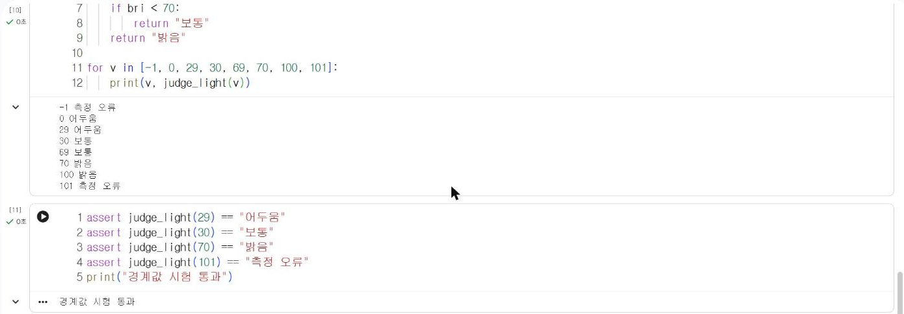

# 2.4 실습: 조도값 판정 함수

사이버파이의 조도 센서 함수 `cyberpi.get_bri()`는 0~100 범위의 정수를 반환한다([Makeblock mCode 문서](https://www.yuque.com/makeblock-help-center-en/mcode/cyberpi-api)). 이 절에서는 측정값을 판정하는 함수를 요구 조건에 맞게 작성하고, 경계값 시험으로 정확성을 확인한다. 완성한 함수는 4.6절에서 실제 센서 측정값에 적용한다.

## 요구 조건

| 조도값 | 판정 |
|---|---|
| 0~29 | 어두움 |
| 30~69 | 보통 |
| 70~100 | 밝음 |
| 0 미만, 100 초과 | 측정 오류 |

센서 값은 정상이라면 0~100 범위에 있지만, 통신 오류나 프로그램 오류로 범위 밖의 값이 입력될 수 있다. 판정 함수는 이런 값을 정상 단계로 판정하지 않도록 먼저 걸러 낸다.

## 함수 작성

```python
def judge_light(bri):
    """조도값을 판정한다. 0~100 범위 밖이면 "측정 오류"를 반환한다."""
    if bri < 0 or bri > 100:
        return "측정 오류"
    if bri < 30:
        return "어두움"
    if bri < 70:
        return "보통"
    return "밝음"

for v in [-1, 0, 29, 30, 69, 70, 100, 101]:
    print(v, judge_light(v))
```

**실행 결과**

```text
-1 측정 오류
0 어두움
29 어두움
30 보통
69 보통
70 밝음
100 밝음
101 측정 오류
```

## 경계값 시험

시험값은 구간의 경계(29·30, 69·70)와 범위의 양 끝(0·100), 범위 밖(−1·101)에서 선택했다. 판정 오류는 대부분 경계에서 발생한다. 예를 들어 `bri < 30`을 `bri <= 30`으로 잘못 작성하면 30이 "어두움"으로 판정되는데, 30을 시험하지 않으면 이 오류를 발견할 수 없다.

`assert` 문은 조건이 거짓이면 오류를 발생시킨다. 기대한 판정 결과를 `assert`로 작성해 두면 함수를 수정한 뒤에도 같은 시험을 반복할 수 있다.

```python
assert judge_light(29) == "어두움"
assert judge_light(30) == "보통"
assert judge_light(70) == "밝음"
assert judge_light(101) == "측정 오류"
print("경계값 시험 통과")
```

**실행 결과**

```text
경계값 시험 통과
```

<figure markdown="span">
  
  <figcaption>그림 2-4 Colab에서 실행한 경계값 시험</figcaption>
</figure>

## 측정 기록 판정

다음 목록은 하루 동안 2시간 간격으로 조도를 측정했다고 가정한 예시 값이다. 판정 결과별 개수를 집계한다.

```python
day_log = [12, 25, 41, 58, 66, 73, 88, 95, 71, 47, 22, 9]
dark = normal = bright = error = 0
for v in day_log:
    r = judge_light(v)
    if r == "어두움":
        dark += 1
    elif r == "보통":
        normal += 1
    elif r == "밝음":
        bright += 1
    else:
        error += 1
print("어두움", dark, "보통", normal, "밝음", bright, "오류", error)
```

**실행 결과**

```text
어두움 4 보통 4 밝음 4 오류 0
```

`dark = normal = bright = error = 0`은 네 변수를 한 줄에서 모두 0으로 초기화한다. 판정 결과별 개수를 이렇게 변수 4개로 집계하는 방법은 단계가 늘어나면 코드가 길어진다. 3.1절에서 딕셔너리로 같은 집계를 간결하게 작성한다.

## 실습 과제

1. 소리 크기 `cyberpi.get_loudness()`도 0~100 범위를 반환한다. 0~39 "조용함", 40~69 "보통", 70~100 "시끄러움", 범위 밖 "측정 오류"로 판정하는 함수 `judge_loud(loud)`를 작성하시오.
2. `judge_loud`의 경계값 시험을 `assert`로 6개 이상 작성하시오.
3. `day_log`에 −5와 120을 추가하고 집계 결과의 「오류」 개수가 2로 변화하는지 확인하시오.
