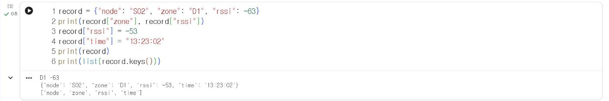

# 3.1 리스트와 딕셔너리

측정 자료는 값 하나가 아니라 여러 값의 묶음으로 다룬다. 파이썬은 순서가 있는 값의 묶음인 리스트(list)와, 이름표(키)로 값을 찾는 딕셔너리(dictionary)를 기본 자료구조로 제공한다.

## 리스트

리스트는 대괄호 안에 값을 쉼표로 구분해 나열한다. 위치 번호인 색인(index)은 0부터 시작하고, 음수 색인은 뒤에서부터 센 위치를 의미한다. 다음 값은 2.2절과 같은 11/4 수업의 실제 신호 세기 측정값이다.

```python
readings = [-63, -53, -54, -52, -55]
print(readings[0], readings[-1])
print(readings[1:4])
readings.append(-56)
print(len(readings), max(readings), min(readings))
print(sorted(readings))
```

**실행 결과**

```text
-63 -55
[-53, -54, -52]
6 -52 -63
[-63, -56, -55, -54, -53, -52]
```

| 표기 | 의미 |
|---|---|
| `readings[0]` | 첫 번째 값 |
| `readings[-1]` | 마지막 값 |
| `readings[1:4]` | 1번부터 3번까지의 값(4번은 제외)을 추출한 새 리스트, 이 방식을 슬라이싱(slicing)이라고 한다 |
| `readings.append(x)` | 리스트 끝에 값 추가 |
| `sorted(readings)` | 오름차순으로 정렬한 새 리스트(원래 리스트는 변경하지 않음) |

## 딕셔너리

딕셔너리는 중괄호 안에 `키: 값` 쌍을 나열한다. 측정 기록 1건처럼 여러 항목으로 구성된 자료를 항목 이름으로 접근할 때 사용한다.

```python
record = {"node": "S02", "zone": "D1", "rssi": -63}
print(record["zone"], record["rssi"])
record["rssi"] = -53
record["time"] = "13:23:02"
print(record)
print(list(record.keys()))
```

**실행 결과**

```text
D1 -63
{'node': 'S02', 'zone': 'D1', 'rssi': -53, 'time': '13:23:02'}
['node', 'zone', 'rssi', 'time']
```

없는 키에 값을 대입하면 새 항목이 추가되고(`time`), 있는 키에 대입하면 값이 변경된다(`rssi`).

<figure markdown="span">
  
  <figcaption>그림 3-1 Colab에서 실행한 딕셔너리 예제</figcaption>
</figure>

## 딕셔너리로 집계

2.4절에서는 판정 결과별 개수를 변수 4개로 집계했다. 딕셔너리를 사용하면 판정 결과를 키로, 개수를 값으로 저장해 단계 수와 관계없이 같은 코드로 집계할 수 있다.

```python
def judge_light(bri):
    if bri < 0 or bri > 100:
        return "측정 오류"
    if bri < 30:
        return "어두움"
    if bri < 70:
        return "보통"
    return "밝음"

day_log = [12, 25, 41, 58, 66, 73, 88, 95, 71, 47, 22, 9]
counts = {}
for v in day_log:
    r = judge_light(v)
    counts[r] = counts.get(r, 0) + 1
print(counts)
```

**실행 결과**

```text
{'어두움': 4, '보통': 4, '밝음': 4}
```

`counts.get(r, 0)`은 키 `r`이 있으면 그 값을, 없으면 0을 반환한다. 처음 등장한 판정 결과는 0에 1을 더해 저장되고, 이후에는 기존 개수에 1씩 누적된다.

## 리스트 안의 딕셔너리

측정 기록 여러 건은 딕셔너리를 원소로 하는 리스트로 표현한다. 다음은 11/4 수업 기록에서 지점(zone)별 첫 번째 측정 기록을 추출한 것이다. 3.2절에서는 같은 구조의 기록 492건을 CSV 파일에서 읽는다.

```python
records = [
    {"node": "S02", "zone": "D1", "rssi": -63},
    {"node": "S03", "zone": "D3", "rssi": -65},
    {"node": "N6", "zone": "D4", "rssi": -51},
    {"node": "S01", "zone": "D2", "rssi": -48},
]
for r in records:
    print(r["zone"], r["node"], r["rssi"])
strongest = max(records, key=lambda r: r["rssi"])
print("가장 강한 신호:", strongest)
```

**실행 결과**

```text
D1 S02 -63
D3 S03 -65
D4 N6 -51
D2 S01 -48
가장 강한 신호: {'node': 'S01', 'zone': 'D2', 'rssi': -48}
```

`max` 함수의 `key` 인자에는 비교 기준을 지정한다. `lambda r: r["rssi"]`는 기록 `r`을 받아 `rssi` 값을 반환하는 이름 없는 함수이며, 신호 세기가 가장 큰(0에 가장 가까운) 기록이 선택된다.

## 확인 문제

1. `readings`에서 −55 이하인 값만 추출한 새 리스트를 for 반복문과 `append`로 작성하시오.
2. `records`의 신호 세기 평균을 산출하시오.
3. 1.4절의 변수 `node`, `bri`, `temp`를 하나의 딕셔너리로 정리하고, f-문자열로 출력하시오.
