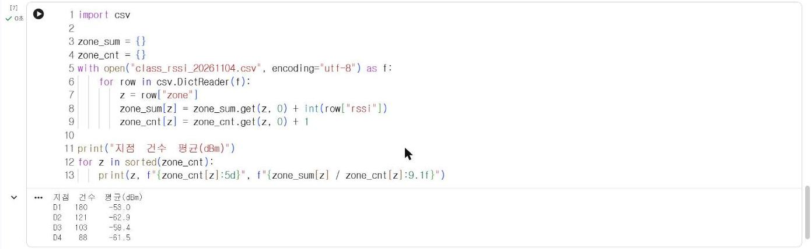

# 3.2 파일 입출력과 CSV

프로그램이 종료되면 변수의 값은 사라진다. 측정 자료를 보존하고 다른 프로그램과 주고받으려면 파일로 저장한다. CSV(Comma-Separated Values)는 한 행에 한 건의 기록을, 쉼표로 구분한 열에 항목을 저장하는 텍스트 파일 형식이며, 엑셀과 pandas 등 대부분의 도구가 읽고 쓸 수 있다.

## 실습 자료

이 절과 5·6장에서는 2026-11-04 정보통신학과 수업에서 측정 노드 14대가 교내 4개 지점의 Wi-Fi 신호 세기를 측정한 실제 기록을 사용한다.

| 항목 | 내용 |
|---|---|
| 파일 | [class_rssi_20261104.csv](../data/class_rssi_20261104.csv) (492행) |
| 열 | `id` 기록 번호, `node` 측정 노드, `zone` 측정 지점(D1~D4), `rssi` 신호 세기(dBm), `time` 측정 시각 |

장 첫머리의 「Colab에서 열기」로 노트북을 열면 첫 셀이 자료 파일을 자동으로 내려받는다. 직접 실습할 때는 파일을 내려받아 1.3절의 방법으로 업로드한다.

## 텍스트 파일 입출력

`open` 함수로 파일을 열고, `with` 구문을 사용하면 블록이 끝날 때 파일이 자동으로 닫힌다. 두 번째 인자 `"w"`는 쓰기, `"r"`(생략 가능)은 읽기 모드다. 한글을 포함한 파일은 `encoding="utf-8"`을 지정한다.

```python
import csv

rows = [["zone", "node", "rssi"], ["D1", "S02", -63], ["D3", "S03", -65], ["D4", "N6", -51]]
with open("sample.csv", "w", newline="", encoding="utf-8") as f:
    writer = csv.writer(f)
    writer.writerows(rows)

with open("sample.csv", encoding="utf-8") as f:
    print(f.read())
```

**실행 결과**

```text
zone,node,rssi
D1,S02,-63
D3,S03,-65
D4,N6,-51
```

`csv.writer`의 `writerows`는 리스트의 각 원소를 한 행으로 기록한다. `newline=""`은 윈도우에서 행 사이에 빈 줄이 추가되는 현상을 방지한다. 파일 전체를 문자열로 읽으면 쉼표로 구분된 텍스트가 그대로 출력된다.

## csv.DictReader

`csv.DictReader`는 첫 행을 열 이름으로 사용하고, 각 행을 열 이름이 키인 딕셔너리로 반환한다. 3.1절의 「리스트 안의 딕셔너리」와 같은 구조로 파일을 읽을 수 있다. CSV에서 읽은 값은 모두 문자열이므로 계산 전에 `int`로 형 변환한다.

```python
import csv

zone_sum = {}
zone_cnt = {}
with open("class_rssi_20261104.csv", encoding="utf-8") as f:
    for row in csv.DictReader(f):
        z = row["zone"]
        zone_sum[z] = zone_sum.get(z, 0) + int(row["rssi"])
        zone_cnt[z] = zone_cnt.get(z, 0) + 1

print("지점  건수  평균(dBm)")
for z in sorted(zone_cnt):
    print(z, f"{zone_cnt[z]:5d}", f"{zone_sum[z] / zone_cnt[z]:9.1f}")
```

**실행 결과**

```text
지점  건수  평균(dBm)
D1   180     -53.0
D2   121     -62.9
D3   103     -59.4
D4    88     -61.5
```

<figure markdown="span">
  
  <figcaption>그림 3-2 Colab에서 실행한 지점별 건수·평균 집계</figcaption>
</figure>

지점별 건수와 평균을 딕셔너리 2개로 누적했다. 같은 집계를 5장에서는 pandas로 한 줄에 작성한다.

## 확인 문제

1. 노드별 기록 건수를 딕셔너리로 집계하고, 건수가 가장 많은 노드를 출력하시오.
2. 신호 세기가 −70 dBm 이하인 기록만 `weak.csv` 파일로 저장하시오.
3. 위 코드에서 `int(row["rssi"])` 대신 `row["rssi"]`를 더하면 어떤 오류가 발생하는지 확인하고 원인을 설명하시오.
