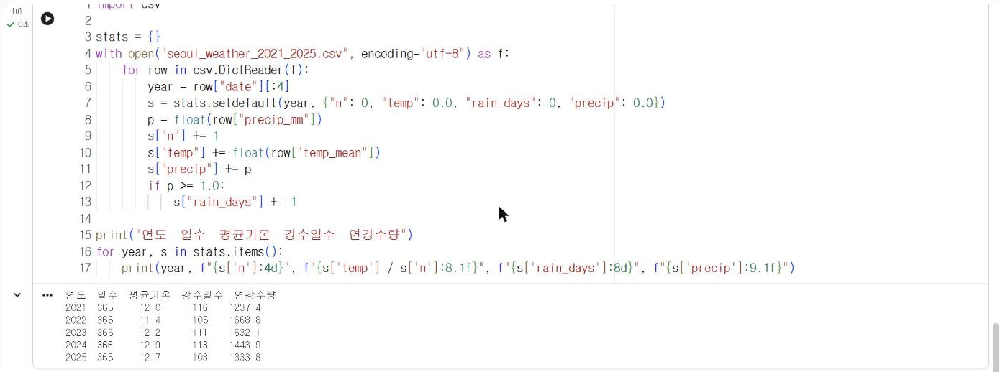

# 3.3 실습: 서울 날씨 자료 첫 분석

9장과 10장의 머신러닝 실습에 사용하는 서울 일별 날씨 자료를 이 절에서 처음 다룬다. pandas를 배우기 전이므로 3.2절의 `csv` 모듈과 딕셔너리만으로 연도별 통계를 산출한다.

## 자료

| 항목 | 내용 |
|---|---|
| 파일 | [seoul_weather_2021_2025.csv](../data/seoul_weather_2021_2025.csv) (2021-01-01 ~ 2025-12-31, 1,826행) |
| 주요 열 | `date` 날짜, `temp_mean` 일평균기온(℃), `precip_mm` 일강수량(mm) |
| 출처 | Open-Meteo 재분석 자료(CC BY 4.0), 상세는 [부록 D](../appendix/d.md) |

## 연도별 통계

연도별로 평균기온, 강수일수(일강수량 1.0 mm 이상인 날), 연강수량을 산출한다. `row["date"][:4]`는 날짜 문자열의 앞 4글자, 즉 연도를 추출한다.

```python
import csv

stats = {}
with open("seoul_weather_2021_2025.csv", encoding="utf-8") as f:
    for row in csv.DictReader(f):
        year = row["date"][:4]
        s = stats.setdefault(year, {"n": 0, "temp": 0.0, "rain_days": 0, "precip": 0.0})
        p = float(row["precip_mm"])
        s["n"] += 1
        s["temp"] += float(row["temp_mean"])
        s["precip"] += p
        if p >= 1.0:
            s["rain_days"] += 1

print("연도  일수  평균기온  강수일수  연강수량")
for year, s in stats.items():
    print(year, f"{s['n']:4d}", f"{s['temp'] / s['n']:8.1f}", f"{s['rain_days']:8d}", f"{s['precip']:9.1f}")
```

**실행 결과**

```text
연도  일수  평균기온  강수일수  연강수량
2021  365     12.0      116    1237.4
2022  365     11.4      105    1668.8
2023  365     12.2      111    1632.1
2024  366     12.9      113    1443.9
2025  365     12.7      108    1333.8
```

<figure markdown="span">
  
  <figcaption>그림 3-3 Colab에서 실행한 서울 날씨 연도별 통계</figcaption>
</figure>

`stats.setdefault(year, {...})`는 `stats`에 `year` 키가 있으면 그 값을 반환하고, 없으면 두 번째 인자의 딕셔너리를 저장한 뒤 반환한다. 연도가 처음 등장할 때 누적용 딕셔너리를 생성하는 코드를 한 줄로 작성할 수 있다.

## 결과 해석

| 항목 | 결과 | 해석 |
|---|---|---|
| 일수 | 2024년만 366일 | 윤년(2월 29일 포함) |
| 평균기온 | 11.4℃(2022) ~ 12.9℃(2024) | 연도 사이의 차이는 1.5℃ 이내 |
| 강수일수 | 105일(2022) ~ 116일(2021) | 1년의 약 30%가 강수일 |
| 연강수량 | 1,237.4 mm(2021) ~ 1,668.8 mm(2022) | 강수일수가 가장 적은 2022년의 연강수량이 가장 많음 |

2022년은 강수일수가 가장 적은데도 연강수량이 가장 많다. 비가 오는 날의 수와 한 번에 내리는 비의 양은 별개의 특성이라는 뜻이며, 6.2절에서 강수량 분포의 형태로 다시 확인한다. 강수일 비율이 약 30%라는 결과는 10장에서 다음 날 강수 여부를 분류할 때 클래스 불균형(10.1절)의 근거가 된다. 이 자료는 재분석 자료이므로 기상청 서울 관측소의 연강수량과 차이가 있을 수 있다.

## 실습 과제

1. 연도별 최고기온(`temp_max`)의 최댓값과 그날의 날짜를 출력하시오.
2. 일평균기온이 25℃ 이상인 날의 수를 연도별로 집계하시오.
3. 2025년의 월별 강수량 합계를 딕셔너리로 산출하시오(`row["date"][5:7]`은 월을 추출한다).
