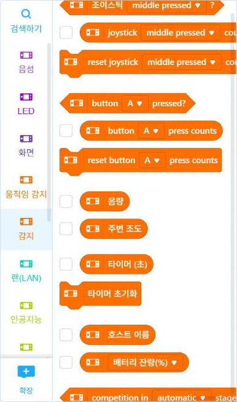
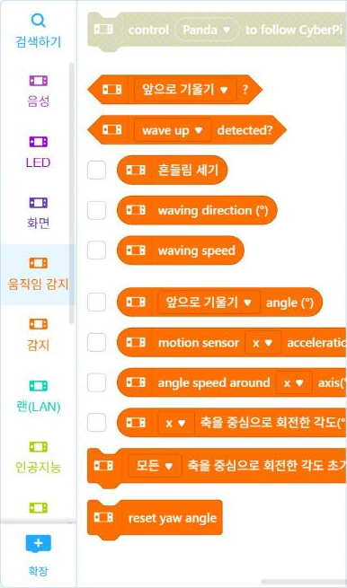

# 4.1 사이버파이 구성과 사양

사이버파이(CyberPi)는 Makeblock이 교육용으로 개발한 마이크로컨트롤러 보드다. 센서·화면·LED·스피커·버튼·무선 통신이 한 보드에 내장되어 있어 별도의 배선 없이 측정과 표시를 실습할 수 있다. 이 과목에서 사이버파이를 선택한 이유도 배선이 없다는 점이다. 온라인 주에 집에서 실습할 때 배선 오류로 인한 문제가 발생하지 않는다.

<!-- PHOTO: ch04_photo_front — 사이버파이 앞면, 흰 배경, 정면. 화면·LED 5개·조이스틱·A/B 단추·조도 센서 위치가 보이게. 본문 그림 번호 표기용으로 여백 넉넉히 -->
<!-- PHOTO: ch04_photo_back — 사이버파이 뒷면, 포켓쉴드 결합 단자가 보이게 -->
<!-- PHOTO: ch04_photo_side — 사이버파이 옆면, USB 단자와 홈 단추(전원) 위치가 보이게 -->

## 주요 사양

| 항목 | 사양 |
|---|---|
| 주 칩 | ESP32-WROVER-B (Xtensa 32비트 LX6 듀얼 코어, 240 MHz) |
| 메모리 | SRAM 520 KB, SPI 플래시 8 MB, PSRAM 8 MB |
| 화면 | 1.44인치 컬러 IPS 화면, 128×128 화소 |
| 무선 통신 | Wi-Fi, 블루투스 |
| 프로그래밍 | mBlock 블록 코딩, 파이썬(Live 모드는 PC 파이썬, Upload 모드는 기기의 MicroPython) |

ESP32는 Wi-Fi와 블루투스 기능을 내장한 마이크로컨트롤러다. 사이버파이는 이 칩의 Wi-Fi 기능으로 교내 Wi-Fi에 접속해 측정값을 서버로 전송한다(8.2절).

## 입력 장치와 센서

| 장치 | 측정 대상 | 파이썬 함수 | 반환값 |
|---|---|---|---|
| 조도 센서 | 주변 밝기 | `cyberpi.get_bri()` | 0~100 |
| 마이크 | 소리 크기 | `cyberpi.get_loudness("maximum")` | 0~100 |
| 6축 관성 센서 | 3축 가속도, 3축 각속도 | `cyberpi.get_acc("x")` 등 | 축별 가속도 |
| A·B 단추 | 누름 여부 | `cyberpi.controller.is_press("a")` | 참·거짓 |
| 조이스틱 | 상하좌우 방향, 가운데 누름 | `cyberpi.controller.is_press("middle")` 등 | 참·거짓 |

6축 관성 센서(IMU, Inertial Measurement Unit)는 3축 가속도 센서와 3축 자이로 센서를 하나로 구성한 센서다. 가속도 센서는 기기가 움직이거나 기울어질 때의 가속도를, 자이로 센서는 회전하는 속도(각속도)를 측정한다. 11장의 동작 분류 실습에서 가속도 측정값을 사용한다.

## 출력 장치

| 장치 | 용도 | 파이썬 함수 |
|---|---|---|
| 컬러 화면 | 문자·숫자·그래프 출력 | `cyberpi.console.println(…)`, `cyberpi.display.show_label(…)` |
| RGB LED 5개 | 색으로 상태 표시 | `cyberpi.led.on(r, g, b, "all")`, `cyberpi.led.off("all")` |
| 스피커 | 소리·음 출력 | `cyberpi.audio` 모듈 |

표의 함수 이름은 mBlock에서 블록을 파이썬으로 변환해 확인한 이름이다(4.4·4.6절). RGB LED는 빨강(R)·초록(G)·파랑(B) 세 색의 밝기를 각각 0~255로 지정해 원하는 색을 만든다.

## mBlock의 블록 범주

mBlock에서 사이버파이를 선택하면 기기 전용 블록이 범주별로 표시된다. 다음 그림은 「감지」 범주와 「움직임 감지」 범주의 블록이다. 「주변 조도」, 「음량」, 「motion sensor x acceleration」 블록이 위 표의 센서 함수에 대응한다.

<figure markdown="span">
  
  <figcaption>그림 4-1 mBlock 「감지」 범주: 조이스틱·단추·음량·주변 조도</figcaption>
</figure>

<figure markdown="span">
  
  <figcaption>그림 4-2 mBlock 「움직임 감지」 범주: 기울기·흔들림·가속도·각속도</figcaption>
</figure>

## 확인 문제

1. 사이버파이 앞면 사진에서 조도 센서, 화면, LED, A·B 단추, 조이스틱의 위치를 찾아 표시하시오.
2. 조도 센서와 마이크의 반환값 범위가 같다는 사실이 2.4절의 판정 함수 작성에 어떤 이점이 있는지 설명하시오.
3. RGB 값 (255, 255, 0)과 (0, 255, 255)가 각각 어떤 색인지 예상하시오.

!!! warning "초안 확인 사항"
    주 칩은 Makeblock 고객 지원 문서, 나머지 사양은 Makeblock 교육 사이트와 판매처 사양표를 기준으로 작성했다. 가속도 반환값의 단위는 4.6절 실측 후 기입한다. 부위 사진은 2026-11-16 주에 촬영해 삽입한다.
