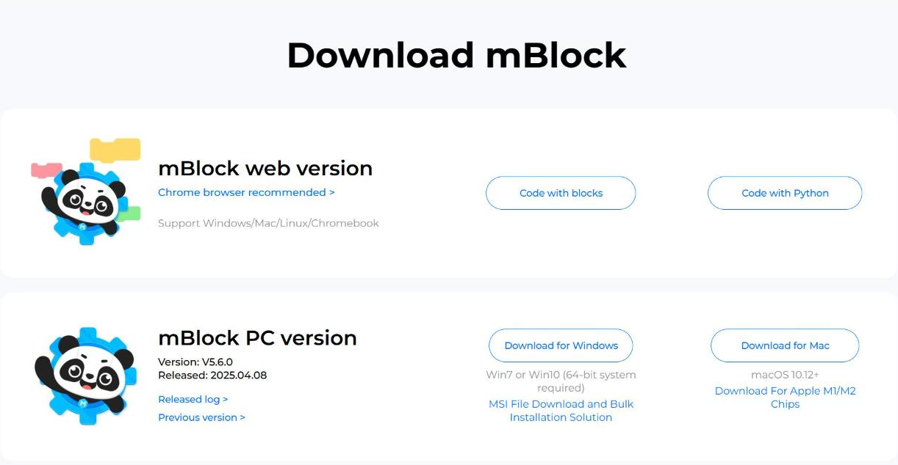
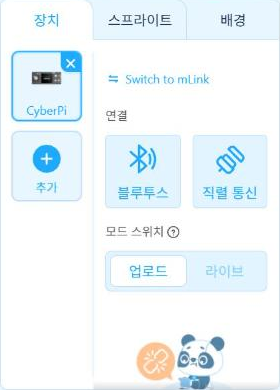

# 4.2 mBlock 설치와 펌웨어 관리

mBlock은 Makeblock이 제공하는 블록 코딩·파이썬 개발 환경이다. 웹 브라우저에서 실행하는 웹 버전과 PC에 설치하는 PC 버전이 있다. 이 과목에서는 기기를 연결하는 실습에 PC 버전을 사용하고, 기기 없이 블록 화면을 확인할 때 웹 버전을 사용한다. 이 장의 mBlock 화면 그림은 웹 버전에서 캡처했다. PC 버전도 화면 구성은 같다.

## mBlock 내려받기

[mBlock 내려받기 페이지](https://mblock.cc/pages/downloads)에서 운영체제에 맞는 PC 버전을 내려받는다.

<figure markdown="span">
  
  <figcaption>그림 4-3 mBlock 내려받기 페이지(2026-11-09 기준 PC 버전 V5.6.0)</figcaption>
</figure>

| 항목 | 내용 |
|---|---|
| 웹 버전 | 「Code with blocks」 단추, Chrome 브라우저 권장 |
| PC 버전(Windows) | 「Download for Windows」, Windows 7·10 64비트 |
| PC 버전(macOS) | 「Download for Mac」, macOS 10.12 이상, Apple M1·M2 전용 파일 별도 제공 |
| 실습실 일괄 설치 | 「MSI File Download and Bulk Installation Solution」 |

내려받은 설치 파일을 실행하고 안내에 따라 설치한다. 설치 중 장치 드라이버 설치를 묻는 창이 표시되면 설치를 허용한다. 드라이버가 없으면 PC가 USB로 연결한 사이버파이를 인식하지 못한다.

<!-- PHOTO: ch04_cap_install — mBlock PC 버전 설치 마법사 화면 1~2장(드라이버 설치 확인 창 포함), G14에서 캡처 -->

## 장치 추가와 USB 연결

mBlock을 실행한 뒤 다음 순서로 사이버파이를 연결한다.

1. 화면 왼쪽 아래의 **장치** 탭을 선택한다. 사이버파이가 목록에 없으면 **추가**를 눌러 장치 목록에서 CyberPi를 선택한다.
2. USB 케이블로 사이버파이와 PC를 연결하고, 사이버파이의 전원을 켠다.
3. **연결** 영역에서 USB 연결을 선택하고, 표시되는 포트 목록에서 사이버파이의 포트를 선택한 뒤 연결한다.
4. **모드 스위치**에서 실행 모드(업로드·라이브)를 선택한다. 두 모드의 차이는 4.3절에서 다룬다.

<figure markdown="span">
  
  <figcaption>그림 4-4 mBlock 장치 탭: CyberPi 장치, 연결 방식(블루투스·직렬 통신), 모드 스위치</figcaption>
</figure>

그림의 「직렬 통신」이 USB 연결이다. USB 케이블은 PC와 데이터를 주고받는 통로이면서 사이버파이에 전원을 공급한다.

<!-- PHOTO: ch04_cap_connect — mBlock PC 버전에서 CyberPi를 USB로 연결할 때의 포트 선택 창과 연결 완료 표시 화면 캡처(기기 연결 필요) -->

## 펌웨어 업데이트 창 처리 원칙

펌웨어(firmware)는 사이버파이 내부에서 동작하는 기본 프로그램이다. mBlock이 새 펌웨어를 감지하면 연결 과정에서 업데이트 창을 표시한다. 수업 중에는 다음 원칙에 따라 처리한다.

| 원칙 | 이유 |
|---|---|
| 업데이트 창이 표시되면 진행하기 전에 교수자에게 알린다 | 10대가 서로 다른 펌웨어로 동작하면 같은 코드의 동작이 달라질 수 있다 |
| 업데이트를 진행하는 동안 USB 케이블을 분리하거나 전원을 끄지 않는다 | 업데이트 도중 연결이 끊기면 기기가 정상적으로 부팅되지 않을 수 있다 |
| 업데이트 후 4.4절의 LED 깜빡임 프로그램으로 동작을 확인한다 | 업데이트 결과를 같은 기준으로 점검한다 |

<!-- PHOTO: ch04_cap_firmware — mBlock 펌웨어 업데이트 안내 창과 진행 표시 화면 캡처(기기 연결 필요) -->

## 확인 문제

1. 사용하는 노트북의 운영체제와 비트 수(32·64비트)를 확인하고, 내려받을 설치 파일을 고르시오.
2. mBlock이 사이버파이를 인식하지 못할 때 확인할 항목 세 가지를 쓰시오(케이블, 전원, 드라이버 등).
