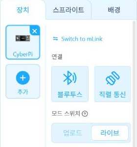

# 4.3 Live 모드와 Upload 모드

mBlock은 사이버파이 프로그램을 두 가지 방식으로 실행한다. Live 모드(라이브 모드)는 PC에서 프로그램을 실행하면서 USB로 연결한 사이버파이를 실시간으로 제어한다. Upload 모드(업로드 모드)는 프로그램을 사이버파이에 저장해 기기가 스스로 실행하도록 한다. mBlock의 모드 스위치 옆 물음표에 마우스를 올리면 두 모드의 설명이 표시된다.

<figure markdown="span">
  
  <figcaption>그림 4-5 모드 스위치 설명(업로드 모드 선택 상태)</figcaption>
</figure>

<figure markdown="span">
  
  <figcaption>그림 4-6 라이브 모드 선택 상태</figcaption>
</figure>

## 실행 위치의 차이

| 항목 | Live 모드 | Upload 모드 |
|---|---|---|
| 프로그램 실행 위치 | PC의 파이썬 | 사이버파이의 MicroPython |
| USB 분리 시 | 프로그램 정지 | 계속 동작(포켓쉴드 배터리 사용 시) |
| 사용 가능한 모듈 | PC 파이썬의 표준 라이브러리(`csv`, `time`, `urllib` 등) | 기기 MicroPython이 제공하는 모듈(`cyberpi`, `time`, `network`, `socket` 등) |
| 측정값 저장 | PC에 CSV 파일로 직접 저장 | 기기 화면 표시, Wi-Fi로 서버 전송 |
| 주요 용도 | 측정·기록·디버깅, 집에서 하는 온라인 실습 | USB 없이 동작하는 기기, 무선 전송(8장) |
| 이 책의 사용 절 | 4.6, 7.4, 12.1 | 8장, 11.3 |

MicroPython은 마이크로컨트롤러에서 동작하도록 만든 경량 파이썬이다. 문법은 PC 파이썬과 같지만 사용할 수 있는 모듈이 제한된다. 예를 들어 pandas는 MicroPython에서 사용할 수 없다. 따라서 5장 이후의 분석은 Live 모드로 PC에 저장한 CSV 파일이나 서버에 전송된 기록으로 진행한다.

## 모드 선택 기준

다음 질문에 차례로 답하면 실행 모드를 정할 수 있다.

1. 기기가 USB 없이 혼자 동작해야 하는가? → 예이면 **Upload 모드**
2. 측정값을 PC에 파일로 저장해야 하는가? → 예이면 **Live 모드**
3. 프로그램을 수정하면서 결과를 바로 확인해야 하는가? → 예이면 **Live 모드**

!!! note "웹 버전의 파이썬 미리보기"
    mBlock 웹 버전에서는 Upload 모드를 선택했을 때 코드 영역 오른쪽에 파이썬 미리보기 단추(`</>`)가 표시되었다. Live 모드에서는 이 단추가 표시되지 않았다(2026-11-09 확인). 4.4절의 블록·파이썬 대조는 Upload 모드에서 진행한다.

<!-- PHOTO: ch04_photo_usb_unplug — 같은 프로그램을 Live 모드와 Upload 모드로 실행한 뒤 USB를 분리했을 때의 차이(Live: 정지, Upload+포켓쉴드: LED 계속 깜빡임) 사진 2장 -->

## 확인 문제

1. 교실 문 앞에 두고 출입 시 소리 크기를 기록하는 기기를 구성하려고 한다. 어느 모드를 선택해야 하는지, 측정값은 어떻게 모아야 하는지 설명하시오.
2. Live 모드로 실행 중인 프로그램에서 USB 케이블을 분리하면 어떤 일이 발생하는지 예상하고 실제로 확인하시오.
