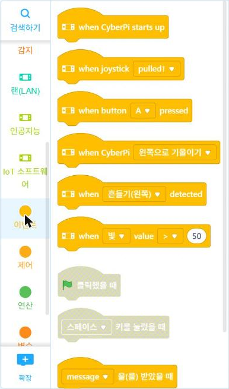
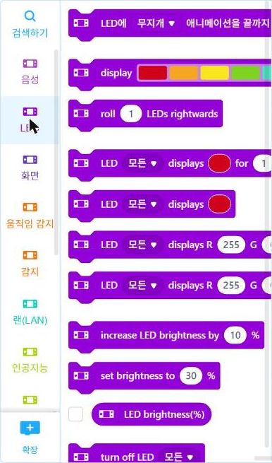
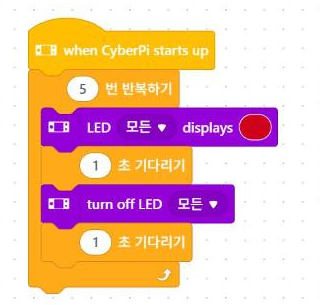
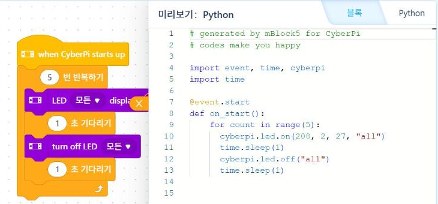

# 4.4 블록 코드와 파이썬 코드 대조

1.2절에서는 스프라이트를 움직이는 블록 프로그램을 작성했다. 이 절에서는 같은 반복 구조를 사이버파이의 LED를 제어하는 기기 블록으로 작성하고, mBlock이 변환한 파이썬 코드와 대조한다. 블록과 파이썬 코드를 한 줄씩 대응시키면 `cyberpi` 라이브러리의 함수 이름을 블록 이름과 함께 익힐 수 있다.

## 기기 블록 프로그램

Upload 모드를 선택하고 다음 블록 프로그램을 작성한다. LED 5개를 빨간색으로 1초 동안 켰다가 1초 동안 끄는 동작을 5번 반복한다.

| 순서 | 범주 | 블록 |
|---|---|---|
| 1 | 이벤트 | when CyberPi starts up |
| 2 | 제어 | 5 번 반복하기 |
| 3 | LED | LED 모든 displays (빨간색) |
| 4 | 제어 | 1 초 기다리기 |
| 5 | LED | turn off LED 모든 |
| 6 | 제어 | 1 초 기다리기 |

<div class="grid" markdown>

<figure markdown="span">
  
  <figcaption>그림 4-7 「이벤트」 범주(Upload 모드): 맨 위가 시작 이벤트</figcaption>
</figure>

<figure markdown="span">
  
  <figcaption>그림 4-8 「LED」 범주: 색 지정 켜기와 끄기(맨 아래)</figcaption>
</figure>

</div>

<figure markdown="span">
  
  <figcaption>그림 4-9 완성한 LED 깜빡임 블록 프로그램</figcaption>
</figure>

1.2절의 프로그램과 비교하면 시작 이벤트가 「깃발을 클릭했을 때」에서 「when CyberPi starts up」(사이버파이가 켜졌을 때)으로 바뀌었고, 반복 안의 명령이 스프라이트 동작에서 LED 제어로 바뀌었다. 반복 구조는 같다.

## 변환된 파이썬 코드

코드 영역 오른쪽의 `</>` 단추를 누르면 블록 프로그램이 파이썬 코드로 변환되어 「미리보기: Python」 창에 표시된다.

<figure markdown="span">
  
  <figcaption>그림 4-10 mBlock이 블록 프로그램을 변환한 파이썬 코드</figcaption>
</figure>

```python
# generated by mBlock5 for CyberPi
# codes make you happy

import event, time, cyberpi
import time

@event.start
def on_start():
    for count in range(5):
        cyberpi.led.on(208, 2, 27, "all")
        time.sleep(1)
        cyberpi.led.off("all")
        time.sleep(1)
```

## 블록과 코드의 대응

| 블록 | 파이썬 코드 | 설명 |
|---|---|---|
| when CyberPi starts up | `@event.start` + `def on_start():` | 사이버파이가 켜지면 실행할 함수를 지정 |
| 5 번 반복하기 | `for count in range(5):` | 2.2절의 `for` 반복문 |
| LED 모든 displays (빨간색) | `cyberpi.led.on(208, 2, 27, "all")` | 색상표의 빨간색을 RGB 값 (208, 2, 27)로 변환, `"all"`은 LED 5개 전체 |
| 1 초 기다리기 | `time.sleep(1)` | 1초 동안 대기 |
| turn off LED 모든 | `cyberpi.led.off("all")` | LED 5개 전체 소등 |

`@event.start`처럼 함수 정의 바로 위에 `@`로 시작하는 줄을 데코레이터(decorator)라고 한다. 여기서는 「사이버파이가 켜질 때 이 함수를 실행하라」는 등록 역할을 한다. 블록의 이벤트 모자 블록 하나가 데코레이터 한 줄과 함수 하나로 변환된다. 같은 방법으로 「when button A pressed」 블록은 `@event.is_press('a')` 데코레이터로 변환된다(4.6절 그림 4-12).

`import time`이 두 번 나타나는 것은 mBlock의 자동 변환 방식 때문이며, 실행에는 영향이 없다. 직접 코드를 작성할 때는 한 번만 쓴다.

## Live 모드 코드로 바꾸기

Live 모드에서는 이벤트 데코레이터 없이 위에서부터 차례로 실행하는 코드를 작성한다. 위 프로그램을 Live 모드용으로 고치면 다음과 같다.

```python
import cyberpi
import time

for count in range(5):
    cyberpi.led.on(255, 0, 0, "all")      # 빨간색
    time.sleep(1)
    cyberpi.led.off("all")
    time.sleep(1)
```

mBlock의 「Python」 탭을 선택하고 이 코드를 입력해 실행한다. 사이버파이의 LED 5개가 1초 간격으로 5번 깜빡이면 성공이다.

<!-- PHOTO: ch04_photo_led_blink — LED 5개가 빨간색으로 켜진 사이버파이 사진(화면 포함) -->

## 실습 과제

1. 블록 프로그램에서 반복 횟수를 10으로, 기다리는 시간을 0.5초로 바꾸고 변환된 파이썬 코드에서 바뀐 부분을 찾으시오.
2. LED 색을 초록색으로 바꾸고, 변환된 `led.on`의 RGB 값을 기록하시오.
3. Live 모드 코드를 수정해 빨강·초록·파랑이 차례로 켜지도록 하시오.
