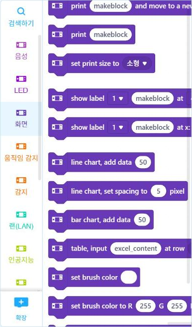

# 4.5 화면·LED·버튼 제어

이 절에서는 사이버파이의 출력 장치(화면·LED)와 입력 장치(단추·조이스틱)를 함께 사용하는 프로그램을 작성한다. 코드는 Live 모드에서 실행한다.

## 화면 출력

화면 출력 함수는 두 종류다. `console` 계열은 문자열을 한 줄씩 차례로 출력하고, `display.show_label`은 지정한 위치에 문자열을 표시한다.

| 함수 | 기능 |
|---|---|
| `cyberpi.console.println(값)` | 값을 출력하고 다음 줄로 이동 |
| `cyberpi.console.print(값)` | 값을 출력하고 줄을 바꾸지 않음 |
| `cyberpi.console.clear()` | 화면 지우기 |
| `cyberpi.display.show_label(문자열, 크기, 위치)` | 지정 위치에 문자열 표시(4.7절에서 사용) |

<figure markdown="span">
  
  <figcaption>그림 4-11 mBlock 「화면」 범주: print, show label, 꺾은선·막대 그래프</figcaption>
</figure>

「print … and move to a new line」 블록은 `console.println`으로 변환된다(4.6절 그림 4-12). 화면에 꺾은선 그래프와 막대 그래프를 그리는 블록도 있다. 측정값의 변화를 기기 화면에서 바로 확인할 때 사용한다.

## LED 제어

```python
import cyberpi
import time

cyberpi.led.on(0, 255, 0, "all")      # 5개 모두 초록
time.sleep(1)
cyberpi.led.on(0, 0, 255, 1)          # 1번 LED만 파랑
time.sleep(1)
cyberpi.led.off("all")
```

`led.on`의 네 번째 인자는 LED 번호다. `"all"`은 5개 전체, 1~5는 해당 위치의 LED 하나를 의미한다.

## 단추 입력

`cyberpi.controller.is_press(이름)`은 단추가 눌려 있으면 참(`True`)을 반환한다. 이름은 `"a"`, `"b"`, 조이스틱 가운데 누름 `"middle"` 등이다. 다음 프로그램은 A 단추를 누르면 LED를 초록색으로 켜고 화면에 「ON」을, B 단추를 누르면 LED를 끄고 「OFF」를 출력한다. 조이스틱 가운데를 누르면 종료한다.

```python
import cyberpi
import time

cyberpi.console.clear()
cyberpi.console.println("A: ON / B: OFF")
while True:
    if cyberpi.controller.is_press("a"):
        cyberpi.led.on(0, 255, 0, "all")
        cyberpi.console.println("ON")
        time.sleep(0.3)                   # 한 번 누름이 여러 번 인식되지 않도록 대기
    if cyberpi.controller.is_press("b"):
        cyberpi.led.off("all")
        cyberpi.console.println("OFF")
        time.sleep(0.3)
    if cyberpi.controller.is_press("middle"):
        cyberpi.led.off("all")
        cyberpi.console.println("END")
        break
    time.sleep(0.05)
```

`while True`는 조건이 항상 참이므로 계속 반복하는 무한 반복문이다. `break`를 만나면 반복을 종료한다. 단추를 누른 직후 0.3초 대기하는 이유는 사람이 한 번 누르는 동안 반복문이 여러 번 실행되어 같은 누름이 여러 번 인식되는 것을 방지하기 위해서다. 2026-11-04 정보통신학과 측정 노드 실습의 기기 프로그램에서도 단추 처리 뒤에 같은 방법으로 0.3초 대기를 사용했다.

<!-- PHOTO: ch04_photo_button_on — A 단추를 눌러 LED 초록 점등 + 화면에 "A: ON / B: OFF", "ON" 출력된 사진 -->

## 실습 과제

1. 단추를 누를 때마다 숫자가 1씩 증가하는 카운터를 작성하고, 누른 횟수를 화면에 출력하시오.
2. A 단추를 누를 때마다 LED가 1번부터 5번까지 하나씩 차례로 켜지도록 작성하시오.
3. 2.4절의 `judge_light` 함수를 이 절의 코드와 결합해, 조이스틱 가운데를 누르면 현재 조도값과 판정 결과를 화면에 출력하시오.

!!! warning "초안 확인 사항"
    `console.println`, `led.on(…, "all")`, `led.off("all")`은 mBlock의 블록 변환으로, `controller.is_press("a"·"b"·"middle")`과 `console.clear()`는 2026-11-04 측정 노드 실습의 기기 프로그램으로 확인했다. `led.on`의 LED 번호 지정(1~5)과 `console.print`, Live 모드 Python 탭 실행은 실기기로 확인한 뒤 확정한다.
