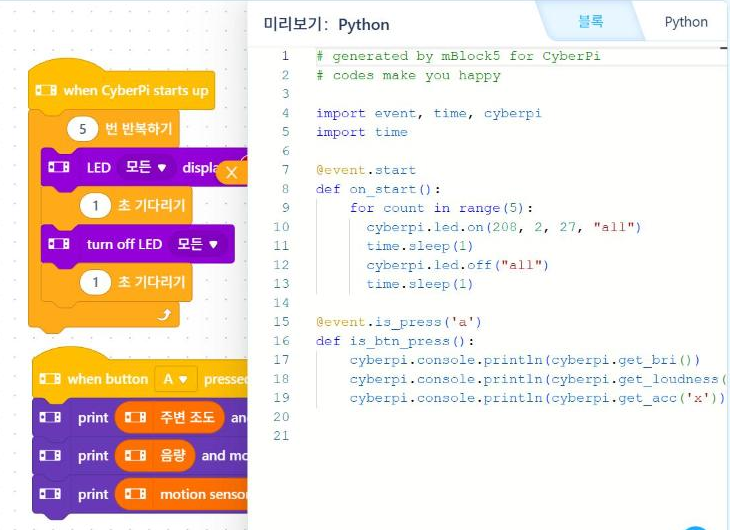

# 4.6 센서값 측정과 CSV 저장

이 절에서는 조도·소리·가속도 센서 3종의 측정값을 일정 간격으로 읽어 PC에 CSV 파일로 저장한다. 저장한 파일은 5장(정리)·6장(시각화)·7장(판정 기준) 실습의 분석 자료가 된다. 측정은 Live 모드에서 실행한다. Live 모드에서는 프로그램이 PC에서 실행되므로 PC의 `csv` 모듈로 파일을 직접 저장할 수 있다(4.3절).

## 센서 함수 확인

mBlock에서 A 단추 이벤트 아래에 출력 블록 3개를 놓고, 각 출력 칸에 「주변 조도」, 「음량」, 「motion sensor x acceleration」 블록을 넣은 뒤 파이썬 미리보기를 확인한다.

<figure markdown="span">
  
  <figcaption>그림 4-12 센서 블록 3종과 변환된 파이썬 코드(17~19행)</figcaption>
</figure>

| 블록 | 변환된 파이썬 코드 |
|---|---|
| when button A pressed | `@event.is_press('a')` |
| print (값) and move to a new line | `cyberpi.console.println(값)` |
| 주변 조도 | `cyberpi.get_bri()` |
| 음량 | `cyberpi.get_loudness("maximum")` |
| motion sensor x acceleration | `cyberpi.get_acc('x')` |

미리보기 창의 18행은 화면 폭을 넘어 잘려 있다. 미리보기 창을 오른쪽으로 이동하면 `cyberpi.get_loudness("maximum")`을 확인할 수 있다. `"maximum"`은 짧은 시간 동안 측정한 소리 크기의 최댓값을 반환하도록 지정하는 인자다. 가속도는 `'x'`, `'y'`, `'z'` 중 하나로 축을 지정한다.

## 측정값 출력 시험

먼저 측정값이 정상적으로 읽히는지 화면과 PC 출력으로 확인한다.

```python
import cyberpi
import time

for i in range(10):
    bri = cyberpi.get_bri()
    loud = cyberpi.get_loudness("maximum")
    ax = cyberpi.get_acc("x")
    print(i, bri, loud, ax)                     # PC 출력 창
    cyberpi.console.println(str(bri) + " " + str(loud))   # 기기 화면
    time.sleep(0.5)
```

손으로 조도 센서를 가리거나 손뼉을 치면서 값이 변화하는지 확인한다. 기기를 기울이면 가속도 값이 변화한다.

<!-- PHOTO: ch04_cap_live_print — mBlock Live 모드에서 위 코드를 실행한 출력 창(10행) 캡처 + 사이버파이 화면 사진 -->

## CSV 파일 저장

다음 프로그램은 0.5초 간격으로 60초 동안(120회) 측정해 바탕 화면에 CSV 파일로 저장한다. 3.2절의 `csv.writer`를 사용한다.

```python
import cyberpi
import time
import csv
import os

N = 120                                         # 0.5초 간격 120회 = 60초
path = os.path.join(os.path.expanduser("~"), "Desktop", "sensor_week4.csv")

with open(path, "w", newline="", encoding="utf-8") as f:
    w = csv.writer(f)
    w.writerow(["t", "bri", "loud", "ax", "ay", "az"])
    t0 = time.time()
    for i in range(N):
        row = [round(time.time() - t0, 2),
               cyberpi.get_bri(),
               cyberpi.get_loudness("maximum"),
               cyberpi.get_acc("x"), cyberpi.get_acc("y"), cyberpi.get_acc("z")]
        w.writerow(row)
        cyberpi.console.clear()
        cyberpi.console.println("%d / %d" % (i + 1, N))   # 진행 상황
        time.sleep(0.5)

cyberpi.console.println("saved")
print("저장 완료:", path)
```

| 코드 | 설명 |
|---|---|
| `os.path.expanduser("~")` | 사용자 폴더 경로(예: `C:\Users\이름`) |
| `os.path.join(…)` | 운영체제에 맞는 구분 문자로 경로 연결 |
| `time.time() - t0` | 측정 시작 후 경과 시간(초) |
| `"%d / %d" % (i + 1, N)` | 문자열 서식 지정, 진행 횟수 표시 |

측정하는 60초 동안 다음 순서로 환경을 변화시키면 6장에서 분석할 변화가 기록된다.

| 구간 | 조작 |
|---|---|
| 0~20초 | 책상 위에 가만히 둔다 |
| 20~40초 | 손으로 조도 센서를 가렸다 떼기를 반복하고, 손뼉을 몇 번 친다 |
| 40~60초 | 기기를 들고 천천히 기울이거나 흔든다 |

<!-- PHOTO: ch04_cap_csv — 저장된 sensor_week4.csv를 메모장 또는 엑셀로 연 화면 캡처(첫 10행) -->
<!-- DATA: ch04_data_sensor_week4 — 실측 CSV 1개를 docs/data/에 추가하면 이 절 끝에 Colab 꺾은선 그래프(조도·소리·가속도 3개)와 캡처를 넣는다 -->

## 저장한 자료 확인

저장한 CSV 파일을 Colab에 업로드하고 5장의 방법으로 불러와 확인한다.

```python
import pandas as pd

s = pd.read_csv("sensor_week4.csv")
print(s.shape)
s.describe().round(1)
```

행 수가 120, 열이 6개이면 정상이다. `describe()`의 최솟값·최댓값으로 각 센서의 변동 범위를 확인한다.

## 실습 과제

1. 측정 간격을 0.2초로 바꾸고 같은 시간 동안 측정해 행 수가 어떻게 변화하는지 확인하시오. 실제 간격이 0.2초보다 길어진다면 그 이유를 설명하시오(측정·전송·화면 출력에 걸리는 시간).
2. 교실의 서로 다른 장소 3곳(창가, 복도 쪽, 교탁)에서 각각 30초씩 측정해 파일 3개로 저장하시오. 파일 이름에 장소를 표기한다.
3. 저장한 파일 하나를 이용해 6.1절의 방법으로 조도와 소리 크기의 꺾은선 그래프를 작성하시오.

!!! warning "초안 확인 사항"
    센서 함수 이름은 mBlock 블록 변환(그림 4-12)으로 확인했다. mBlock 내장 파이썬에서의 `csv`·`os` 모듈 사용, 바탕 화면 경로, 실제 측정 간격, 가속도 값의 단위는 실기기로 확인한 뒤 확정한다.
