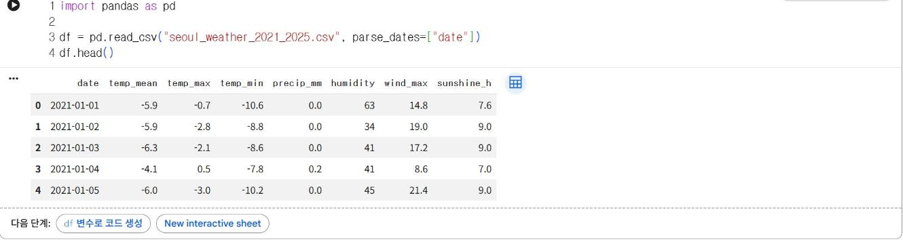

# 5.1 DataFrame 기초

pandas는 표 형식 자료를 다루는 파이썬 라이브러리다. 3장에서 `csv` 모듈과 딕셔너리로 10줄 이상 작성한 집계를 pandas에서는 한두 줄로 작성할 수 있다. pandas의 기본 자료구조는 행과 열로 구성된 표인 DataFrame과, DataFrame의 열 하나에 해당하는 Series다.

## 자료 준비

`pd.read_csv`는 CSV 파일을 DataFrame으로 불러온다. `parse_dates=["date"]`를 지정하면 `date` 열을 문자열이 아닌 날짜 자료형으로 변환한다.

```python
import pandas as pd

df = pd.read_csv("seoul_weather_2021_2025.csv", parse_dates=["date"])
df.head()
```

**실행 결과**

```text
        date  temp_mean  temp_max  temp_min  precip_mm  humidity  wind_max  sunshine_h
0 2021-01-01       -5.9      -0.7     -10.6        0.0        63      14.8         7.6
1 2021-01-02       -5.9      -2.8      -8.8        0.0        34      19.0         9.0
2 2021-01-03       -6.3      -2.1      -8.6        0.0        41      17.2         9.0
3 2021-01-04       -4.1       0.5      -7.8        0.2        41       8.6         7.0
4 2021-01-05       -6.0      -3.0     -10.2        0.0        45      21.4         9.0
```

<figure markdown="span">
  
  <figcaption>그림 5-1 Colab에서 표 형식으로 표시된 df.head() 결과</figcaption>
</figure>

`head()`는 처음 5행을 반환한다. Colab에서는 셀의 마지막 줄에 DataFrame을 쓰면 그림 5-1처럼 표 형식으로 표시된다. 왼쪽의 0, 1, 2…는 각 행의 이름인 색인(index)이다.

## 구조 확인

```python
df.info()
```

**실행 결과**

```text
<class 'pandas.DataFrame'>
RangeIndex: 1826 entries, 0 to 1825
Data columns (total 8 columns):
 #   Column      Non-Null Count  Dtype         
---  ------      --------------  -----         
 0   date        1826 non-null   datetime64[us]
 1   temp_mean   1826 non-null   float64       
 2   temp_max    1826 non-null   float64       
 3   temp_min    1826 non-null   float64       
 4   precip_mm   1826 non-null   float64       
 5   humidity    1826 non-null   int64         
 6   wind_max    1826 non-null   float64       
 7   sunshine_h  1826 non-null   float64       
dtypes: datetime64[us](1), float64(6), int64(1)
memory usage: 114.3 KB
```

`info()`는 행 수, 열 이름, 열별 결측이 아닌 값의 개수(Non-Null Count), 자료형(Dtype)을 출력한다. `date` 열이 `datetime64` 자료형으로 변환되었고, 모든 열의 값 개수가 행 수와 같으므로 결측치가 없다. pandas 버전에 따라 첫 줄의 클래스 이름과 날짜 자료형의 단위 표기(`[us]`, `[ns]`)는 다르게 출력될 수 있다.

## 기술통계 요약

```python
df.describe().round(1)
```

**실행 결과**

```text
                      date  temp_mean  temp_max  temp_min  precip_mm  humidity  wind_max  \
count                 1826     1826.0    1826.0    1826.0     1826.0    1826.0    1826.0   
mean   2023-07-02 12:00:00       12.2      17.2       8.0        4.0      71.5      15.7   
min    2021-01-01 00:00:00      -15.6     -12.1     -18.8        0.0      21.0       3.8   
25%    2022-04-02 06:00:00        2.9       8.3      -1.9        0.0      63.0      11.2   
50%    2023-07-02 12:00:00       13.0      18.4       8.2        0.0      74.0      14.8   
75%    2024-09-30 18:00:00       21.9      26.1      18.2        1.7      82.0      19.2   
max    2025-12-31 00:00:00       32.8      38.5      28.1      107.7      96.0      41.3   
std                    NaN       10.7      10.6      11.1       11.0      13.9       5.8   

       sunshine_h  
count      1826.0  
mean          8.3  
min           0.0  
25%           6.4  
50%           9.2  
75%          11.0  
max          13.3  
std           3.8  
```

`describe()`는 수치 열마다 개수(count), 평균(mean), 최솟값(min), 사분위수(25%·50%·75%), 최댓값(max), 표준편차(std)를 한 번에 산출한다. 각 값의 의미는 6.2절에서 다룬다.

## 열 선택과 행 필터

`df["temp_max"]`처럼 열 이름 하나를 대괄호에 쓰면 Series를, `df[["date", "temp_max"]]`처럼 열 이름 리스트를 쓰면 DataFrame을 반환한다. 대괄호 안에 조건식을 쓰면 조건을 만족하는 행만 추출한다. 일최고기온이 33℃ 이상인 날을 폭염일로 정의하고 연도별로 집계한다.

```python
hot = df[df["temp_max"] >= 33]
print(len(hot))
hot["date"].dt.year.value_counts().sort_index()
```

**실행 결과**

```text
42
date
2021     8
2022     2
2023     4
2024     6
2025    22
Name: count, dtype: int64
```

5년 동안 폭염일은 42일이며, 그중 22일이 2025년이다. 아래 정렬 결과에서도 일최고기온 상위 5일 중 4일이 2025-07-26~30에 집중되어 있다. `df["temp_max"] >= 33`은 행마다 `True`·`False`를 저장한 Series이고, 이 Series로 DataFrame을 필터링하면 `True`인 행만 남는다. `dt.year`는 날짜에서 연도를 추출하고, `value_counts()`는 값별 개수를 집계한다.

## 정렬

```python
df.sort_values("temp_max", ascending=False).head(5)[["date", "temp_max", "temp_mean"]]
```

**실행 결과**

```text
           date  temp_max  temp_mean
1670 2025-07-29      38.5       32.5
1668 2025-07-27      38.4       32.8
1671 2025-07-30      38.0       32.2
1667 2025-07-26      37.8       32.1
1653 2025-07-12      37.0       30.3
```

`sort_values`는 지정한 열을 기준으로 행을 정렬한다. `ascending=False`는 내림차순(큰 값부터)이다.

## 확인 문제

1. 일최저기온(`temp_min`)이 −10℃ 이하인 날의 수를 연도별로 집계하시오.
2. 일강수량이 가장 많은 5일을 출력하시오.
3. 3.3절에서 `csv` 모듈로 산출한 연도별 평균기온을 `df.groupby(df["date"].dt.year)["temp_mean"].mean()`으로 산출해 결과를 비교하시오.
