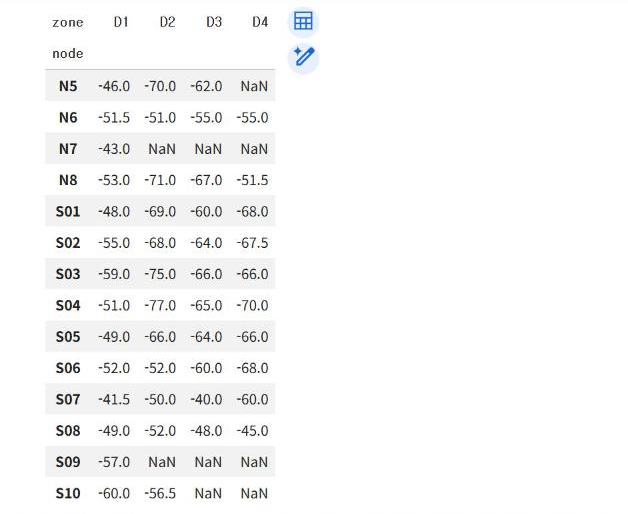

# 5.2 결측치·이상치 처리

실제 측정 자료에는 값이 없는 칸(결측치, missing value)과 다른 값들과 크게 떨어진 값(이상치, outlier)이 섞여 있다. 이 절에서는 3.2절의 11/4 수업 신호 세기 기록으로 두 가지를 찾아내고 처리 방법을 결정한다. 처리 방법은 분석 목적에 따라 달라지므로, 먼저 찾아낸 뒤 원인을 확인하고 결정한다.

## 지점별 요약

```python
rssi = pd.read_csv("class_rssi_20261104.csv")
print(rssi.shape)
print(rssi.isna().sum())
rssi.groupby("zone")["rssi"].agg(["count", "mean", "median"]).round(1)
```

**실행 결과**

```text
(492, 5)
id      0
node    0
zone    0
rssi    0
time    0
dtype: int64
      count  mean  median
zone                     
D1      180 -53.0   -52.0
D2      121 -62.9   -66.0
D3      103 -59.4   -62.0
D4       88 -61.5   -65.5
```

`isna().sum()`은 열별 결측치 개수다. 원자료에는 결측치가 없다. `groupby("zone")`은 지점별로 행을 묶고, `agg`는 묶음마다 여러 통계를 산출한다. 3.2절에서 딕셔너리 2개로 산출한 건수·평균과 같은 결과를 한 줄로 얻는다.

## 피벗 표의 결측치

노드별·지점별 중앙값을 표로 정리하면 결측치가 나타난다. `pivot_table`은 행 색인(`index`)과 열(`columns`)의 조합마다 값을 집계한다.

```python
pv = rssi.pivot_table(index="node", columns="zone", values="rssi", aggfunc="median")
pv
```

**실행 결과**

```text
zone    D1    D2    D3    D4
node                        
N5   -46.0 -70.0 -62.0   NaN
N6   -51.5 -51.0 -55.0 -55.0
N7   -43.0   NaN   NaN   NaN
N8   -53.0 -71.0 -67.0 -51.5
S01  -48.0 -69.0 -60.0 -68.0
S02  -55.0 -68.0 -64.0 -67.5
S03  -59.0 -75.0 -66.0 -66.0
S04  -51.0 -77.0 -65.0 -70.0
S05  -49.0 -66.0 -64.0 -66.0
S06  -52.0 -52.0 -60.0 -68.0
S07  -41.5 -50.0 -40.0 -60.0
S08  -49.0 -52.0 -48.0 -45.0
S09  -57.0   NaN   NaN   NaN
S10  -60.0 -56.5   NaN   NaN
```

<figure markdown="span">
  
  <figcaption>그림 5-2 노드별·지점별 중앙값 피벗 표(NaN은 결측치)</figcaption>
</figure>

`NaN`(Not a Number)은 결측치를 표시한다. 수업 시간 안에 일부 지점을 측정하지 못한 노드의 칸이 결측치가 되었다. 결측치는 측정값이 없다는 사실 자체가 정보이므로, 원인을 확인하지 않고 임의의 값으로 대체하지 않도록 한다.

```python
print(pv.isna().sum())
print("4개 지점을 모두 측정한 노드:", len(pv.dropna()))
```

**실행 결과**

```text
zone
D1    0
D2    2
D3    3
D4    4
dtype: int64
4개 지점을 모두 측정한 노드: 10
```

## 결측치 처리 방법

| 방법 | 코드 | 적합한 경우 |
|---|---|---|
| 행 제거 | `pv.dropna()` | 4개 지점을 모두 측정한 노드끼리만 비교할 때 |
| 대표값으로 대체 | `pv.fillna(pv.median())` | 결측 비율이 낮고, 대체값이 결론을 바꾸지 않을 때 |
| 그대로 유지 | 처리하지 않음 | 지도·표에 「측정 없음」을 표시해야 할 때 |

대체값을 사용하면 측정하지 않은 칸이 측정한 칸과 구별되지 않는다. 다음은 중앙값으로 대체한 결과의 예다.

```python
filled = pv.fillna(pv.median())
filled.loc[["N7", "S09"]]
```

**실행 결과**

```text
zone    D1    D2    D3    D4
node                        
N7   -43.0 -67.0 -62.0 -66.0
S09  -57.0 -67.0 -62.0 -66.0
```

N7과 S09는 D1만 측정했지만, 대체 후에는 D2~D4에도 값이 있는 것처럼 표시된다. 전파 지도처럼 실제 측정 위치가 중요한 분석에서는 대체하지 않고 결측 상태를 유지한다.

## 이상치 탐색

첫째, 물리적으로 불가능한 값을 확인한다. Wi-Fi 신호 세기는 0 dBm보다 클 수 없고, −100 dBm 아래는 측정 노드가 신호를 수신하지 못하는 수준이다. 둘째, 사분위수 범위(IQR, Interquartile Range) 규칙으로 지점별 분포에서 크게 떨어진 값을 찾는다. 1사분위수(Q1)에서 1.5×IQR을 뺀 값보다 작거나, 3사분위수(Q3)에 1.5×IQR을 더한 값보다 큰 값을 이상치 후보로 판정한다.

```python
out_range = rssi[(rssi["rssi"] > 0) | (rssi["rssi"] < -100)]
print("범위 밖 기록:", len(out_range))

q1 = rssi.groupby("zone")["rssi"].quantile(0.25)
q3 = rssi.groupby("zone")["rssi"].quantile(0.75)
iqr = q3 - q1
low = rssi["zone"].map(q1 - 1.5 * iqr)
high = rssi["zone"].map(q3 + 1.5 * iqr)
outliers = rssi[(rssi["rssi"] < low) | (rssi["rssi"] > high)]
print("IQR 기준 이상치 후보:", len(outliers))
outliers.groupby("zone")["rssi"].agg(["count", "min", "max"])
```

**실행 결과**

```text
범위 밖 기록: 0
IQR 기준 이상치 후보: 13
      count  min  max
zone                 
D1       13  -84  -35
```

`map`은 각 행의 지점 이름을 그 지점의 경계값으로 변환해, 행마다 자기 지점의 기준과 비교할 수 있게 한다. 범위 밖 기록은 없고, IQR 기준 이상치 후보 13건은 모두 D1에서 나왔다. D1은 Q1 −56, Q3 −49 dBm으로 IQR이 7 dB에 불과해 경계가 −66.5~−38.5 dBm으로 좁다. 그 결과 −84 dBm 같은 약한 값과 −35 dBm 같은 강한 값이 모두 후보로 판정되었다. 다른 지점은 IQR이 14~22 dB로 넓어 후보가 없다.

## 이상치 처리 판단

IQR 규칙으로 찾은 값은 이상치 「후보」다. 11/4 수업 자료를 분석한 결과, 같은 노드가 같은 자리에서 5초 간격으로 측정한 값의 표준편차는 약 3.4 dB였고, 같은 지점 안에서도 측정한 자리에 따라 8~12 dB 차이가 났다. 따라서 이상치 후보의 상당수는 기기 오류가 아니라 지점 안의 다른 자리에서 측정한 정상값일 수 있다. 이상치 후보는 삭제하지 않고 표시만 해 두고, 측정 기록(노드·시각)을 확인한 뒤 제외 여부를 결정한다.

```python
rssi["outlier"] = (rssi["rssi"] < low) | (rssi["rssi"] > high)
rssi["outlier"].value_counts()
```

**실행 결과**

```text
outlier
False    479
True      13
Name: count, dtype: int64
```

## 확인 문제

1. `pv`에서 결측치가 가장 많은 노드를 찾으시오(`pv.isna().sum(axis=1)` 사용).
2. IQR 규칙의 배수를 1.5에서 3.0으로 변경하면 이상치 후보가 몇 건으로 변화하는지 확인하시오.
3. 이상치 후보를 제외하기 전과 후의 지점별 중앙값을 비교하시오. 평균과 중앙값 중 이상치의 영향을 더 크게 받는 통계는 무엇인지 설명하시오.
