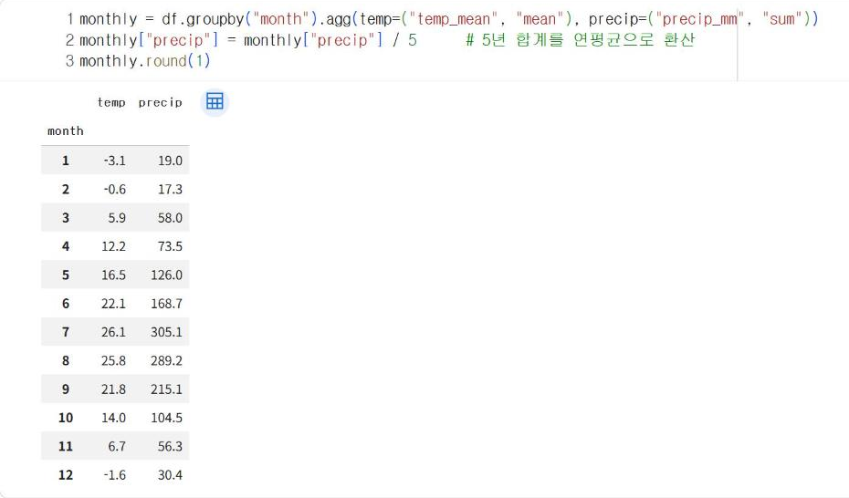

# 5.3 날짜 열과 월별 집계

날씨 자료는 날짜를 기준으로 연·월·계절 단위로 묶어 분석한다. pandas의 날짜 자료형은 `dt` 접근자로 연·월·요일 등을 추출할 수 있다.

## 연·월 열 추가

```python
df["year"] = df["date"].dt.year
df["month"] = df["date"].dt.month
df[["date", "year", "month", "temp_mean"]].head(3)
```

**실행 결과**

```text
        date  year  month  temp_mean
0 2021-01-01  2021      1       -5.9
1 2021-01-02  2021      1       -5.9
2 2021-01-03  2021      1       -6.3
```

| 표기 | 추출 값 |
|---|---|
| `dt.year` | 연도 |
| `dt.month` | 월(1~12) |
| `dt.day_of_year` | 연중 일수(1~366), 9.2절에서 사용 |
| `dt.dayofweek` | 요일(월요일 0 ~ 일요일 6) |

## 월별 평년값

5년 자료를 월별로 묶어 평균기온과 월강수량을 산출한다. `agg`에 `새 열 이름=(원래 열, 통계)` 형식으로 지정하면 결과 열의 이름을 함께 정할 수 있다. 강수량은 5년 합계를 5로 나누어 연평균 월강수량으로 환산한다.

```python
monthly = df.groupby("month").agg(temp=("temp_mean", "mean"), precip=("precip_mm", "sum"))
monthly["precip"] = monthly["precip"] / 5      # 5년 합계를 연평균으로 환산
monthly.round(1)
```

**실행 결과**

```text
       temp  precip
month              
1      -3.1    19.0
2      -0.6    17.3
3       5.9    58.0
4      12.2    73.5
5      16.5   126.0
6      22.1   168.7
7      26.1   305.1
8      25.8   289.2
9      21.8   215.1
10     14.0   104.5
11      6.7    56.3
12     -1.6    30.4
```

<figure markdown="span">
  
  <figcaption>그림 5-3 Colab에서 실행한 월별 평균기온·월강수량</figcaption>
</figure>

평균기온은 1월이 −3.1℃로 가장 낮고 7월이 26.1℃로 가장 높다. 월강수량은 7월(305.1 mm)과 8월(289.2 mm)이 가장 많고, 6~9월 4개월의 합계 978.1 mm가 연강수량(약 1,463 mm)의 약 67%를 차지한다. 여름철에 비가 집중되는 이 특성은 10장의 강수 분류 모델이 계절 위치를 분기 기준으로 사용하는 근거가 된다(10.2절).

## 월별 강수일수

```python
df["rain"] = df["precip_mm"] >= 1.0
(df.groupby("month")["rain"].sum() / 5).round(1)
```

**실행 결과**

```text
month
1      4.4
2      4.2
3      7.2
4      6.8
5      9.0
6     12.6
7     18.2
8     18.2
9     10.8
10     8.8
11     5.8
12     4.6
Name: rain, dtype: float64
```

논리값 열의 합계는 `True`의 개수다. 5년 합계를 5로 나눈 값은 그 달의 연평균 강수일수다.

## 연도·월 교차표

```python
df.pivot_table(index="year", columns="month", values="temp_mean", aggfunc="mean").round(1)
```

**실행 결과**

```text
month   1    2    3     4     5     6     7     8     9     10   11   12
year                                                                    
2021  -3.9  0.5  6.7  11.9  15.2  21.1  26.4  24.7  21.1  14.0  6.2 -1.3
2022  -3.5 -2.6  5.2  12.0  17.0  21.9  25.6  24.0  20.4  12.3  7.8 -4.6
2023  -3.5  0.1  7.2  11.9  17.3  21.4  25.1  25.6  22.0  13.7  4.9 -0.4
2024  -2.3  1.8  4.7  13.8  16.6  22.9  25.3  27.3  23.5  14.6  7.5 -1.1
2025  -2.1 -2.6  5.8  11.5  16.6  23.2  27.8  27.1  22.3  15.5  7.3 -0.7
```

같은 달이라도 연도에 따라 월평균기온이 다르다. 이 표는 6장에서 그래프로 시각화하고, 9장에서 계절 위치를 특징으로 사용하는 근거가 된다.

## 확인 문제

1. 월별 최고기온의 평균(`temp_max`)과 최저기온의 평균(`temp_min`)을 함께 산출하시오.
2. 요일별 평균 강수량을 산출하고, 요일과 강수량 사이에 관계가 있다고 판단할 수 있는지 설명하시오.
3. 연도별 7·8월 강수량 합계를 산출하시오.
