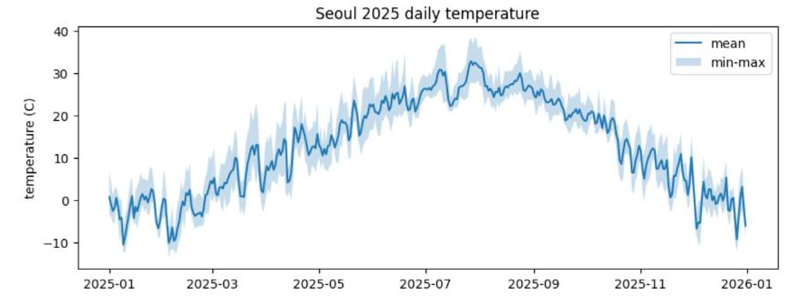
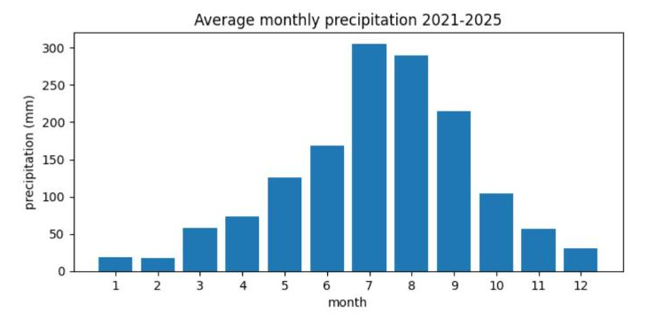
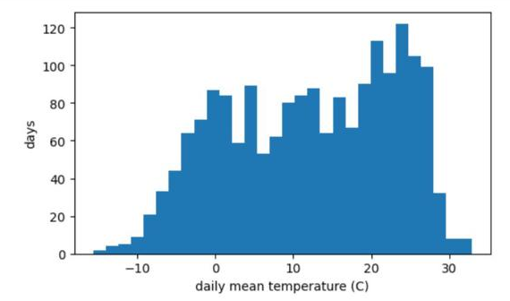

# 6.1 matplotlib 그래프

숫자 표만으로는 자료의 변화와 분포를 한눈에 파악하기 어렵다. matplotlib은 파이썬의 대표적인 그래프 라이브러리이며, pandas와 함께 사용한다. 이 장의 그래프는 축 이름을 영문으로 표기한다. Colab의 기본 글꼴에는 한글이 없어 한글 축 이름이 네모 칸으로 표시되기 때문이다.

## 준비 코드

새 노트북에서 시작하는 경우 5장의 자료 불러오기와 연·월 열 추가, 월별 집계 코드를 먼저 실행한다.

```python
import pandas as pd
import matplotlib.pyplot as plt

df = pd.read_csv("seoul_weather_2021_2025.csv", parse_dates=["date"])
df["year"] = df["date"].dt.year
df["month"] = df["date"].dt.month
monthly = df.groupby("month").agg(temp=("temp_mean", "mean"), precip=("precip_mm", "sum"))
monthly["precip"] = monthly["precip"] / 5
```

## 선 그래프

선 그래프는 시간에 따른 변화를 표시한다. 2025년 일평균기온을 선으로, 일최저·최고기온 범위를 음영으로 표시한다.

```python
y25 = df[df["year"] == 2025]
plt.figure(figsize=(10, 3.5))
plt.plot(y25["date"], y25["temp_mean"], label="mean")
plt.fill_between(y25["date"], y25["temp_min"], y25["temp_max"], alpha=0.25, label="min-max")
plt.ylabel("temperature (C)")
plt.title("Seoul 2025 daily temperature")
plt.legend()
plt.show()
```

<figure markdown="span">
  
  <figcaption>그림 6-1 Colab에서 출력한 2025년 일평균기온과 최저·최고기온 범위</figcaption>
</figure>

| 함수 | 역할 |
|---|---|
| `plt.figure(figsize=(가로, 세로))` | 그래프 영역 생성, 크기 단위는 인치 |
| `plt.plot(x, y, label=…)` | 선 그래프 |
| `plt.fill_between(x, y1, y2, alpha=…)` | 두 선 사이 음영, `alpha`는 투명도(0~1) |
| `plt.xlabel`, `plt.ylabel`, `plt.title` | 축 이름, 제목 |
| `plt.legend()` | `label`로 지정한 범례 표시 |
| `plt.show()` | 그래프 출력 |

## 막대 그래프

막대 그래프는 범주별 크기를 비교한다. 5.3절의 월별 연평균 강수량을 막대로 표시한다.

```python
plt.figure(figsize=(8, 3.5))
plt.bar(monthly.index, monthly["precip"])
plt.xticks(range(1, 13))
plt.xlabel("month")
plt.ylabel("precipitation (mm)")
plt.title("Average monthly precipitation 2021-2025")
plt.show()
```

<figure markdown="span">
  
  <figcaption>그림 6-2 Colab에서 출력한 월별 연평균 강수량</figcaption>
</figure>

5.3절의 표에서 숫자로 확인한 7·8월의 강수 집중이 막대 높이로 드러난다.

## 히스토그램

히스토그램(histogram)은 값의 범위를 일정한 구간(bin)으로 나누고, 구간마다 속한 값의 개수를 막대로 표시해 분포의 형태를 보여 준다.

```python
plt.figure(figsize=(6, 3.5))
plt.hist(df["temp_mean"], bins=30)
plt.xlabel("daily mean temperature (C)")
plt.ylabel("days")
plt.show()
```

<figure markdown="span">
  
  <figcaption>그림 6-3 Colab에서 출력한 일평균기온 히스토그램(구간 30개)</figcaption>
</figure>

서울의 일평균기온 분포는 한 곳에 몰리지 않고 −15.6℃부터 32.8℃까지 넓게 퍼져 있다. 0℃ 부근과 20~26℃ 부근에 날이 많고, 그중 20~26℃ 구간의 막대가 가장 높다. 여름은 기온의 변동 폭이 작아 좁은 구간에 날이 몰리기 때문이며, 6.3절에서 계절별로 나누어 확인한다.

## 확인 문제

1. 2025년 일강수량을 막대 그래프로 표시하시오(`plt.bar(y25["date"], y25["precip_mm"])`).
2. 히스토그램의 구간 수를 10과 60으로 변경하고, 구간 수에 따라 분포의 모양이 어떻게 달라 보이는지 설명하시오.
3. 그래프를 이미지 파일로 저장하려면 `plt.show()` 앞에 `plt.savefig("temp.png", dpi=150)`을 추가한다. 저장한 파일을 Colab 파일 창에서 확인하시오.
