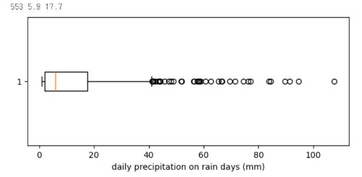

# 6.2 기술통계와 분포

기술통계(descriptive statistics)는 자료의 특성을 몇 개의 숫자로 요약한다. 자료의 중심을 나타내는 대표값과, 값이 흩어진 정도를 나타내는 산포도로 구분한다.

| 구분 | 통계 | 의미 |
|---|---|---|
| 대표값 | 평균(mean) | 모든 값의 합 ÷ 개수 |
| 대표값 | 중앙값(median) | 크기 순으로 정렬했을 때 가운데 값 |
| 산포도 | 표준편차(std) | 값이 평균에서 떨어진 정도 |
| 산포도 | 사분위수(quartile) | 정렬한 값을 4등분하는 위치의 값(25%·50%·75%) |

## 평균과 중앙값

```python
print(df["temp_mean"].agg(["mean", "median", "std"]).round(2))
print(df["precip_mm"].agg(["mean", "median", "std"]).round(2))
df["precip_mm"].quantile([0.25, 0.5, 0.75, 0.9, 0.99])
```

**실행 결과**

```text
mean      12.22
median    12.95
std       10.74
Name: temp_mean, dtype: float64
mean       4.01
median     0.00
std       11.00
Name: precip_mm, dtype: float64
0.25     0.000
0.50     0.000
0.75     1.700
0.90    11.500
0.99    58.175
Name: precip_mm, dtype: float64
```

일평균기온은 평균(12.22℃)과 중앙값(12.95℃)의 차이가 1℃ 미만이다. 반면 일강수량은 평균이 4.01 mm인데 중앙값은 0 mm다. 1826일 중 절반 이상이 강수량 0 mm이고, 75% 위치의 값도 1.7 mm에 불과하다. 그러나 상위 10%는 11.5 mm 이상, 상위 1%는 58.2 mm 이상이다. 비가 많이 온 소수의 날이 평균을 끌어올렸다.

이처럼 한쪽으로 긴 꼬리를 가진 분포를 치우친(skewed) 분포라고 한다. 치우친 분포에서는 평균이 「보통의 날」을 대표하지 못하므로 중앙값과 사분위수를 함께 보고한다. 5.2절에서 이상치 후보를 판정할 때 평균이 아닌 사분위수를 사용한 이유도 같다.

## 상자그림

상자그림(box plot)은 사분위수로 분포를 요약한다. 상자의 아래쪽·위쪽 경계가 1사분위수(Q1)·3사분위수(Q3), 상자 안의 선이 중앙값이다. 수염은 상자에서 1.5×IQR 이내의 가장 먼 값까지 그리고, 그 밖의 값은 점으로 표시한다. 5.2절의 IQR 이상치 규칙과 같은 기준이다. 강수일(1.0 mm 이상)의 일강수량 분포를 상자그림으로 확인한다.

```python
rain = df[df["precip_mm"] >= 1.0]["precip_mm"]
print(len(rain), rain.median(), rain.quantile(0.75))
plt.figure(figsize=(7, 2.8))
plt.boxplot(rain, vert=False)
plt.xlabel("daily precipitation on rain days (mm)")
plt.show()
```

**실행 결과**

```text
553 5.9 17.7
```

<figure markdown="span">
  
  <figcaption>그림 6-4 Colab에서 출력한 강수일 일강수량 상자그림</figcaption>
</figure>

강수일은 553일이고, 강수일의 일강수량 중앙값은 5.9 mm, 3사분위수는 17.7 mm다. 상자는 그래프 왼쪽에 좁게 위치하고, 오른쪽 수염 바깥에 큰 값의 점이 여러 개 표시된다. 비가 오는 날만 보아도 대부분은 적은 양이고, 소수의 날에 많은 비가 집중된다는 뜻이다. 3.3절에서 강수일수가 가장 적은 2022년의 연강수량이 가장 많았던 결과도 이런 분포 때문이다.

## 확인 문제

1. `df["temp_max"]`의 평균과 중앙값을 산출하고, 두 값의 차이가 작은 이유를 히스토그램과 연결해 설명하시오.
2. 강수일만 추출한 `rain`의 평균과 중앙값을 산출하고, 어느 쪽이 「보통의 비 오는 날」을 더 잘 대표하는지 판단하시오.
3. 3.2절의 신호 세기 자료에서 지점별 표준편차를 산출하고, 측정값의 흩어짐이 가장 큰 지점을 찾으시오.
