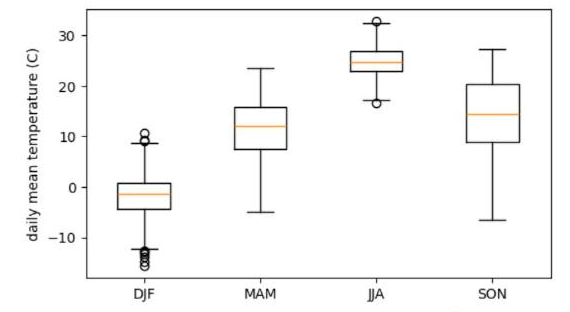
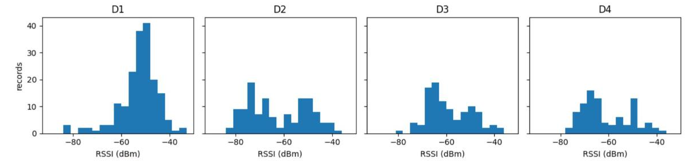

# 6.3 실습: 계절별 기온 분포와 센서 분포

이 절에서는 두 가지 실제 자료의 분포를 그룹별로 나누어 비교한다. 날씨 자료는 계절별로, 신호 세기 자료는 측정 지점별로 나눈다. 분포를 비교한 결과는 7장에서 판정 기준(임계값)을 정하는 근거가 된다.

## 계절별 기온 분포

월을 계절로 변환하는 딕셔너리를 작성하고 `map`으로 계절 열을 추가한다. 기상학에서 흔히 사용하는 구분에 따라 12~2월을 겨울(DJF), 3~5월을 봄(MAM), 6~8월을 여름(JJA), 9~11월을 가을(SON)로 정한다. 약어는 각 달의 영문 첫 글자다.

```python
season_of = {12: "DJF", 1: "DJF", 2: "DJF", 3: "MAM", 4: "MAM", 5: "MAM",
             6: "JJA", 7: "JJA", 8: "JJA", 9: "SON", 10: "SON", 11: "SON"}
df["season"] = df["month"].map(season_of)
order = ["DJF", "MAM", "JJA", "SON"]

plt.figure(figsize=(6, 3.5))
plt.boxplot([df[df["season"] == s]["temp_mean"] for s in order], tick_labels=order)
plt.ylabel("daily mean temperature (C)")
plt.show()
df.groupby("season")["temp_mean"].describe().loc[order].round(1)
```

**실행 결과**

```text
        count  mean  std   min   25%   50%   75%   max
season                                                
DJF     451.0  -1.8  4.2 -15.6  -4.4  -1.4   0.9  10.7
MAM     460.0  11.6  5.4  -4.9   7.4  12.0  15.8  23.5
JJA     460.0  24.7  2.9  16.7  22.9  24.8  26.8  32.8
SON     455.0  14.2  7.2  -6.6   9.0  14.5  20.4  27.2
```

<figure markdown="span">
  
  <figcaption>그림 6-5 Colab에서 출력한 계절별 일평균기온 상자그림</figcaption>
</figure>

| 계절 | 평균 | 표준편차 | 해석 |
|---|---|---|---|
| 겨울(DJF) | −1.8℃ | 4.2℃ | 평균이 0℃ 아래, 한파일(최저 −15.6℃)이 하위 꼬리 |
| 봄(MAM) | 11.6℃ | 5.4℃ | 3월에서 5월로 기온이 상승해 범위가 넓음 |
| 여름(JJA) | 24.7℃ | 2.9℃ | 변동 폭이 가장 작음, 6.1절 히스토그램의 높은 막대 |
| 가을(SON) | 14.2℃ | 7.2℃ | 9월에서 11월로 기온이 하강해 변동 폭이 가장 큼 |

같은 17℃라도 여름에는 5년 중 가장 서늘한 축에 속하는 날(여름 최저 16.7℃)이고, 가을에는 중앙값(14.5℃)보다 약간 높은 보통의 날이다. 계절에 따라 같은 값의 의미가 달라지므로, 판정 기준도 계절별로 정하는 것이 적절하다. 겨울의 개수가 451일로 다른 계절보다 적은 이유는 2월이 짧기 때문이다(윤년 2024년 포함).

## 지점별 신호 세기 분포

3.2절의 11/4 수업 신호 세기 기록을 지점별 히스토그램으로 비교한다. `plt.subplots(1, 4)`는 그래프 4개를 가로로 배치하고, `sharey=True`는 세로축 눈금을 공유해 높이를 직접 비교할 수 있게 한다.

```python
rssi = pd.read_csv("class_rssi_20261104.csv")
fig, axes = plt.subplots(1, 4, figsize=(12, 3), sharey=True)
for ax, z in zip(axes, ["D1", "D2", "D3", "D4"]):
    ax.hist(rssi[rssi["zone"] == z]["rssi"], bins=range(-90, -30, 3))
    ax.set_title(z)
    ax.set_xlabel("RSSI (dBm)")
axes[0].set_ylabel("records")
plt.tight_layout()
plt.show()
rssi.groupby("zone")["rssi"].quantile([0.1, 0.5, 0.9]).unstack().round(1)
```

**실행 결과**

```text
       0.1   0.5   0.9
zone                  
D1   -62.0 -52.0 -44.0
D2   -77.0 -66.0 -47.0
D3   -68.0 -62.0 -47.0
D4   -73.3 -65.5 -48.7
```

<figure markdown="span">
  
  <figcaption>그림 6-6 Colab에서 출력한 지점별 신호 세기 히스토그램</figcaption>
</figure>

중앙값은 D1이 −52 dBm으로 가장 강하고, D2(−66), D4(−65.5), D3(−62) 순이다. 하위 10% 값과 상위 10% 값의 차이는 D1이 18 dB로 가장 좁고 D2가 30 dB로 가장 넓다. 같은 −65 dBm이라도 D1에서는 하위 10%보다 약한 값이고, D2·D4에서는 중앙값 수준이다. 측정 지점마다 신호 환경이 다르므로, 「약한 신호」의 기준도 지점별로 정해야 한다.

## 판정 기준 후보

분포를 근거로 판정 기준을 정하는 방법은 7.1절에서 다룬다. 이 절의 결과에서 다음과 같은 기준 후보를 도출할 수 있다.

| 자료 | 기준 후보 | 근거 |
|---|---|---|
| 기온 | 계절별 하위 10%·상위 10% 기온을 「평년보다 추움·더움」의 경계로 사용 | 계절마다 분포의 위치가 다르므로 연중 하나의 기준은 부적합 |
| 신호 세기 | 지점별 하위 10% 값보다 약한 측정값을 「약한 신호」로 판정 | 지점마다 기준이 되는 신호 세기가 다름 |

## 실습 과제

1. 계절별 일강수량의 상자그림을 작성하고, 여름의 분포가 다른 계절과 어떻게 다른지 설명하시오.
2. 지점별 신호 세기 히스토그램을 노드 종류(`S`로 시작하는 학생 노드, `N`으로 시작하는 노드)로 나누어 비교하시오(`rssi["node"].str[0]` 사용).
3. 4주차에 사이버파이로 수집한 조도·소리 자료로 같은 방법의 히스토그램을 작성하고, 2.4절 판정 기준(30·70)이 실제 분포에 적합한지 검토하시오.
