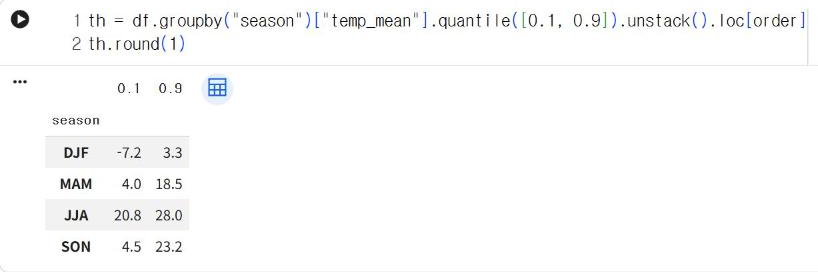
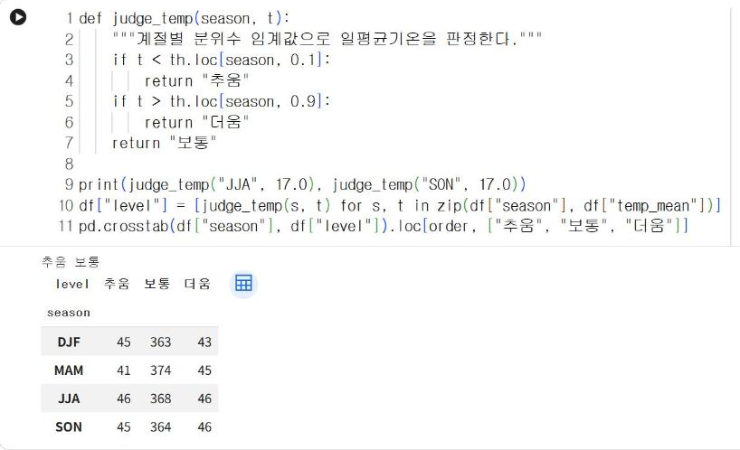
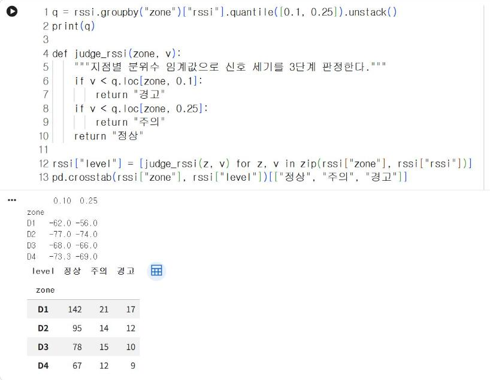
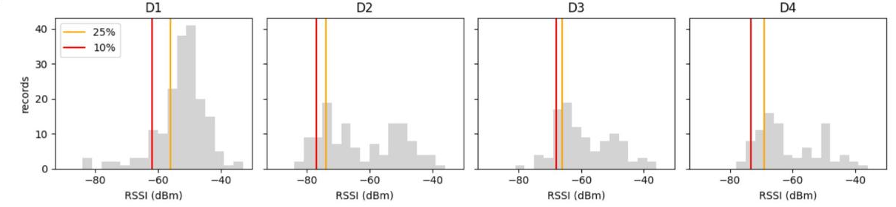

# 7.1 임계값 설계

판정 규칙은 측정값을 기준값과 비교해 단계를 결정한다. 이 기준값을 임계값(threshold)이라고 한다. 2.4절의 조도 판정에서는 30과 70을 임계값으로 사용했지만, 그 값을 정한 근거는 제시하지 않았다. 이 절에서는 6.3절에서 확인한 분포를 근거로 임계값을 산출하고, 측정값을 3단계로 판정하는 함수를 작성한다.

## 준비 코드

새 노트북에서 시작하는 경우 다음 코드를 먼저 실행한다. 6.3절의 계절 열과 11/4 수업 신호 세기 기록을 함께 준비한다.

```python
import pandas as pd
import matplotlib.pyplot as plt

df = pd.read_csv("seoul_weather_2021_2025.csv", parse_dates=["date"])
df["year"] = df["date"].dt.year
df["month"] = df["date"].dt.month
season_of = {12: "DJF", 1: "DJF", 2: "DJF", 3: "MAM", 4: "MAM", 5: "MAM",
             6: "JJA", 7: "JJA", 8: "JJA", 9: "SON", 10: "SON", 11: "SON"}
df["season"] = df["month"].map(season_of)
order = ["DJF", "MAM", "JJA", "SON"]
rssi = pd.read_csv("class_rssi_20261104.csv")
```

## 분위수 기반 임계값

분위수(quantile)는 크기 순으로 정렬한 자료에서 지정한 비율 위치에 있는 값이다. 예를 들어 10% 분위수보다 작은 값은 전체의 약 10%다. 분위수로 임계값을 정하면 「평소 측정값의 하위 10%보다 낮음」처럼 판정의 의미가 명확하고, 판정이 발생하는 빈도도 미리 정할 수 있다. 6.3절에서 도출한 기준 후보에 따라 계절별 일평균기온의 10%·90% 분위수를 산출한다.

```python
th = df.groupby("season")["temp_mean"].quantile([0.1, 0.9]).unstack().loc[order]
th.round(1)
```

**실행 결과**

```text
         0.1   0.9
season            
DJF     -7.2   3.3
MAM      4.0  18.5
JJA     20.8  28.0
SON      4.5  23.2
```

<figure markdown="span">
  
  <figcaption>그림 7-1 Colab에서 산출한 계절별 일평균기온의 10%·90% 분위수</figcaption>
</figure>

`quantile([0.1, 0.9])`는 그룹마다 두 분위수를 산출하고, `unstack()`은 분위수를 열로 펼쳐 계절별 한 행으로 정리한다. 여름(JJA)의 10% 분위수 20.8℃는 겨울(DJF)의 90% 분위수 3.3℃보다 17.5℃ 높다. 계절마다 「평소보다 추움」의 기준이 크게 다르다는 6.3절의 결론이 임계값으로 확인된다.

## 판정 함수

계절과 기온을 입력받아 「추움」·「보통」·「더움」을 반환하는 함수를 작성하고, 1,826일 전체에 적용한다.

```python
def judge_temp(season, t):
    """계절별 분위수 임계값으로 일평균기온을 판정한다."""
    if t < th.loc[season, 0.1]:
        return "추움"
    if t > th.loc[season, 0.9]:
        return "더움"
    return "보통"

print(judge_temp("JJA", 17.0), judge_temp("SON", 17.0))
df["level"] = [judge_temp(s, t) for s, t in zip(df["season"], df["temp_mean"])]
pd.crosstab(df["season"], df["level"]).loc[order, ["추움", "보통", "더움"]]
```

**실행 결과**

```text
추움 보통
level   추움   보통  더움
season             
DJF     45  363  43
MAM     41  374  45
JJA     46  368  46
SON     45  364  46
```

<figure markdown="span">
  
  <figcaption>그림 7-2 Colab에서 실행한 기온 판정 함수와 계절별 판정 건수</figcaption>
</figure>

같은 17℃가 여름에는 「추움」, 가을에는 「보통」으로 판정된다. 6.3절에서 문장으로 설명한 내용이 코드로 구현되었다. `zip`은 두 열의 값을 같은 위치끼리 묶어 차례로 반환하고, 리스트 내포는 각 날짜의 판정 결과를 리스트로 생성한다. `pd.crosstab(행, 열)`은 두 열의 값 조합별 건수를 집계한 교차표(cross table)를 산출한다. 분위수로 임계값을 정했으므로 계절마다 「추움」과 「더움」이 각각 약 10%씩 판정된다.

## 단계 판정(정상·주의·경고)

센서 측정값은 정상과 이상의 2단계보다 중간 단계를 두어 판정하는 경우가 많다. 주의 단계는 즉시 조치할 필요는 없지만 상태를 관찰해야 하는 구간이다. 신호 세기를 지점별 25% 분위수와 10% 분위수로 3단계 판정한다.

| 단계 | 조건 | 의미 |
|---|---|---|
| 정상 | 지점별 25% 분위수 이상 | 해당 지점의 평소 수준 |
| 주의 | 10% 분위수 이상, 25% 분위수 미만 | 평소보다 약함, 관찰 필요 |
| 경고 | 10% 분위수 미만 | 해당 지점의 하위 10%보다 약함 |

```python
q = rssi.groupby("zone")["rssi"].quantile([0.1, 0.25]).unstack()
print(q)

def judge_rssi(zone, v):
    """지점별 분위수 임계값으로 신호 세기를 3단계 판정한다."""
    if v < q.loc[zone, 0.1]:
        return "경고"
    if v < q.loc[zone, 0.25]:
        return "주의"
    return "정상"

rssi["level"] = [judge_rssi(z, v) for z, v in zip(rssi["zone"], rssi["rssi"])]
pd.crosstab(rssi["zone"], rssi["level"])[["정상", "주의", "경고"]]
```

**실행 결과**

```text
      0.10  0.25
zone            
D1   -62.0 -56.0
D2   -77.0 -74.0
D3   -68.0 -66.0
D4   -73.3 -69.0
level   정상  주의  경고
zone              
D1     142  21  17
D2      95  14  12
D3      78  15  10
D4      67  12   9
```

<figure markdown="span">
  
  <figcaption>그림 7-3 Colab에서 실행한 지점별 임계값과 3단계 판정 건수</figcaption>
</figure>

경고 임계값은 D1이 −62 dBm, D2가 −77 dBm으로 15 dB 차이가 있다. 같은 −65 dBm 측정값이 D1에서는 「경고」, D2에서는 「정상」으로 판정된다. 판정 건수가 정확히 10%·15%로 나뉘지 않는 이유는 신호 세기가 정수로 기록되어 같은 값이 여러 개 존재하기 때문이다. 임계값과 같은 값은 「미만」 조건을 만족하지 않으므로 한 단계 위로 판정된다.

## 임계값 시각화

히스토그램에 임계값을 세로선으로 표시하면 각 단계가 분포의 어느 구간에 해당하는지 확인할 수 있다. `axvline`은 지정한 x 위치에 세로선을 그린다.

```python
fig, axes = plt.subplots(1, 4, figsize=(12, 3), sharey=True)
for ax, z in zip(axes, ["D1", "D2", "D3", "D4"]):
    ax.hist(rssi[rssi["zone"] == z]["rssi"], bins=range(-90, -30, 3), color="lightgray")
    ax.axvline(q.loc[z, 0.25], color="orange", label="25%")
    ax.axvline(q.loc[z, 0.1], color="red", label="10%")
    ax.set_title(z)
    ax.set_xlabel("RSSI (dBm)")
axes[0].set_ylabel("records")
axes[0].legend()
plt.tight_layout()
plt.show()
```

<figure markdown="span">
  
  <figcaption>그림 7-4 Colab에서 출력한 지점별 히스토그램과 경고(빨강)·주의(주황) 임계값</figcaption>
</figure>

빨간 선의 왼쪽이 「경고」, 빨간 선과 주황 선 사이가 「주의」 구간이다. D1은 분포가 오른쪽(강한 신호)에 몰려 있어 두 선이 −62·−56 dBm에 위치하고, D2는 분포가 넓게 퍼져 있어 두 선이 −77·−74 dBm에 위치한다.

## 확인 문제

1. 기온 임계값을 5%·95% 분위수로 변경하고, 계절별 「추움」·「더움」 판정 건수가 어떻게 변화하는지 확인하시오.
2. 2025년 여름 중 「추움」으로 판정된 날짜를 출력하시오(`df[(df["year"] == 2025) & (df["season"] == "JJA") & (df["level"] == "추움")]`).
3. 4주차에 수집한 조도 자료의 25%·75% 분위수를 산출하고, 2.4절의 판정 기준(30·70)과 비교하시오.
