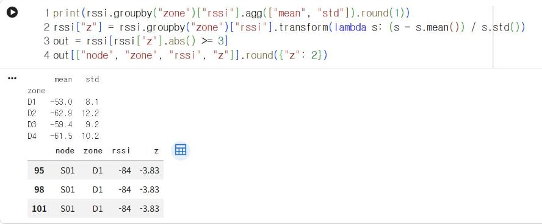
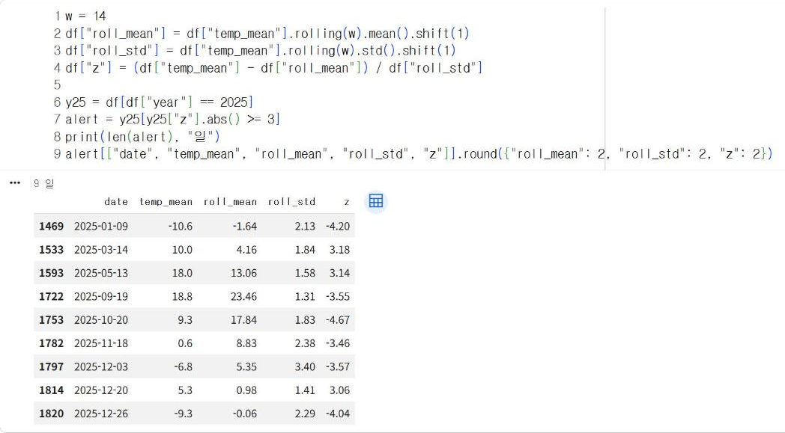
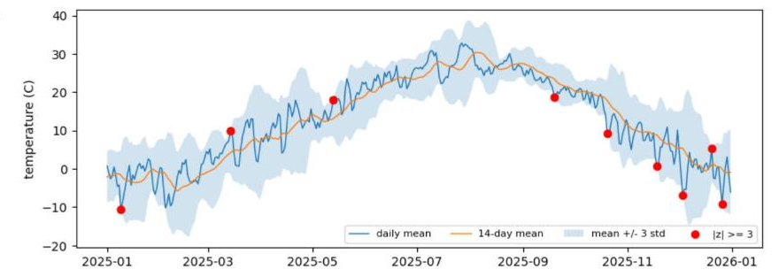

# 7.2 z-점수 이상 탐지

7.1절의 분위수 임계값은 판정 빈도를 정하는 방법이다. z-점수(z-score)는 측정값이 평균에서 표준편차의 몇 배만큼 떨어져 있는지를 산출한다. 단위가 dBm이든 ℃든 「표준편차의 3배 이상」처럼 같은 기준으로 이상 측정값을 판정할 수 있다.

## 표준화 공식

<p class="formula">z = (x − μ) ÷ σ</p>

x는 측정값, μ는 평균, σ는 표준편차다. 측정값을 이 공식으로 변환하는 과정을 표준화(standardization)라고 한다. z = 0은 평균과 같은 값, z = 2는 평균보다 표준편차의 2배만큼 큰 값, z = −3은 평균보다 표준편차의 3배만큼 작은 값이다.

| 기준 | 자료가 정규분포일 때 기준을 벗어나는 비율 | 용도 |
|---|---|---|
| \|z\| ≥ 2 | 약 4.6% | 주의 단계 후보 |
| \|z\| ≥ 3 | 약 0.3% | 이상 측정값 판정에 흔히 사용 |

정규분포(normal distribution)는 평균을 중심으로 좌우가 대칭인 종 모양의 분포다. 실제 측정 자료는 정규분포와 다른 경우가 많으므로, 위 비율은 기준값을 정하는 참고값으로 사용한다.

## 신호 세기의 z-점수

지점마다 평균과 표준편차가 다르므로 z-점수도 지점별로 산출한다. `transform`은 그룹별로 계산한 결과를 원래 행의 위치에 맞춰 반환한다. `lambda s: 식`은 인자 `s`를 받아 식의 값을 반환하는 이름 없는 한 줄 함수다.

```python
print(rssi.groupby("zone")["rssi"].agg(["mean", "std"]).round(1))
rssi["z"] = rssi.groupby("zone")["rssi"].transform(lambda s: (s - s.mean()) / s.std())
out = rssi[rssi["z"].abs() >= 3]
out[["node", "zone", "rssi", "z"]].round({"z": 2})
```

**실행 결과**

```text
      mean   std
zone            
D1   -53.0   8.1
D2   -62.9  12.2
D3   -59.4   9.2
D4   -61.5  10.2
    node zone  rssi     z
95   S01   D1   -84 -3.83
98   S01   D1   -84 -3.83
101  S01   D1   -84 -3.83
```

<figure markdown="span">
  
  <figcaption>그림 7-5 Colab에서 실행한 지점별 z-점수와 |z| ≥ 3 판정 결과</figcaption>
</figure>

|z| ≥ 3으로 판정된 측정값은 D1의 −84 dBm 3건이다. 5.2절에서는 같은 자료에서 IQR 규칙으로 D1의 13건(−84~−35 dBm)을 이상치 후보로 판정했다. 두 결과가 다른 이유는 다음과 같다.

| 방법 | 판정 건수 | 특징 |
|---|---|---|
| IQR 규칙(5.2절) | 13건 | 사분위수 기준이므로 이상치 자체의 영향을 적게 받음 |
| z-점수 \|z\| ≥ 3 | 3건 | 평균·표준편차 기준이므로 이상치가 있으면 표준편차가 증가해 판정 기준이 넓어짐 |

D1의 −35 dBm은 IQR 규칙으로는 이상치 후보였지만 z-점수는 약 2.2로 기준 3에 미달한다. 분포가 대칭에 가깝고 이상치가 적은 자료에는 z-점수가, 분포가 치우치거나 이상치가 많은 자료에는 IQR 규칙이 적합하다.

## 이동평균과 이동 표준편차

기온처럼 평균이 시간에 따라 변화하는 자료에 5년 전체의 평균과 표준편차로 z-점수를 적용하면, 여름은 대부분 큰 양수, 겨울은 큰 음수가 된다. 이상 판정이 계절 판정으로 변질되는 것이다. 이 경우 최근 일정 기간의 평균과 표준편차를 기준으로 사용한다. 이를 이동평균(moving average)과 이동 표준편차(moving standard deviation)라고 한다.

`rolling(14)`는 현재 행을 포함한 최근 14개 행의 창(window)을 구성하고, `.mean()`·`.std()`는 창마다 평균과 표준편차를 산출한다. `shift(1)`로 결과를 한 행 아래로 이동하면 오늘의 기준값은 어제까지 14일의 통계가 된다. 실시간 판정에서는 오늘의 측정값을 판정하는 기준에 오늘의 값을 포함하지 않도록 한다.

```python
w = 14
df["roll_mean"] = df["temp_mean"].rolling(w).mean().shift(1)
df["roll_std"] = df["temp_mean"].rolling(w).std().shift(1)
df["z"] = (df["temp_mean"] - df["roll_mean"]) / df["roll_std"]

y25 = df[df["year"] == 2025]
alert = y25[y25["z"].abs() >= 3]
print(len(alert), "일")
alert[["date", "temp_mean", "roll_mean", "roll_std", "z"]].round({"roll_mean": 2, "roll_std": 2, "z": 2})
```

**실행 결과**

```text
9 일
           date  temp_mean  roll_mean  roll_std     z
1469 2025-01-09      -10.6      -1.64      2.13 -4.20
1533 2025-03-14       10.0       4.16      1.84  3.18
1593 2025-05-13       18.0      13.06      1.58  3.14
1722 2025-09-19       18.8      23.46      1.31 -3.55
1753 2025-10-20        9.3      17.84      1.83 -4.67
1782 2025-11-18        0.6       8.83      2.38 -3.46
1797 2025-12-03       -6.8       5.35      3.40 -3.57
1814 2025-12-20        5.3       0.98      1.41  3.06
1820 2025-12-26       -9.3      -0.06      2.29 -4.04
```

<figure markdown="span">
  
  <figcaption>그림 7-6 Colab에서 실행한 14일 이동 z-점수와 2025년 |z| ≥ 3 판정일</figcaption>
</figure>

2025년에 |z| ≥ 3으로 판정된 날은 9일이며, 그중 6일이 기온이 급격히 하강한 날(z < 0)이다. 2025-10-20은 평균기온이 9.3℃로 직전 14일 평균 17.84℃보다 8.5℃ 이상 낮았고 z는 −4.67이다. 2025-01-09(z −4.20)는 9.5절에서 선형회귀 모델의 오차가 두 번째로 크게 산출되는 날짜다. 이동 z-점수로 검출한 급변일은 예측 모델이 실패하기 쉬운 날이기도 하다.

## 이동 기준의 시각화

```python
plt.figure(figsize=(10, 3.5))
plt.plot(y25["date"], y25["temp_mean"], lw=1, label="daily mean")
plt.plot(y25["date"], y25["roll_mean"], lw=1, label="14-day mean")
plt.fill_between(y25["date"], y25["roll_mean"] - 3 * y25["roll_std"],
                 y25["roll_mean"] + 3 * y25["roll_std"], alpha=0.2, label="mean +/- 3 std")
plt.scatter(alert["date"], alert["temp_mean"], color="red", zorder=3, label="|z| >= 3")
plt.ylabel("temperature (C)")
plt.legend(ncol=4, fontsize=8)
plt.show()
```

<figure markdown="span">
  
  <figcaption>그림 7-7 Colab에서 출력한 2025년 일평균기온, 14일 이동평균, ±3 표준편차 범위와 판정일(빨간 점)</figcaption>
</figure>

음영은 날마다 변화하는 판정 기준이다. 기온 변동이 작은 기간에는 음영의 폭이 좁아 작은 변화도 검출되고, 변동이 큰 기간에는 폭이 넓어 같은 크기의 변화도 정상으로 판정된다. 빨간 점은 기온이 음영 밖으로 벗어난 날이다.

## 확인 문제

1. 창 크기 `w`를 7과 30으로 변경하고, 2025년의 판정일 수가 어떻게 변화하는지 확인하시오.
2. 판정 기준을 |z| ≥ 2로 낮추면 판정일이 몇 일로 증가하는지 산출하고, 7.3절의 오경보 개념으로 결과를 설명하시오.
3. 신호 세기 자료를 노드별·시간 순으로 정렬하고(`rssi.sort_values(["node", "time"])`), 노드마다 최근 5개 측정값의 이동평균을 산출하시오.
