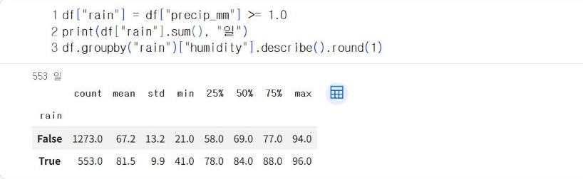
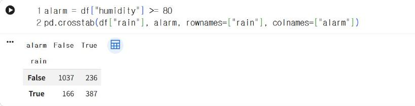
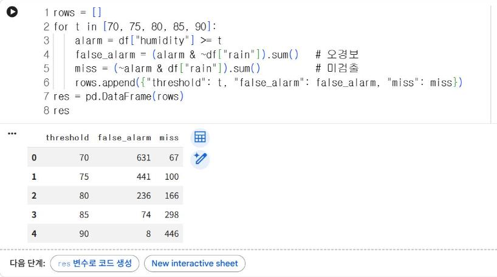
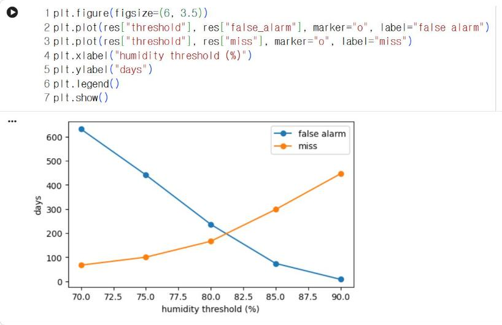

# 7.3 오경보와 미검출

판정 규칙은 두 종류의 오류를 발생시킨다. 사건이 발생하지 않았는데 경보를 발생시키는 오경보(false alarm)와, 사건이 발생했는데 경보를 발생시키지 않는 미검출(miss)이다. 이 절에서는 정답이 확인된 자료에 판정 규칙을 적용해 두 오류를 집계하고, 임계값에 따라 두 오류가 어떻게 변화하는지 확인한다.

| | 경보 발생 | 경보 없음 |
|---|---|---|
| **사건 발생** | 정상 검출 | 미검출 |
| **사건 없음** | 오경보 | 정상 판정 |

## 습도 경보 규칙

습도 센서 하나로 「비가 오는 날」을 판정하는 경보 장치를 가정한다. 정답은 일강수량 1.0 mm 이상(6.2절의 강수일 기준)이다. 먼저 강수일과 무강수일의 습도 분포를 비교한다.

```python
df["rain"] = df["precip_mm"] >= 1.0
print(df["rain"].sum(), "일")
df.groupby("rain")["humidity"].describe().round(1)
```

**실행 결과**

```text
553 일
        count  mean   std   min   25%   50%   75%   max
rain                                                   
False  1273.0  67.2  13.2  21.0  58.0  69.0  77.0  94.0
True    553.0  81.5   9.9  41.0  78.0  84.0  88.0  96.0
```

<figure markdown="span">
  
  <figcaption>그림 7-8 Colab에서 실행한 강수일(True)·무강수일(False)의 습도 기술통계</figcaption>
</figure>

강수일 553일의 습도 중앙값은 84%, 무강수일의 중앙값은 69%다. 강수일의 습도가 전반적으로 높지만, 무강수일의 75% 분위수(77%)와 강수일의 25% 분위수(78%)가 거의 같다. 두 분포의 범위가 상당 부분 중첩되므로, 어떤 임계값을 정해도 두 종류의 오류가 함께 발생한다.

## 오경보와 미검출의 집계

습도 80% 이상이면 경보를 발생시키는 규칙을 적용하고, 실제 강수 여부와의 교차표를 산출한다.

```python
alarm = df["humidity"] >= 80
pd.crosstab(df["rain"], alarm, rownames=["rain"], colnames=["alarm"])
```

**실행 결과**

```text
alarm  False  True 
rain               
False   1037    236
True     166    387
```

<figure markdown="span">
  
  <figcaption>그림 7-9 Colab에서 산출한 습도 80% 경보 규칙과 실제 강수 여부의 교차표</figcaption>
</figure>

| | 경보 발생(True) | 경보 없음(False) |
|---|---|---|
| **강수(True)** | 387 (정상 검출) | 166 (미검출) |
| **무강수(False)** | 236 (오경보) | 1,037 (정상 판정) |

습도 80% 규칙은 비가 오지 않은 236일에 경보를 발생시키고, 비가 온 166일에는 경보를 발생시키지 않았다. 10.3절의 혼동행렬에서는 오경보를 거짓양성(FP), 미검출을 거짓음성(FN)이라고 한다.

## 임계값 조정에 따른 상충

임계값을 70%부터 90%까지 5% 간격으로 변경하면서 두 오류를 집계한다. `~`는 참과 거짓을 반전하고, `&`는 두 조건이 모두 참인 경우에 참이다.

```python
rows = []
for t in [70, 75, 80, 85, 90]:
    alarm = df["humidity"] >= t
    false_alarm = (alarm & ~df["rain"]).sum()   # 오경보
    miss = (~alarm & df["rain"]).sum()          # 미검출
    rows.append({"threshold": t, "false_alarm": false_alarm, "miss": miss})
res = pd.DataFrame(rows)
res
```

**실행 결과**

```text
   threshold  false_alarm  miss
0         70          631    67
1         75          441   100
2         80          236   166
3         85           74   298
4         90            8   446
```

<figure markdown="span">
  
  <figcaption>그림 7-10 Colab에서 집계한 임계값별 오경보·미검출 일수</figcaption>
</figure>

```python
plt.figure(figsize=(6, 3.5))
plt.plot(res["threshold"], res["false_alarm"], marker="o", label="false alarm")
plt.plot(res["threshold"], res["miss"], marker="o", label="miss")
plt.xlabel("humidity threshold (%)")
plt.ylabel("days")
plt.legend()
plt.show()
```

<figure markdown="span">
  
  <figcaption>그림 7-11 Colab에서 출력한 습도 임계값에 따른 오경보·미검출 일수</figcaption>
</figure>

임계값을 70%에서 90%로 높이면 오경보는 631일에서 8일로 감소하고, 미검출은 67일에서 446일로 증가한다. 한쪽 오류를 줄이면 다른 쪽 오류가 증가하는 관계를 상충(trade-off)이라고 한다. 임계값 조정만으로는 두 오류를 동시에 줄일 수 없다. 두 오류를 함께 줄이려면 일조시간처럼 강수와 관련된 다른 측정값을 추가해야 하며, 10장에서 여러 특징을 결합해 판정하는 분류 모델을 학습한다.

| 사용 목적 | 더 줄여야 할 오류 | 임계값 조정 방향 |
|---|---|---|
| 우산 지참 알림 | 미검출(비를 맞는 손실) | 임계값을 낮춤 |
| 실외 작업 중지 경보 | 오경보(불필요한 작업 중지 손실) | 임계값을 높임 |
| 작업장 소음 경고(7.4절) | 미검출(청력 보호 실패) | 임계값을 낮춤 |

어느 오류를 우선해서 줄일지는 오류 1건의 손실을 비교해 결정한다. 이 판단은 자료가 아니라 규칙의 사용 목적에서 도출된다.

## 확인 문제

1. `range(60, 96)`의 임계값 중 오경보와 미검출의 합이 최소가 되는 값을 찾으시오.
2. 일조시간 규칙(`df["sunshine_h"] <= 4`이면 경보)의 오경보·미검출 일수를 산출하고, 습도 80% 규칙과 비교하시오.
3. 7.2절의 이동 z-점수 기준을 3에서 2로 낮추면 오경보와 미검출 중 어느 쪽이 증가할지 설명하시오.
