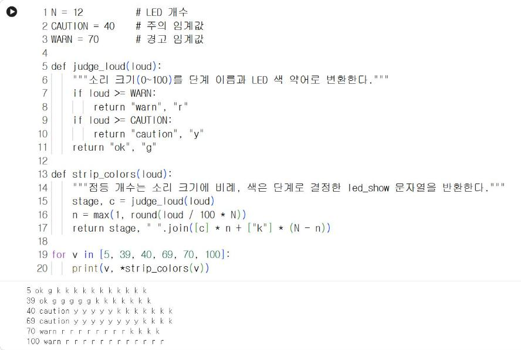
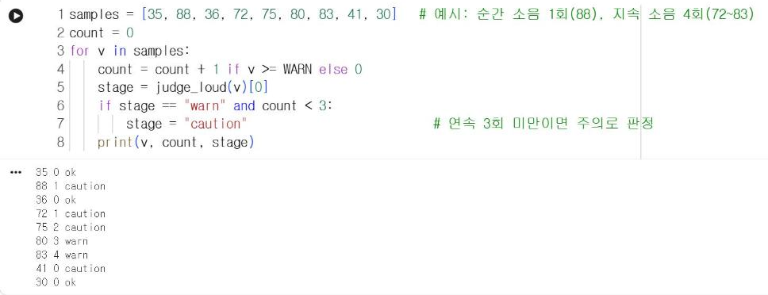

# 7.4 실습: 소음 단계 LED 스트립 신호등

<span class="chip">기기 대여 시 실습</span> <span class="chip">Live 모드</span>

사이버파이의 마이크로 소리 크기를 측정해 정상·주의·경고 3단계로 판정하고, LED 스트립의 점등 개수와 색으로 표시한다. 7.1절의 분위수 임계값과 7.3절의 오경보·미검출 상충을 실제 측정값으로 확인하는 실습이다. 연결 구성은 4.7절과 같다(포켓쉴드 S1 포트, LED 12개).

!!! note "기기를 대여하지 않은 경우"
    2단계의 판정 함수와 4단계의 연속 판정 코드는 사이버파이 없이 Colab에서 실행할 수 있다. 1·3단계는 다음 등교일에 실습한다.

<!-- PHOTO: ch07_photo_setup — 사이버파이+포켓쉴드+LED 스트립(S1) 결합 상태, USB로 PC 연결, 위에서 촬영 -->

## 1단계: 평소 소리 크기 측정

`cyberpi.get_loudness("maximum")`은 짧은 시간 동안 마이크로 측정한 소리 크기의 최댓값을 0~100 범위로 반환한다. Live 모드에서는 프로그램이 PC에서 실행되고 기기는 측정값을 PC로 전달한다. 따라서 측정값을 리스트에 저장한 뒤 PC에서 통계를 산출할 수 있다. 실습실이 평소 상태일 때 30초 동안 측정해 임계값의 근거를 마련한다.

```python
import cyberpi
import time

values = []
for i in range(150):                          # 0.2초 간격 150회 = 30초
    values.append(cyberpi.get_loudness("maximum"))
    time.sleep(0.2)

values.sort()
q50 = values[len(values) // 2]                # 중앙값
q90 = values[int(len(values) * 0.9)]          # 90% 분위수
print("최솟값", values[0], "중앙값", q50, "90% 분위수", q90, "최댓값", values[-1])
```

정렬한 리스트에서 전체 길이의 50%·90% 위치에 있는 값을 선택하면 중앙값과 90% 분위수를 pandas 없이 산출할 수 있다. 측정 결과는 실습실의 환기 장치, 복도 소음, 기기 위치에 따라 달라지므로 다음 표에 기록한다.

| 측정 조건 | 최솟값 | 중앙값 | 90% 분위수 | 최댓값 |
|---|---|---|---|---|
| 평소 상태(30초) | | | | |
| 대화 중(30초) | | | | |

<!-- PHOTO: ch07_photo_live_measure — mBlock Live 모드에서 1단계 코드 실행 후 출력 창(최솟값·중앙값·90% 분위수·최댓값)이 보이는 화면 캡처 -->

## 2단계: 판정 함수와 색 구성

2.4절 확인 문제의 기준(40·70)을 초기 임계값으로 사용한다. 점등 개수는 소리 크기에 비례하고, 색은 단계에 따라 초록(정상)·노랑(주의)·빨강(경고)으로 결정한다. 단계 이름은 출력과 기기 화면에 공통으로 사용하므로 영문으로 작성한다.

```python
N = 12          # LED 개수
CAUTION = 40    # 주의 임계값
WARN = 70       # 경고 임계값

def judge_loud(loud):
    """소리 크기(0~100)를 단계 이름과 LED 색 약어로 변환한다."""
    if loud >= WARN:
        return "warn", "r"
    if loud >= CAUTION:
        return "caution", "y"
    return "ok", "g"

def strip_colors(loud):
    """점등 개수는 소리 크기에 비례, 색은 단계로 결정한 led_show 문자열을 반환한다."""
    stage, c = judge_loud(loud)
    n = max(1, round(loud / 100 * N))
    return stage, " ".join([c] * n + ["k"] * (N - n))

for v in [5, 39, 40, 69, 70, 100]:
    print(v, *strip_colors(v))
```

**실행 결과**

```text
5 ok g k k k k k k k k k k k
39 ok g g g g g k k k k k k k
40 caution y y y y y k k k k k k k
69 caution y y y y y y y y k k k k
70 warn r r r r r r r r k k k k
100 warn r r r r r r r r r r r r
```

<figure markdown="span">
  
  <figcaption>그림 7-12 Colab에서 실행한 소리 크기별 단계와 led_show 색 문자열</figcaption>
</figure>

시험값은 2.4절과 같은 방법으로 경계(39·40, 69·70)와 범위의 양 끝에서 선택했다. `max(1, …)`는 소리가 매우 작아도 LED 1개는 점등해 프로그램이 동작 중임을 표시한다. `print(v, *strip_colors(v))`의 `*`는 함수가 반환한 두 값을 풀어서 각각의 인자로 전달한다.

## 3단계: LED 스트립 신호등

2단계의 함수를 사용해 측정·판정·표시를 반복하는 프로그램을 작성한다. 사이버파이 화면에는 소리 크기와 단계 이름을 표시한다.

```python
import cyberpi
import time

PORT = "s1"
N = 12
CAUTION = 40
WARN = 70

def judge_loud(loud):
    if loud >= WARN:
        return "warn", "r"
    if loud >= CAUTION:
        return "caution", "y"
    return "ok", "g"

def strip_colors(loud):
    stage, c = judge_loud(loud)
    n = max(1, round(loud / 100 * N))
    return stage, " ".join([c] * n + ["k"] * (N - n))

cyberpi.pocket.led_set_bri(30, PORT)
while True:
    loud = cyberpi.get_loudness("maximum")
    stage, colors = strip_colors(loud)
    cyberpi.pocket.led_show(colors, PORT)

    cyberpi.display.clear()
    cyberpi.display.show_label(f"{loud} {stage}", 24, "center")

    if cyberpi.controller.is_press("a"):      # A 단추로 종료
        cyberpi.pocket.led_off("all", PORT)
        break
    time.sleep(0.2)
```

조용한 상태, 보통 크기의 대화, 손뼉 소리에서 점등 개수와 색이 변화하는지 확인한다.

<!-- PHOTO: ch07_photo_stages — LED 스트립 3단계 점등 3장(정상: 초록 1~5개, 주의: 노랑 5~8개, 경고: 빨강 8~12개), 사이버파이 화면의 숫자·단계 이름이 함께 보이게 -->

## 4단계: 임계값 조정 실험

### 임계값 변경

1단계에서 측정한 평소 상태의 90% 분위수를 `CAUTION`으로 설정하고 다음 두 가지를 측정한다. 오경보는 1분 동안 조용히 있을 때 주의·경고가 점등된 횟수, 미검출은 손뼉을 10회 쳤을 때 경고가 점등되지 않은 횟수다.

| CAUTION | WARN | 오경보(조용한 1분) | 미검출(손뼉 10회 중) |
|---|---|---|---|
| 40 | 70 | | |
| 평소 90% 분위수 | 70 | | |
| 평소 90% 분위수 | 60 | | |

### 연속 판정

문 닫는 소리처럼 짧은 순간 소음은 한 번의 측정값만 경고 임계값을 초과한다. 경고 임계값을 연속 3회 초과한 경우에만 경고로 판정하면 순간 소음에 의한 오경보를 줄일 수 있다. 다음 코드는 예시 측정값 목록으로 연속 판정을 시험한다.

```python
samples = [35, 88, 36, 72, 75, 80, 83, 41, 30]   # 예시: 순간 소음 1회(88), 지속 소음 4회(72~83)
count = 0
for v in samples:
    count = count + 1 if v >= WARN else 0
    stage = judge_loud(v)[0]
    if stage == "warn" and count < 3:
        stage = "caution"                          # 연속 3회 미만이면 주의로 판정
    print(v, count, stage)
```

**실행 결과**

```text
35 0 ok
88 1 caution
36 0 ok
72 1 caution
75 2 caution
80 3 warn
83 4 warn
41 0 caution
30 0 ok
```

<figure markdown="span">
  
  <figcaption>그림 7-13 Colab에서 실행한 연속 3회 경고 판정 시험</figcaption>
</figure>

순간 소음 88은 「caution」으로 판정되어 경고가 발생하지 않는다. 지속 소음은 세 번째 측정값 80부터 「warn」으로 판정된다. 오경보가 감소하는 대신 경고가 측정 2회 간격(약 0.4초)만큼 늦게 발생하고, 연속 3회 측정보다 짧게 지속되는 큰 소리는 미검출된다. 7.3절에서 확인한 상충이 판정 방식에서도 나타난다. 3단계 프로그램의 반복문에 같은 `count` 처리를 추가해 실기기로 확인한다.

## 실습 과제

1. 4단계의 표를 완성하고, 작업장 소음 경고에 사용할 임계값 조합을 근거와 함께 제시하시오.
2. 연속 판정 횟수를 2·3·5로 변경하면서 손뼉 10회의 미검출 횟수를 비교하시오.
3. 경고 단계가 3초 이상 지속되면 사이버파이 스피커로 경고음을 출력하도록 수정하시오(`cyberpi.audio.play_tone(주파수, 시간)`).

!!! warning "초안 확인 사항"
    `get_loudness("maximum")`의 반환 범위, `led_show` 문자열 형식, `audio.play_tone` 인자, Live 모드 반복 속도는 Makeblock mCode 공식 문서를 기준으로 작성했다. 실습용 기기와 LED 스트립으로 확인한 뒤 확정한다.
