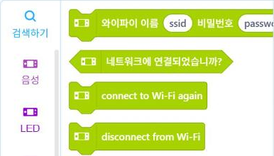

# 8.2 Wi-Fi 접속과 측정값 전송

이 절에서는 Upload 모드로 동작하는 사이버파이를 교내 Wi-Fi에 접속시키고, 측정값을 수업 서버로 전송한다. 이 절의 코드는 2026-2학기 정보통신학과 전파지도 프로젝트와 2026-11-04 측정 노드 실습에서 실제로 동작한 기기 프로그램을 단순화한 것이다.

## 전송 구조

| 단계 | 장치 | 내용 |
|---|---|---|
| 1 | 사이버파이 | 측정값을 JSON 문자열로 구성 |
| 2 | 사이버파이 → 교내 Wi-Fi 공유기 | 무선으로 전송 |
| 3 | 공유기 → 수업 서버(교수 노트북) | 같은 교내망 안에서 전달 |
| 4 | 수업 서버 | 수신 기록을 데이터베이스에 저장, 실시간 화면 갱신(8.3절) |

## Wi-Fi 접속

Upload 모드의 MicroPython은 `network` 모듈로 Wi-Fi에 접속한다. `network.WLAN(network.STA_IF)`는 기기를 공유기에 접속하는 단말(station) 모드로 설정한다.

```python
import network
import time
import cyberpi

WIFI_SSID = "교수자가 안내한 Wi-Fi 이름"
WIFI_PASS = "교수자가 안내한 비밀번호"

def connect_wifi():
    wlan = network.WLAN(network.STA_IF)
    wlan.active(True)
    if not wlan.isconnected():
        cyberpi.console.println("WiFi connecting")
        wlan.connect(WIFI_SSID, WIFI_PASS)
        for _ in range(30):                   # 최대 30초 대기
            if wlan.isconnected():
                break
            time.sleep(1)
    if wlan.isconnected():
        cyberpi.console.println("WiFi OK")
        cyberpi.console.println(wlan.ifconfig()[0])   # 기기에 배정된 IP 주소
    else:
        cyberpi.console.println("WiFi FAIL")
    return wlan
```

| 함수 | 기능 |
|---|---|
| `wlan.active(True)` | Wi-Fi 기능 켜기 |
| `wlan.connect(이름, 비밀번호)` | 공유기 접속 시작(완료를 기다리지 않음) |
| `wlan.isconnected()` | 접속 완료 여부 |
| `wlan.ifconfig()[0]` | 공유기가 기기에 배정한 IP 주소 |

`wlan.connect`는 접속을 시작만 하고 바로 다음 줄로 넘어간다. 그래서 1초마다 `isconnected()`를 확인하면서 최대 30초 기다린다.

!!! warning "Wi-Fi 이름과 비밀번호"
    교내 Wi-Fi 이름과 비밀번호는 수업 당일 교수자가 안내한다. 코드를 개인 블로그나 공개 저장소에 올릴 때는 이 두 값을 지우고 올린다.

mBlock에도 Wi-Fi 접속 블록이 있다. 「인공지능」 범주 맨 위의 「와이파이 이름 … 비밀번호 … 연결」 블록이다. 이 책에서는 수업에서 동작을 검증한 `network` 모듈 코드를 사용한다.

<figure markdown="span">
  
  <figcaption>그림 8-1 mBlock의 Wi-Fi 블록(Upload 모드, 「인공지능」 범주)</figcaption>
</figure>

## JSON 페이로드

전송하는 측정값은 JSON(JavaScript Object Notation) 형식의 문자열로 구성한다. JSON은 3.1절의 딕셔너리와 같은 「이름: 값」 구조를 문자열로 표현하는 형식이다. 수업 서버는 다음 네 항목을 받는다.

| 이름 | 의미 | 예 |
|---|---|---|
| `node_id` | 기기 번호(스티커 번호) | `"S01"` |
| `zone` | 측정 지점 | `"D1"` |
| `rssi` | 측정값(신호 세기, dBm) | `-55` |
| `ssid` | 신호가 가장 강한 공유기 이름 | `"ICT"` |

```python
NODE_ID = "S01"

def make_body(zone, rssi, ssid):
    return ('{"node_id":"%s","zone":"%s","rssi":%d,"ssid":"%s"}'
            % (NODE_ID, zone, rssi, ssid))

print(make_body("D1", -55, "ICT"))
```

**실행 결과**

```text
{"node_id":"S01","zone":"D1","rssi":-55,"ssid":"ICT"}
```

숫자인 `rssi`는 따옴표 없이, 문자열인 나머지 항목은 큰따옴표로 감싼다. 서버가 같은 형식을 수신하는지는 8.3절의 수신 시험 화면에서 확인한다.

## UDP 전송과 실패 처리

웹 페이지처럼 요청을 보내고 응답을 받는 방식은 HTTP다. 그러나 2026-08 측정 노드 개발 과정에서 사이버파이의 HTTP 전송이 동작하지 않아, UDP 방식으로 전송하도록 확정했다. UDP(User Datagram Protocol)는 연결 절차 없이 데이터 묶음(데이터그램)을 바로 보내는 전송 방식이다. 수업 서버는 HTTP와 UDP를 모두 수신하며, UDP로 받은 측정값에는 `200`이 포함된 짧은 응답을 돌려보낸다.

```python
import socket

SERVER_IP = "교수자가 안내한 서버 주소"
UDP_PORT = 8611

def send_udp(body):
    s = socket.socket(socket.AF_INET, socket.SOCK_DGRAM)
    s.settimeout(3)                            # 응답을 3초까지 기다림
    try:
        s.sendto(body.encode(), (SERVER_IP, UDP_PORT))
        resp = s.recv(64)
        return b"200" in resp                  # 서버가 정상 수신하면 True
    except Exception:
        return False
    finally:
        s.close()

def send_measure(wlan, body):
    if not wlan.isconnected():                 # 끊겨 있으면 재접속
        wlan.connect(WIFI_SSID, WIFI_PASS)
        time.sleep(5)
    ok = send_udp(body)
    if not ok:                                 # 실패하면 1회 재시도
        ok = send_udp(body)
    cyberpi.console.println("send OK" if ok else "send FAIL")
    return ok
```

| 실패 원인 | 처리 |
|---|---|
| Wi-Fi 연결이 끊김 | 전송 전에 `isconnected()`를 확인하고 재접속 |
| 서버 응답 없음(3초 초과) | `settimeout(3)` 후 예외 발생 → `False` 반환 |
| 일시적 손실 | 1회 재시도 후 결과를 화면에 표시 |

UDP는 전송 성공을 보장하지 않으므로 서버의 응답으로 성공 여부를 확인한다. 측정 노드 실습에서는 화면에 「send OK」, 「send FAIL」을 표시해 학생이 전송 결과를 바로 확인하도록 했다.

## 실습 과제

1. `connect_wifi()`를 업로드하고 화면에 표시된 IP 주소를 기록하시오. 옆 사람의 IP 주소와 비교해 같은 교내망에 접속했는지 확인하시오.
2. 8.1절 반복 방식 예제의 `measure()`를 수정해, 5초마다 조도값을 `rssi` 항목에 입력해 전송하고 결과를 화면에 표시하시오(수업 서버가 조도 전용 항목을 받도록 설정된 경우에는 교수자 안내에 따른다).
3. 공유기에서 멀리 떨어진 복도 끝에서 전송을 시도하고, 「send FAIL」이 표시되는 위치를 기록하시오.

!!! warning "초안 확인 사항"
    Wi-Fi 접속(`network.WLAN`)과 UDP 전송·응답 확인 구조는 2026-11-04 측정 노드 실습의 기기 프로그램(v4.6)에서 동작을 확인했다. 이 절의 단순화한 코드 자체와 조도값 전송용 서버 설정은 실기기로 확인한 뒤 확정한다. 서버 주소와 포트는 수업용 서버 설정에 따른다.
