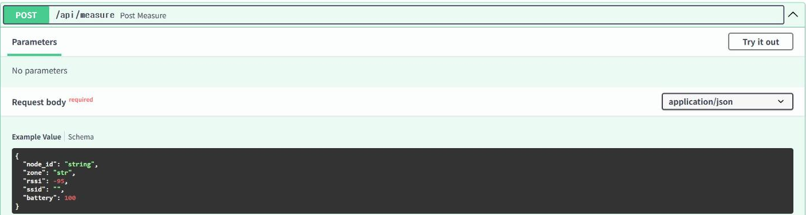
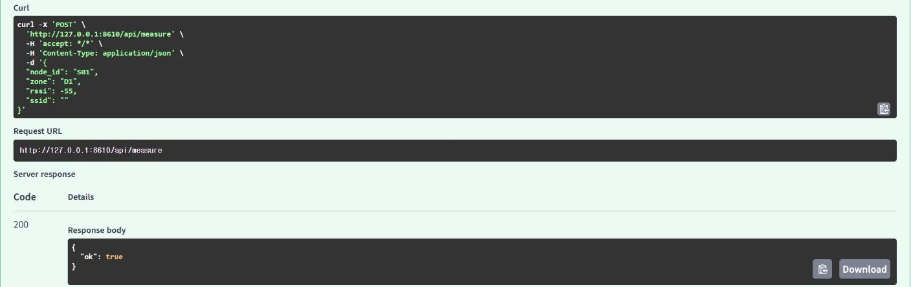
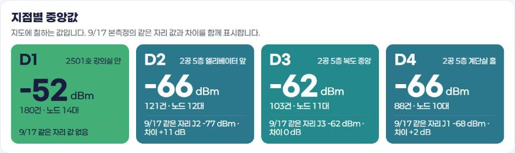
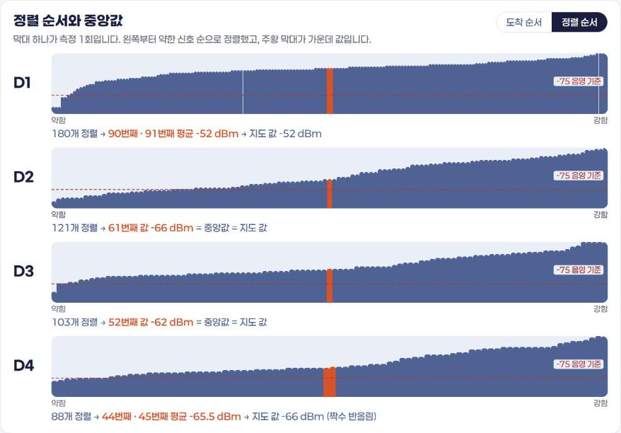
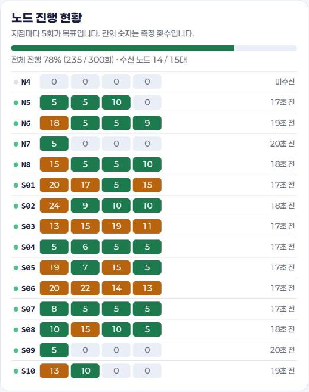

# 8.3 수업 서버 실시간 화면

10대의 사이버파이가 동시에 측정값을 전송하면 수업 서버는 수신한 기록을 저장하고, 지점별 통계를 실시간 화면에 표시한다. 이 절의 화면은 2026-11-04 정보통신학과 수업에서 15대의 측정 노드가 4개 지점(D1~D4)에서 전송한 기록 492건을 수업 서버에 다시 전송해 재현한 것이다. 3.2절과 5.2절에서 분석한 `class_rssi_20261104.csv`가 이 기록이다.

## 서버 수신 구조

수업 서버는 파이썬 웹 프레임워크 FastAPI로 작성했다. 14장에서 FastAPI로 직접 서버를 작성한다.

| 구성 | 역할 |
|---|---|
| HTTP `POST /api/measure` | JSON 측정값 수신(8.2절 형식) |
| UDP 수신부 | 같은 JSON을 UDP로 수신, `200 ok` 응답 |
| SQLite 데이터베이스 | 수신 기록 저장(번호·노드·지점·값·시각) |
| `GET /api/class_live` | 실시간 화면용 통계 제공 |
| `/live` 페이지 | 2초마다 통계를 다시 받아 화면 갱신 |

FastAPI는 서버의 수신 형식을 자동으로 문서화한다. 서버 주소 뒤에 `/docs`를 추가해 접속하면 다음 화면이 표시된다.

<figure markdown="span">
  
  <figcaption>그림 8-2 수업 서버의 자동 문서(/docs): POST /api/measure의 JSON 형식</figcaption>
</figure>

「Example Value」의 JSON이 8.2절의 페이로드와 같은 구조다(`battery`는 선택 항목). 이 화면의 「Try it out」 단추로 PC에서 시험 측정값을 직접 전송할 수 있다.

<figure markdown="span">
  
  <figcaption>그림 8-3 PC에서 시험 측정값을 전송한 결과: 응답 코드 200, {"ok": true}</figcaption>
</figure>

응답 코드 200과 `{"ok": true}`는 서버가 측정값을 정상적으로 저장했다는 의미다. 기기가 전송에 실패할 때 서버 쪽 문제인지 기기 쪽 문제인지 구분하려면, 먼저 이 화면에서 시험 전송이 성공하는지 확인한다.

## 실시간 화면 해석

### 지점별 중앙값

<figure markdown="span">
  
  <figcaption>그림 8-4 실시간 화면의 지점별 중앙값(2026-11-04 수업 기록 재현)</figcaption>
</figure>

| 지점 | 장소 | 중앙값 | 기록 수 | 9/17 같은 자리 값과 차이 |
|---|---|---|---|---|
| D1 | 2501호 강의실 안 | −52 dBm | 180건, 노드 14대 | 9/17 값 없음 |
| D2 | 2공 5층 엘리베이터 앞 | −66 dBm | 121건, 노드 12대 | J2 −77 dBm, +11 dB |
| D3 | 2공 5층 복도 중앙 | −62 dBm | 103건, 노드 11대 | J3 −62 dBm, 0 dB |
| D4 | 2공 5층 계단실 홀 | −66 dBm | 88건, 노드 10대 | J1 −68 dBm, +2 dB |

화면은 평균이 아니라 중앙값을 표시한다. 6.2절에서 확인한 대로 신호 세기 기록에는 이상치가 있으므로, 이상치의 영향을 적게 받는 중앙값을 지점의 대표값으로 사용한다. D3·D4는 9월 17일 측정값과 0~2 dB 차이로 거의 같고, D2는 11 dB 강하게 측정되었다.

### 정렬 순서와 중앙값

<figure markdown="span">
  
  <figcaption>그림 8-5 지점별 측정값을 약한 신호부터 정렬한 막대(주황 막대가 가운데 값)</figcaption>
</figure>

막대 하나가 측정 1회다. 왼쪽부터 약한 신호 순으로 정렬했고, 주황 막대가 정렬한 자료의 가운데 위치다. D1은 180개이므로 90번째와 91번째의 평균 −52 dBm이 중앙값이다. D2는 121개(홀수)이므로 61번째 값 −66 dBm이 중앙값이다. D4는 88개이므로 44번째와 45번째의 평균 −65.5 dBm이 중앙값이며, 지도에는 정수로 반올림한 −66 dBm을 표시한다. 빨간 점선은 이 장비의 음영 기준인 −75 dBm이다. 6.2절의 중앙값 정의를 측정 기록으로 직접 확인할 수 있는 화면이다.

### 노드 진행 현황

<figure markdown="span">
  
  <figcaption>그림 8-6 노드별·지점별 측정 횟수(목표 5회)</figcaption>
</figure>

행은 노드, 열은 D1~D4 지점, 칸의 숫자는 측정 횟수다. 초록 칸은 목표 5회를 채운 지점, 주황 칸은 5회를 넘겨 측정한 지점, 회색 칸은 측정하지 않은 지점이다. 전체 진행률 78%(235/300회)는 노드 15대 × 지점 4곳 × 5회 = 300회 중 지점당 5회까지만 집계한 값이다. N4는 기록이 없어 「미수신」으로 표시되었다. 이 표로 교수자는 수업 중 어느 기기가 전송하지 못하는지, 어느 지점의 측정이 부족한지 확인한다.

!!! note "재현 화면의 시각 표시"
    그림의 「17초 전」 같은 수신 시각은 기록을 다시 전송한 시각 기준이다. 지점별 중앙값, 정렬 막대, 측정 횟수는 2026-11-04 수업 기록과 같다.

<!-- PHOTO: ch08_cap_live_class — 2027 수업 당일 10대 동시 전송 중인 실시간 화면 캡처(가능하면 교실 빔프로젝터 화면 사진 1장) -->

## 확인 문제

1. D1의 기록 수가 다른 지점보다 많은 이유를 노드 진행 현황 표에서 찾아 설명하시오.
2. 노드 진행 현황에서 5회를 크게 넘긴 칸(예: S02의 D1 24회)이 중앙값에 미치는 영향을 6.2절의 내용과 연결해 설명하시오.
3. `class_rssi_20261104.csv`를 Colab에서 불러와 지점별 중앙값을 산출하고, 그림 8-4의 값과 일치하는지 확인하시오.
