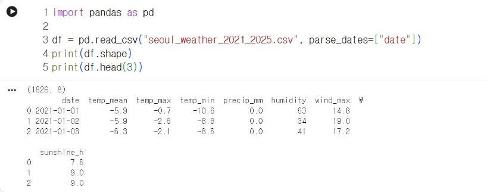
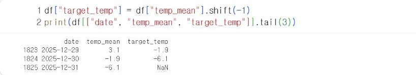
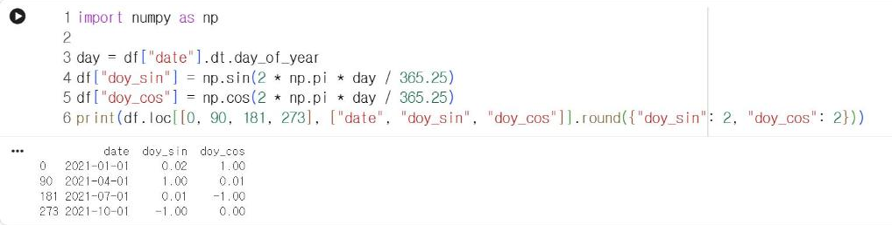
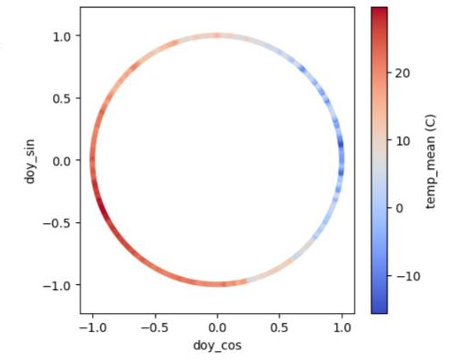

# 9.2 날씨 자료의 특징과 레이블

## 자료 불러오기

장 노트북의 첫 셀로 자료를 내려받거나 자료실의 `seoul_weather_2021_2025.csv`를 Colab에 업로드한 뒤 다음 코드를 실행한다.

```python
import pandas as pd

df = pd.read_csv("seoul_weather_2021_2025.csv", parse_dates=["date"])
print(df.shape)
print(df.head(3))
```

**실행 결과**

```text
(1826, 8)
        date  temp_mean  temp_max  ...  humidity  wind_max  sunshine_h
0 2021-01-01       -5.9      -0.7  ...        63      14.8         7.6
1 2021-01-02       -5.9      -2.8  ...        34      19.0         9.0
2 2021-01-03       -6.3      -2.1  ...        41      17.2         9.0

[3 rows x 8 columns]
```

<figure markdown="span">
  
  <figcaption>그림 9-1 Colab에서 실행한 날씨 자료 불러오기</figcaption>
</figure>

2021-01-01부터 2025-12-31까지 1,826일의 자료이며 열은 8개다. 열의 의미와 단위는 다음과 같다.

| 열 | 의미 | 단위 |
|---|---|---|
| `date` | 날짜 | |
| `temp_mean` | 일평균기온 | ℃ |
| `temp_max` | 일최고기온 | ℃ |
| `temp_min` | 일최저기온 | ℃ |
| `precip_mm` | 일강수량 | mm |
| `humidity` | 일평균 상대습도 | % |
| `wind_max` | 일최대풍속(지상 10 m) | km/h |
| `sunshine_h` | 일조시간 | 시간 |

!!! note "자료의 성격"
    이 자료는 Open-Meteo가 제공하는 서울 지점(위도 37.57, 경도 126.98) 재분석 자료다. 재분석 자료는 관측값을 수치 모델로 보정해 격자 단위로 산출한 값이므로, 기상청 서울 관측소의 실측값과 수치가 다를 수 있다. 출처와 이용 조건은 [부록 D](../appendix/d.md)에 정리했다.

## 레이블 생성

예측 대상은 다음 날 평균기온이다. 각 행에 다음 날의 `temp_mean` 값을 레이블 열 `target_temp`로 추가한다. `shift(-1)`은 열 전체를 한 행 위로 이동한다.

```python
df["target_temp"] = df["temp_mean"].shift(-1)
print(df[["date", "temp_mean", "target_temp"]].tail(3))
```

**실행 결과**

```text
           date  temp_mean  target_temp
1823 2025-12-29        3.1         -1.9
1824 2025-12-30       -1.9         -6.1
1825 2025-12-31       -6.1          NaN
```

<figure markdown="span">
  
  <figcaption>그림 9-2 Colab에서 생성한 다음 날 평균기온 레이블</figcaption>
</figure>

2025-12-29 행의 `target_temp`는 다음 날인 12-30의 평균기온 −1.9℃다. 마지막 날은 다음 날 자료가 없으므로 `NaN`(결측)이며, 9.3절에서 제외한다.

## 계절 위치 특징

기온은 계절에 따라 반복적으로 변동한다. 날짜를 1~366의 연중 일수로 입력하면 12월 31일(365)과 1월 1일(1)이 가장 먼 값이 되지만, 실제로는 하루 차이다. 이 문제를 해결하기 위해 연중 일수를 원 위의 각도로 환산하고 사인·코사인 값 두 개를 특징으로 사용한다.

```python
import numpy as np

day = df["date"].dt.day_of_year
df["doy_sin"] = np.sin(2 * np.pi * day / 365.25)
df["doy_cos"] = np.cos(2 * np.pi * day / 365.25)
print(df.loc[[0, 90, 181, 273], ["date", "doy_sin", "doy_cos"]].round({"doy_sin": 2, "doy_cos": 2}))
```

**실행 결과**

```text
          date  doy_sin  doy_cos
0   2021-01-01     0.02     1.00
90  2021-04-01     1.00     0.01
181 2021-07-01     0.01    -1.00
273 2021-10-01    -1.00     0.00
```

<figure markdown="span">
  
  <figcaption>그림 9-3 Colab에서 산출한 계절 위치 특징 doy_sin·doy_cos</figcaption>
</figure>

`doy_cos`는 1월 초에 1, 7월 초에 −1이므로 겨울과 여름을 구분한다. `doy_sin`은 4월 초에 1, 10월 초에 −1이므로 기온이 상승하는 봄과 하강하는 가을을 구분한다. 두 값을 함께 사용하면 1년의 모든 날짜가 원 위의 한 점으로 표현되고, 12월 31일과 1월 1일은 인접한 점이 된다.

2021년 365일의 두 값을 산점도로 표시하고, 점의 색을 그날의 평균기온으로 지정해 원 위의 위치와 기온의 관계를 확인한다.

```python
import matplotlib.pyplot as plt

one = df[df["date"].dt.year == 2021]
plt.figure(figsize=(5, 4.5))
plt.scatter(one["doy_cos"], one["doy_sin"], c=one["temp_mean"], cmap="coolwarm", s=12)
plt.colorbar(label="temp_mean (C)")
plt.xlabel("doy_cos")
plt.ylabel("doy_sin")
plt.axis("equal")
plt.show()
```

<figure markdown="span">
  
  <figcaption>그림 9-4 Colab에서 출력한 2021년 날짜별 계절 위치와 평균기온(색)</figcaption>
</figure>

1월 1일은 원의 오른쪽 (1, 0)에 위치하고, 날짜가 진행할수록 점은 시계 반대 방향으로 이동한다. 원의 오른쪽에는 겨울의 파란 점이, 왼쪽에는 여름의 빨간 점이 모인다. 원 위의 위치가 연속적으로 변화하면 기온의 색도 연속적으로 변화하므로, 두 특징이 계절 정보를 담고 있음을 확인할 수 있다.

## 확인 문제

1. `shift(-1)` 대신 `shift(1)`을 적용하면 `target_temp`에 어떤 값이 저장되는지 설명하시오.
2. 10월 15일의 `doy_sin`과 `doy_cos` 부호를 예상하고 코드로 확인하시오.
