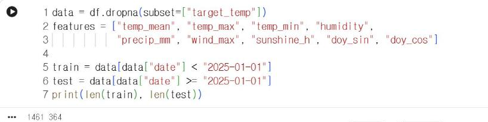
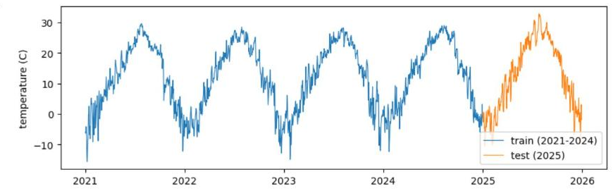

# 9.3 학습 데이터와 평가 데이터의 분할

## 시간 순서 분할

일반적인 머신러닝 실습에서는 자료를 무작위로 섞어 학습 데이터와 평가 데이터로 분할한다. 그러나 날씨처럼 시간 순서가 있는 시계열(time series) 자료를 무작위로 분할하면, 2025년 3월 10일을 평가하는 모델이 3월 9일과 3월 11일 자료로 학습하는 상황이 발생한다. 실제 예측 상황에서는 미래 자료를 사용할 수 없으므로, 이렇게 측정한 성능은 실제보다 높게 산출된다. 평가 대상 시점 이후의 정보가 학습에 포함되는 오류를 정보 누출(data leakage)이라고 한다.

이 장에서는 2021~2024년 자료를 학습 데이터로, 2025년 자료를 평가 데이터로 사용한다. 과거 4년으로 학습하고 다음 1년을 예측하는 구성이므로 실제 사용 조건과 같다.

```python
data = df.dropna(subset=["target_temp"])
features = ["temp_mean", "temp_max", "temp_min", "humidity",
            "precip_mm", "wind_max", "sunshine_h", "doy_sin", "doy_cos"]

train = data[data["date"] < "2025-01-01"]
test = data[data["date"] >= "2025-01-01"]
print(len(train), len(test))
```

**실행 결과**

```text
1461 364
```

<figure markdown="span">
  
  <figcaption>그림 9-5 Colab에서 실행한 학습·평가 데이터 분할</figcaption>
</figure>

학습 데이터는 1,461일(2021~2024년, 윤년 포함), 평가 데이터는 364일이다. 2025년은 365일이지만 마지막 날은 레이블이 결측이므로 `dropna`로 제외되었다.

| 구분 | 기간 | 행 수 | 용도 |
|---|---|---|---|
| 학습 데이터 | 2021-01-01 ~ 2024-12-31 | 1,461 | 모델 계수 결정 |
| 평가 데이터 | 2025-01-01 ~ 2025-12-30 | 364 | 예측 오차 측정 |

`features` 리스트는 9.2절에서 정리한 특징 9개다. 레이블 열 `target_temp`와 날짜 열 `date`는 특징에 포함하지 않는다.

학습 데이터와 평가 데이터를 서로 다른 색의 선으로 표시하면 분할 구조를 확인할 수 있다.

```python
import matplotlib.pyplot as plt

plt.figure(figsize=(10, 3))
plt.plot(train["date"], train["temp_mean"], lw=0.8, label="train (2021-2024)")
plt.plot(test["date"], test["temp_mean"], lw=0.8, label="test (2025)")
plt.ylabel("temperature (C)")
plt.legend()
plt.show()
```

<figure markdown="span">
  
  <figcaption>그림 9-6 Colab에서 출력한 학습 데이터(2021~2024년)와 평가 데이터(2025년)</figcaption>
</figure>

파란 선의 4년으로 계수를 결정하고, 주황 선의 1년으로 오차를 측정한다. 평가 구간은 학습 구간 이후에 위치하므로 모델은 평가 기간의 정보를 학습에 사용하지 않는다.

## 확인 문제

1. 평가 데이터를 2024년, 학습 데이터를 2021~2023년과 2025년으로 구성하면 어떤 문제가 발생하는지 설명하시오.
2. `features`에 `target_temp`를 실수로 포함하면 평가 결과가 어떻게 산출될지 예상하시오.
