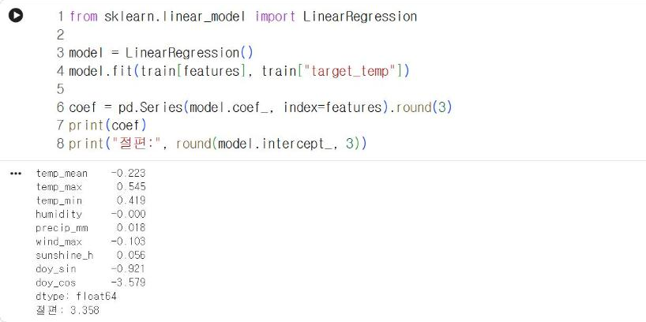
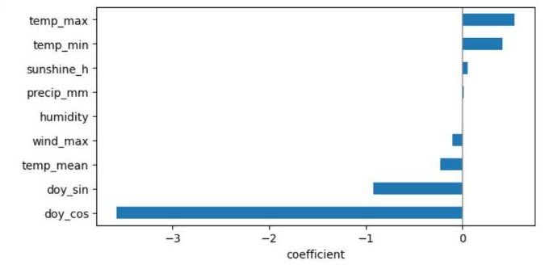
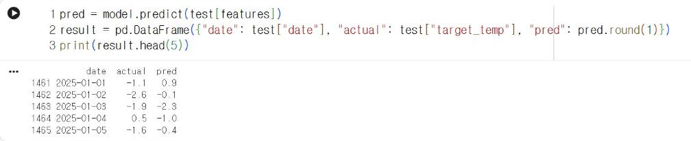

# 9.4 선형회귀를 이용한 다음 날 기온 예측

## 선형회귀

선형회귀(linear regression)는 각 특징에 계수를 곱해 합산한 값으로 레이블을 예측하는 모델이다.

<p class="formula">ŷ = w<sub>1</sub>x<sub>1</sub> + w<sub>2</sub>x<sub>2</sub> + … + w<sub>9</sub>x<sub>9</sub> + b</p>

x<sub>1</sub>~x<sub>9</sub>는 특징 9개, w<sub>1</sub>~w<sub>9</sub>는 계수, b는 절편, ŷ는 예측값이다. 학습 과정에서는 학습 데이터의 예측값과 실제값의 차이를 제곱해 합산한 값이 최소가 되도록 계수와 절편을 결정한다.

## 모델 학습

scikit-learn의 `LinearRegression`으로 모델을 생성하고 `fit`으로 학습한다.

```python
from sklearn.linear_model import LinearRegression

model = LinearRegression()
model.fit(train[features], train["target_temp"])

coef = pd.Series(model.coef_, index=features).round(3)
print(coef)
print("절편:", round(model.intercept_, 3))
```

**실행 결과**

```text
temp_mean    -0.223
temp_max      0.545
temp_min      0.419
humidity     -0.000
precip_mm     0.018
wind_max     -0.103
sunshine_h    0.056
doy_sin      -0.921
doy_cos      -3.579
dtype: float64
절편: 3.358
```

<figure markdown="span">
  
  <figcaption>그림 9-7 Colab에서 학습한 선형회귀 계수와 절편</figcaption>
</figure>

## 계수의 해석

| 특징 | 계수 | 해석 |
|---|---|---|
| `temp_max` | 0.545 | 당일 최고기온이 1℃ 높으면 다음 날 평균기온 예측값이 0.545℃ 증가 |
| `temp_min` | 0.419 | 당일 최저기온이 1℃ 높으면 예측값이 0.419℃ 증가 |
| `temp_mean` | −0.223 | 단독 해석 불가(아래 설명) |
| `wind_max` | −0.103 | 풍속이 강한 날의 다음 날 기온이 낮은 경향 |
| `doy_cos` | −3.579 | 계절 위치에 따른 보정값 |

`temp_mean`의 계수가 음수인 결과는 「당일이 따뜻할수록 다음 날이 춥다」는 의미가 아니다. 평균기온은 최고기온·최저기온과 거의 같은 정보를 담고 있으므로, 세 특징이 함께 입력되면 계수가 서로의 영향을 분담한다. 특징 사이의 상관이 높아 개별 계수를 독립적으로 해석할 수 없는 상태를 다중공선성(multicollinearity)이라고 한다. 세 기온 계수의 합(0.545 + 0.419 − 0.223 = 0.741)이 「당일 기온 전체가 1℃ 높을 때의 증가량」에 가깝다.

계수를 가로 막대그래프로 표시한다.

```python
import matplotlib.pyplot as plt

plt.figure(figsize=(7, 3.5))
coef.sort_values().plot.barh()
plt.axvline(0, color="gray", lw=1)
plt.xlabel("coefficient")
plt.show()
```

<figure markdown="span">
  
  <figcaption>그림 9-8 Colab에서 출력한 선형회귀 계수</figcaption>
</figure>

`doy_cos`의 막대가 가장 길지만, 이 결과만으로 가장 중요한 특징이라고 판단할 수는 없다. 계수의 크기는 특징의 단위에 좌우되기 때문이다. `doy_cos`는 −1~1 범위의 값이고 기온 특징은 −20~40 범위의 값이므로, 계수 크기는 단위가 같은 기온 특징끼리만 비교한다.

## 예측

평가 데이터의 특징을 입력해 2025년의 다음 날 평균기온을 예측한다.

```python
pred = model.predict(test[features])
result = pd.DataFrame({"date": test["date"], "actual": test["target_temp"], "pred": pred.round(1)})
print(result.head(5))
```

**실행 결과**

```text
           date  actual  pred
1461 2025-01-01    -1.1   0.9
1462 2025-01-02    -2.6  -0.1
1463 2025-01-03    -1.9  -2.3
1464 2025-01-04     0.5  -1.0
1465 2025-01-05    -1.6  -0.4
```

<figure markdown="span">
  
  <figcaption>그림 9-9 Colab에서 실행한 2025년 다음 날 평균기온 예측</figcaption>
</figure>

첫 행은 2025-01-01의 자료로 예측한 01-02의 평균기온이다. 실제값은 −1.1℃, 예측값은 0.9℃이므로 오차는 2.0℃다. 9.5절에서 364일 전체의 오차를 지표로 요약한다.

## 확인 문제

1. `features`에서 `temp_mean`을 제외하고 다시 학습한 뒤, `temp_max`·`temp_min` 계수가 어떻게 변화하는지 확인하시오.
2. `doy_sin`·`doy_cos`를 제외하고 학습하면 9.5절의 MAE가 증가하는지 감소하는지 확인하시오.
