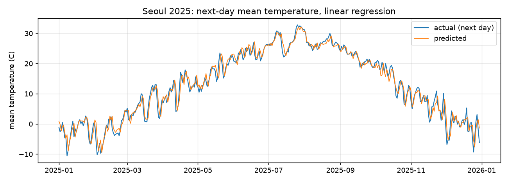

# 9.5 회귀 모델 평가

## 회귀 평가 지표

회귀 모델의 오차는 다음 세 가지 지표로 요약한다.

| 지표 | 정의 | 해석 |
|---|---|---|
| MAE(Mean Absolute Error, 평균절대오차) | 오차 절댓값의 평균 | 평균적으로 몇 ℃ 차이가 발생하는가 |
| RMSE(Root Mean Squared Error, 평균제곱근오차) | 오차 제곱 평균의 제곱근 | 큰 오차에 더 큰 비중을 부여한 오차 |
| 결정계수 R² | 1 − (예측 오차 제곱합 ÷ 레이블 분산 합) | 레이블 변동 중 모델이 설명하는 비율(최댓값 1) |

```python
from sklearn.metrics import mean_absolute_error, mean_squared_error, r2_score

mae = mean_absolute_error(test["target_temp"], pred)
rmse = mean_squared_error(test["target_temp"], pred) ** 0.5
r2 = r2_score(test["target_temp"], pred)
print(f"MAE  {mae:.2f}")
print(f"RMSE {rmse:.2f}")
print(f"R2   {r2:.3f}")
```

**실행 결과**

```text
MAE  1.43
RMSE 1.96
R2   0.969
```

2025년 364일에 대한 예측 오차는 평균 1.43℃다. RMSE가 MAE보다 큰 것은 일부 날짜에서 큰 오차가 발생했음을 의미한다.

## 기준선 모델과의 비교

결정계수 0.969는 높은 값이지만, 이 값만으로 모델이 유용하다고 판단할 수는 없다. 이 자료의 서울 일평균기온은 계절에 따라 −15.6℃에서 32.8℃까지 변동하므로, 계절 변동만 추종해도 결정계수는 높게 산출된다. 모델의 유효성은 가장 단순한 예측 방법인 기준선(baseline) 모델과 비교해 판정한다. 기온 예측에서 대표적인 기준선은 "내일 평균기온은 오늘 평균기온과 같다"는 예측이다.

```python
base = test["temp_mean"]          # 오늘 평균기온을 그대로 내일 예측값으로 사용
base_mae = mean_absolute_error(test["target_temp"], base)
print(f"기준선 MAE {base_mae:.2f}")
```

**실행 결과**

```text
기준선 MAE 1.70
```

| 모델 | MAE(℃) |
|---|---|
| 기준선(오늘 기온 유지) | 1.70 |
| 선형회귀(특징 9개) | 1.43 |

선형회귀는 기준선보다 MAE를 0.27℃, 약 16% 감소시켰다. 이 감소분이 특징 9개와 학습으로 얻은 실제 개선량이다. 머신러닝 모델을 보고할 때는 기준선 수치를 항상 함께 제시한다.

## 예측 결과 그래프



파란 선이 실제값, 주황 선이 예측값이다. 계절 변동은 정확히 추종하지만, 기온이 하루 만에 급변하는 날에는 예측값이 실제값보다 늦게 반응한다.

## 오차가 큰 날짜 분석

```python
result["error"] = (result["actual"] - result["pred"]).abs()
print(result.sort_values("error", ascending=False).head(3))
```

**실행 결과**

```text
           date  actual  pred  error
1562 2025-04-12     4.1  12.0    7.9
1468 2025-01-08   -10.6  -3.6    7.0
1793 2025-11-29    10.1   3.8    6.3
```

오차가 가장 큰 날은 2025-04-12의 자료로 예측한 04-13이다. 평균기온이 04-12의 13.7℃에서 04-13의 4.1℃로 하루 사이에 9.6℃ 하강했고, 이틀 모두 강수가 있었다. 모델은 12.0℃를 예측했다. 01-08의 자료로 예측한 01-09도 평균기온이 −4.2℃에서 −10.6℃로 급격히 하강한 날이다. 반대로 11-29의 자료로 예측한 11-30은 3.8℃에서 10.1℃로 급격히 상승한 날이다. 이런 급변은 주변 지역의 기압계와 기단 이동 정보가 있어야 예측할 수 있다. 서울 한 지점의 하루치 자료만 입력받는 이 모델은 해당 정보를 사용하지 않으므로 급변 예측에 한계가 있다.

## 확인 문제

1. `print(test["target_temp"].std())`로 평가 데이터 레이블의 표준편차를 산출하고, MAE 1.43℃와 비교해 결정계수가 높게 산출된 이유를 설명하시오.
2. 특징에 "어제 평균기온"(`df["temp_mean"].shift(1)`)을 추가하고 MAE가 감소하는지 확인하시오.
3. 오차가 큰 상위 10일을 출력하고, 몇 월에 집중되는지 집계하시오.
