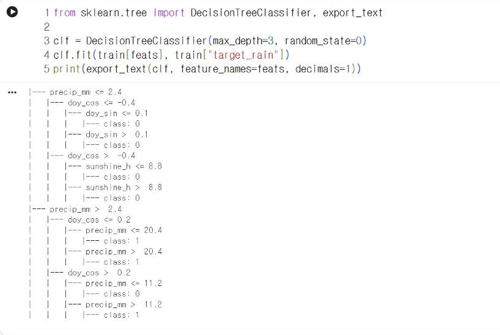
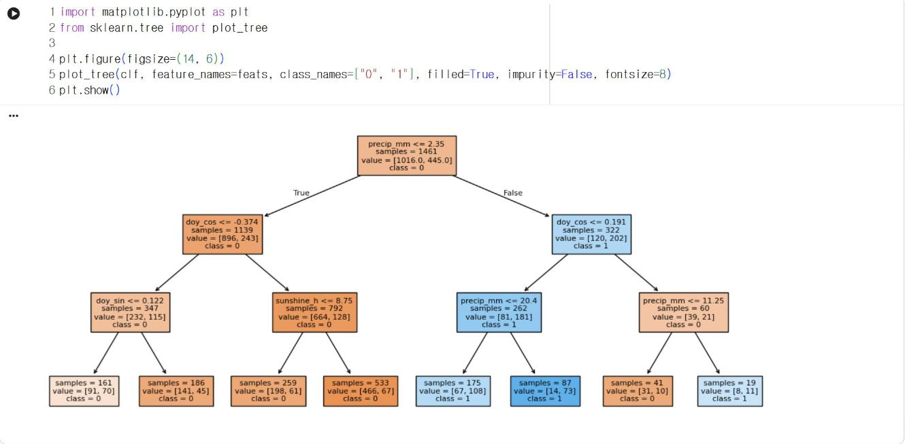

# 10.2 결정트리 분류기

## 결정트리의 구조

결정트리(decision tree)는 「특징 값이 기준보다 작거나 같은가」라는 질문을 반복해 자료를 분할하고, 마지막 분할 영역마다 하나의 범주를 배정하는 모델이다. 학습 과정에서는 각 단계에서 두 범주가 가장 잘 구분되는 특징과 기준값을 자동으로 선택한다. 학습 결과가 조건문 형태로 출력되므로 사람이 판정 근거를 해석할 수 있고, 외부 라이브러리 없이 if 문으로 변환할 수 있다. 이 성질은 11장에서 모델을 사이버파이에 탑재할 때 사용한다.

| 용어 | 의미 |
|---|---|
| 분기(split) | 하나의 특징과 기준값으로 자료를 두 영역으로 분할하는 질문 |
| 깊이(depth) | 뿌리에서 가장 아래 분기까지 질문이 이어지는 단계 수 |
| 잎(leaf) | 더 이상 분할하지 않는 마지막 영역, 하나의 범주를 출력 |

## 모델 학습과 규칙 출력

깊이를 3으로 제한한 결정트리를 학습하고, `export_text`로 분기 규칙을 출력한다.

```python
from sklearn.tree import DecisionTreeClassifier, export_text

clf = DecisionTreeClassifier(max_depth=3, random_state=0)
clf.fit(train[feats], train["target_rain"])
print(export_text(clf, feature_names=feats, decimals=1))
```

**실행 결과**

```text
|--- precip_mm <= 2.4
|   |--- doy_cos <= -0.4
|   |   |--- doy_sin <= 0.1
|   |   |   |--- class: 0
|   |   |--- doy_sin >  0.1
|   |   |   |--- class: 0
|   |--- doy_cos >  -0.4
|   |   |--- sunshine_h <= 8.8
|   |   |   |--- class: 0
|   |   |--- sunshine_h >  8.8
|   |   |   |--- class: 0
|--- precip_mm >  2.4
|   |--- doy_cos <= 0.2
|   |   |--- precip_mm <= 20.4
|   |   |   |--- class: 1
|   |   |--- precip_mm >  20.4
|   |   |   |--- class: 1
|   |--- doy_cos >  0.2
|   |   |--- precip_mm <= 11.2
|   |   |   |--- class: 0
|   |   |--- precip_mm >  11.2
|   |   |   |--- class: 1
```

<figure markdown="span">
  
  <figcaption>그림 10-2 Colab에서 출력한 깊이 3 결정트리의 분기 규칙</figcaption>
</figure>

## 규칙의 해석

`plot_tree`는 같은 트리를 그림으로 표시한다. `filled=True`는 각 상자를 다수 범주의 색으로 칠한다.

```python
import matplotlib.pyplot as plt
from sklearn.tree import plot_tree

plt.figure(figsize=(14, 6))
plot_tree(clf, feature_names=feats, class_names=["0", "1"], filled=True, impurity=False, fontsize=8)
plt.show()
```

<figure markdown="span">
  
  <figcaption>그림 10-3 Colab에서 출력한 깊이 3 결정트리</figcaption>
</figure>

각 상자의 첫 줄은 분기 조건이다. `samples`는 그 영역에 속한 학습 자료 수, `value`는 [무강수, 강수] 건수, `class`는 그 영역에 배정된 범주다. 화살표의 왼쪽(True)은 조건을 만족하는 자료가, 오른쪽(False)은 만족하지 않는 자료가 이동하는 방향이다. 주황 상자는 0(무강수), 파란 상자는 1(강수)이 다수인 영역이며, 색이 진할수록 다수 범주의 비율이 높다. 기준값은 `export_text`의 소수점 1자리 표시(2.4)와 달리 정확한 값(2.35)으로 표시된다. 맨 아래 왼쪽 잎(samples 161, value [91, 70])은 강수일 비율이 43%로 왼쪽 가지의 잎 중 가장 높지만, 무강수일이 더 많으므로 0이 배정되었다.


첫 분기는 당일 강수량이 2.4 mm 이하인가를 판정한다. 학습 알고리즘이 7개 특징 중 당일 강수량을 첫 기준으로 선택했으므로, 당일의 강수 여부가 다음 날 강수 여부와 가장 밀접하다는 의미다.

| 경로 | 조건 | 예측 |
|---|---|---|
| 당일 강수량 2.4 mm 이하 | 모든 하위 경로 | 0(무강수) |
| 당일 강수량 2.4 mm 초과, `doy_cos` 0.2 이하 | 3월 하순~10월 중순(9.2절) | 1(강수) |
| 당일 강수량 2.4 mm 초과, `doy_cos` 0.2 초과 | 10월 중순~3월 하순, 당일 강수량 11.2 mm 이하 | 0(무강수) |
| 〃 | 10월 중순~3월 하순, 당일 강수량 11.2 mm 초과 | 1(강수) |

`doy_cos`가 0.2인 날은 연중 약 80일째(3월 하순)와 약 286일째(10월 중순)다. 정리하면 이 트리는 「당일 비가 2.4 mm를 초과해 내렸고, 3월 하순~10월 중순이거나 강수량이 11.2 mm를 초과하면 다음 날도 비가 온다」고 판정한다. 왼쪽 가지의 잎 4개는 모두 0을 출력한다. 하위 분기가 두 범주의 비율을 변경하기는 하지만, 어느 잎에서도 강수일이 무강수일보다 많지 않으므로 같은 범주가 배정되었다. 따라서 당일 강수량이 2.4 mm 이하인 날은 이 트리가 다음 날 강수를 예측하지 못한다. 10.3절에서 이 결과가 재현율에 미치는 영향을 확인한다.

## 확인 문제

1. `max_depth=2`로 다시 학습하고 출력된 규칙을 표로 정리하시오.
2. 위 트리를 if·elif·else 문으로 작성한 함수 `predict_rain(precip_mm, doy_cos)`로 변환하시오. 오른쪽 가지만 구현하면 된다.
