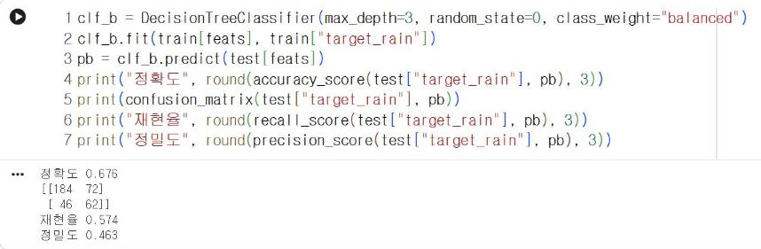
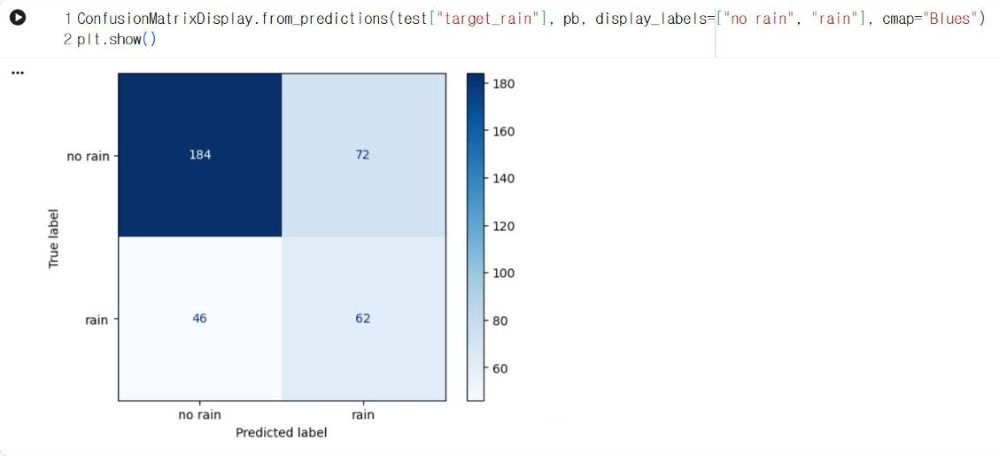
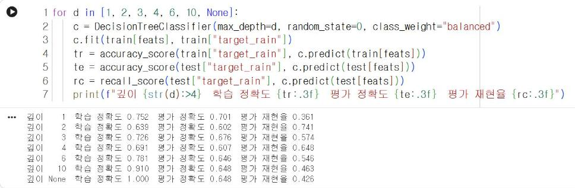
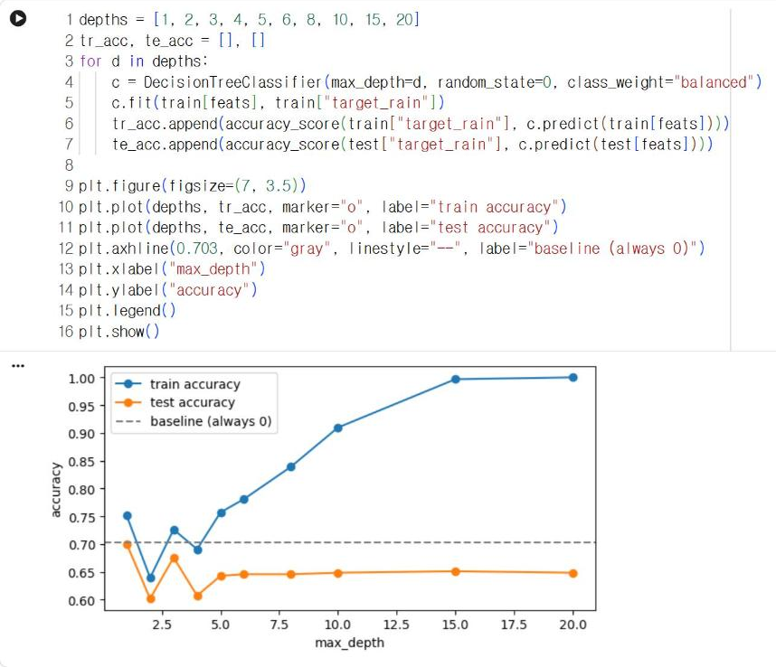

# 10.4 클래스 불균형과 트리 깊이

## 클래스 가중치

학습 자료에서 무강수일이 강수일보다 약 2.3배 많으므로, 결정트리는 무강수를 맞히는 방향으로 분기를 선택한다. `class_weight="balanced"`를 지정하면 적은 범주(강수)의 오류에 더 큰 가중치를 부여해 학습한다.

```python
clf_b = DecisionTreeClassifier(max_depth=3, random_state=0, class_weight="balanced")
clf_b.fit(train[feats], train["target_rain"])
pb = clf_b.predict(test[feats])
print("정확도", round(accuracy_score(test["target_rain"], pb), 3))
print(confusion_matrix(test["target_rain"], pb))
print("재현율", round(recall_score(test["target_rain"], pb), 3))
print("정밀도", round(precision_score(test["target_rain"], pb), 3))
```

**실행 결과**

```text
정확도 0.676
[[184  72]
 [ 46  62]]
재현율 0.574
정밀도 0.463
```

<figure markdown="span">
  
  <figcaption>그림 10-6 Colab에서 산출한 가중치 적용 결정트리의 성능</figcaption>
</figure>

| 모델 | 정확도 | 재현율 | 정밀도 | 미검출(FN) | 오경보(FP) |
|---|---|---|---|---|---|
| 기본 결정트리 | 0.706 | 0.287 | 0.508 | 77 | 30 |
| 가중치 적용 결정트리 | 0.676 | 0.574 | 0.463 | 46 | 72 |

가중치를 적용하자 재현율이 0.287에서 0.574로 증가하고 미검출이 77건에서 46건으로 감소했다. 대신 오경보가 30건에서 72건으로 증가하고 정확도는 0.676으로 감소했다. 미검출과 오경보는 상충(trade-off) 관계이므로, 모델의 사용 목적에 따라 어느 쪽을 우선할지 결정한다.

```python
ConfusionMatrixDisplay.from_predictions(test["target_rain"], pb, display_labels=["no rain", "rain"], cmap="Blues")
plt.show()
```

<figure markdown="span">
  
  <figcaption>그림 10-7 Colab에서 출력한 가중치 적용 결정트리의 혼동행렬</figcaption>
</figure>

10.3절의 기본 결정트리 혼동행렬과 비교하면 왼쪽 아래 칸(미검출)이 77에서 46으로 감소하고, 오른쪽 위 칸(오경보)이 30에서 72로 증가했다.

## 트리 깊이와 과대적합

트리 깊이를 증가시키면 분기가 많아져 학습 자료를 더 세밀하게 분할한다. 깊이별로 학습 정확도와 평가 정확도를 비교한다.

```python
for d in [1, 2, 3, 4, 6, 10, None]:
    c = DecisionTreeClassifier(max_depth=d, random_state=0, class_weight="balanced")
    c.fit(train[feats], train["target_rain"])
    tr = accuracy_score(train["target_rain"], c.predict(train[feats]))
    te = accuracy_score(test["target_rain"], c.predict(test[feats]))
    rc = recall_score(test["target_rain"], c.predict(test[feats]))
    print(f"깊이 {str(d):>4}  학습 정확도 {tr:.3f}  평가 정확도 {te:.3f}  평가 재현율 {rc:.3f}")
```

**실행 결과**

```text
깊이    1  학습 정확도 0.752  평가 정확도 0.701  평가 재현율 0.361
깊이    2  학습 정확도 0.639  평가 정확도 0.602  평가 재현율 0.741
깊이    3  학습 정확도 0.726  평가 정확도 0.676  평가 재현율 0.574
깊이    4  학습 정확도 0.691  평가 정확도 0.607  평가 재현율 0.648
깊이    6  학습 정확도 0.781  평가 정확도 0.646  평가 재현율 0.546
깊이   10  학습 정확도 0.910  평가 정확도 0.648  평가 재현율 0.463
깊이 None  학습 정확도 1.000  평가 정확도 0.648  평가 재현율 0.426
```

<figure markdown="span">
  
  <figcaption>그림 10-8 Colab에서 실행한 트리 깊이별 정확도와 재현율</figcaption>
</figure>

`None`은 깊이 제한이 없다는 의미다. 위 수치는 Colab(2026-11-09)에서 실행한 결과다. 깊이 6 이하의 결과는 다른 PC 환경에서도 같았지만, 깊이 10 이상의 결과는 scikit-learn 버전에 따라 재현율이 0.02 정도 달랐다. 깊은 트리일수록 개선 효과가 같은 분기 후보가 많아지고, 그중 어느 분기를 선택하는지가 버전에 따라 달라질 수 있다. 깊이 제한을 해제하면 학습 정확도는 1.000이 되어 학습 자료를 모두 맞히지만, 평가 정확도는 0.648, 재현율은 0.426에 그친다. 깊이 10에서도 학습 정확도 0.910과 평가 정확도 0.648의 차이가 크다. 학습 자료의 우연한 변동까지 규칙으로 학습한 과대적합(overfitting) 상태다. 깊이가 증가할수록 학습 정확도와 평가 정확도의 차이가 확대되는지 확인하는 것이 과대적합 판정의 기본 절차다.

깊이별 학습 정확도와 평가 정확도를 그래프로 비교한다. 깊이 제한 없음(`None`)은 그래프의 가로축에 표시할 수 없으므로 깊이 20까지 산출한다.

```python
depths = [1, 2, 3, 4, 5, 6, 8, 10, 15, 20]
tr_acc, te_acc = [], []
for d in depths:
    c = DecisionTreeClassifier(max_depth=d, random_state=0, class_weight="balanced")
    c.fit(train[feats], train["target_rain"])
    tr_acc.append(accuracy_score(train["target_rain"], c.predict(train[feats])))
    te_acc.append(accuracy_score(test["target_rain"], c.predict(test[feats])))

plt.figure(figsize=(7, 3.5))
plt.plot(depths, tr_acc, marker="o", label="train accuracy")
plt.plot(depths, te_acc, marker="o", label="test accuracy")
plt.axhline(0.703, color="gray", linestyle="--", label="baseline (always 0)")
plt.xlabel("max_depth")
plt.ylabel("accuracy")
plt.legend()
plt.show()
```

<figure markdown="span">
  
  <figcaption>그림 10-9 Colab에서 출력한 트리 깊이별 학습 정확도와 평가 정확도(회색 점선: 기준선)</figcaption>
</figure>

깊이가 증가할수록 학습 정확도(파란 선)는 1.0에 접근하지만 평가 정확도(주황 선)는 0.65 부근에 머물고, 두 선의 간격이 확대된다. 깊이 20에서 학습 정확도가 1.000에 도달해 깊이 제한 없음(`None`)과 같은 결과가 산출된다. 평가 정확도는 어느 깊이에서도 기준선(회색 점선)을 넘지 못한다.

깊이 2는 재현율이 0.741로 가장 높고, 깊이 3은 정확도와 재현율의 균형이 상대적으로 양호하다. 12장의 날씨 신호등에는 규칙이 짧아 기기 코드로 변환하기 쉬운 깊이 2~3의 트리를 사용한다.

## 모델의 한계

가중치를 적용한 모델은 어느 깊이에서도 평가 정확도가 기준선 0.703을 넘지 못하고, 재현율을 높이면 오경보가 함께 증가한다. 다음 날의 강수는 상층 대기와 주변 지역의 기상 상태에 좌우되므로, 서울 한 지점의 하루치 자료 7개 특징으로는 예측에 한계가 있다. 기상청 예보는 위성·레이더·고층 관측 자료와 수치예보 모델을 사용한다. 12.1절에서는 이 장에서 학습한 모델의 판정과 공개 예보 서비스의 예보를 LED 스트립에 함께 표시해 비교한다.

## 확인 문제

1. 특징에 「전날 강수량」과 「전날 대비 습도 변화량」을 추가하고, 깊이 3 가중치 모델의 재현율이 증가하는지 확인하시오.
2. `clf_b`의 규칙을 `export_text`로 출력하고, 10.2절의 기본 트리와 달라진 분기를 찾으시오.
3. 재현율 0.7 이상, 정밀도 0.4 이상을 동시에 만족하는 깊이가 있는지 위 표에서 확인하고, 없다면 그 이유를 설명하시오.
