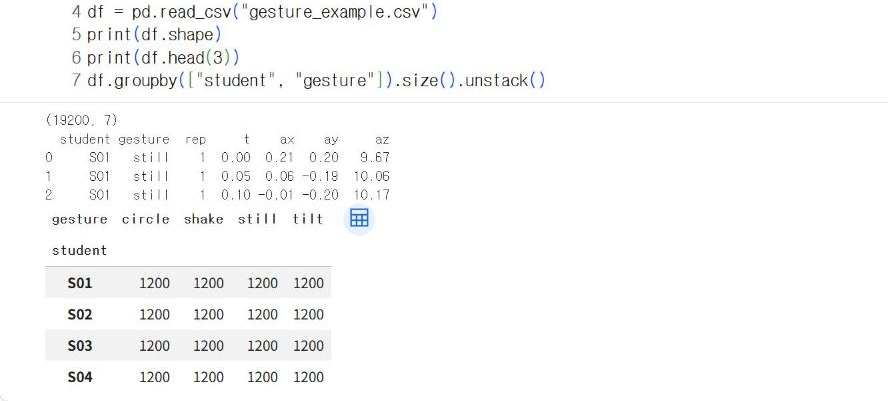
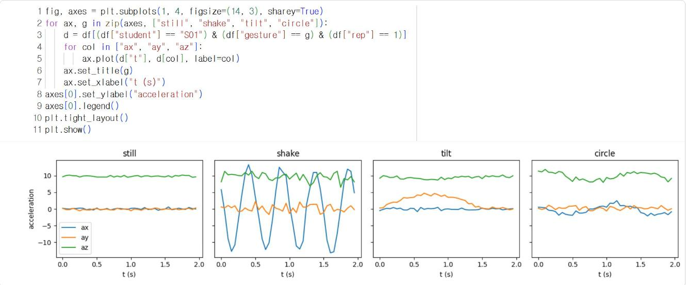
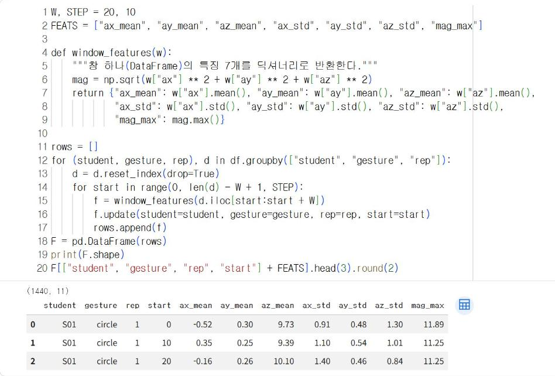
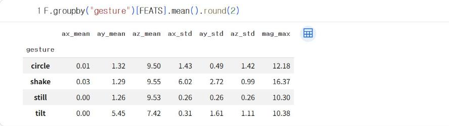
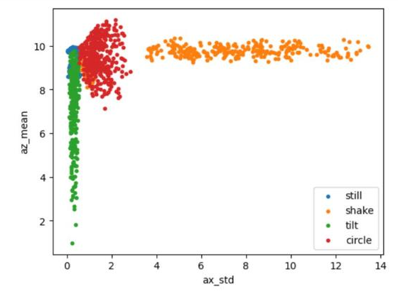

# 11.1 가속도 자료의 구간 특징

가속도 센서는 0.05초마다 3개 축의 값을 기록한다. 측정값 하나만으로는 기기가 흔들리는 중인지, 정지해 있는지 판단할 수 없다. 흔들기는 값이 크게 오르내리는 「변화」로 나타나기 때문이다. 따라서 동작 분류에서는 일정 시간 동안의 측정값을 하나의 구간으로 묶고, 구간의 평균·표준편차 같은 통계값을 특징으로 사용한다.

## 자료 불러오기

8.5절 규칙으로 저장한 파일이 여러 개이면 다음 코드로 하나의 표로 합친다. 파일 이름에서 동작과 수강생 번호를 추출해 열로 추가한다.

```python
import glob
import pandas as pd

def load_gesture_files(pattern="g_*.csv"):
    """8.5절 파일(g_동작_번호.csv)을 모두 읽어 하나의 DataFrame으로 합친다."""
    parts = []
    for path in glob.glob(pattern):
        _, gesture, student = path.replace(".csv", "").split("_")
        d = pd.read_csv(path)
        d["gesture"], d["student"] = gesture, "S" + student
        parts.append(d)
    return pd.concat(parts, ignore_index=True)
```

이 장의 예시 자료는 파일 16개(동작 4종 × 4명)를 이 방법으로 합친 결과와 같은 형식의 파일 하나로 제공한다.

```python
import numpy as np
import matplotlib.pyplot as plt

df = pd.read_csv("gesture_example.csv")
print(df.shape)
print(df.head(3))
df.groupby(["student", "gesture"]).size().unstack()
```

**실행 결과**

```text
(19200, 7)
  student gesture  rep     t    ax    ay     az
0     S01   still    1  0.00  0.21  0.20   9.67
1     S01   still    1  0.05  0.06 -0.19  10.06
2     S01   still    1  0.10 -0.01 -0.20  10.17
gesture  circle  shake  still  tilt
student                            
S01        1200   1200   1200  1200
S02        1200   1200   1200  1200
S03        1200   1200   1200  1200
S04        1200   1200   1200  1200
```

<figure markdown="span">
  
  <figcaption>그림 11-1 Colab에서 불러온 제스처 예시 자료</figcaption>
</figure>

19,200행은 4명 × 동작 4종 × 30회 × 40행이다. 학생·동작 조합마다 1,200행(30회 × 40행)씩 기록되어 있다.

## 동작별 측정값

동작마다 1회 기록(2초)의 가속도 변화를 그래프로 비교한다.

```python
fig, axes = plt.subplots(1, 4, figsize=(14, 3), sharey=True)
for ax, g in zip(axes, ["still", "shake", "tilt", "circle"]):
    d = df[(df["student"] == "S01") & (df["gesture"] == g) & (df["rep"] == 1)]
    for col in ["ax", "ay", "az"]:
        ax.plot(d["t"], d[col], label=col)
    ax.set_title(g)
    ax.set_xlabel("t (s)")
axes[0].set_ylabel("acceleration")
axes[0].legend()
plt.tight_layout()
plt.show()
```

<figure markdown="span">
  
  <figcaption>그림 11-2 학생 S01의 동작별 1회 기록(파랑 ax, 주황 ay, 초록 az)</figcaption>
</figure>

| 동작 | 그래프의 특징 |
|---|---|
| 정지(`still`) | 세 축 모두 거의 일정, `az`는 중력에 해당하는 약 9.8 |
| 흔들기(`shake`) | `ax`가 위아래로 크게 진동 |
| 기울이기(`tilt`) | `az`가 감소했다가 회복하고, `ay`가 증가했다가 회복 |
| 원 그리기(`circle`) | `ax`와 `az`가 완만하게 오르내림 |

기기를 앞으로 기울이면 중력 방향이 기기의 z축에서 y축 쪽으로 이동하므로 `az`는 감소하고 `ay`는 증가한다. 그래프의 모양 차이를 몇 개의 숫자로 요약하는 것이 특징 추출이다.

## 창 크기와 이동 간격

연속된 측정값에서 일정 개수를 잘라 낸 구간을 창(window)이라고 한다. 창을 일정 간격으로 이동하면서 특징을 추출하는 방법을 이동 창(sliding window) 방식이라고 한다.

| 설정 | 값 | 의미 |
|---|---|---|
| 창 크기 `W` | 20행 | 0.05초 × 20 = 1초 동안의 측정값 |
| 이동 간격 `STEP` | 10행 | 0.5초마다 새 창 |
| 회차당 창 개수 | 3개 | 0~19행, 10~29행, 20~39행 |

이동 간격을 창 크기보다 작게 정하면 이웃한 창이 측정값의 절반을 공유한다. 12장에서 사이버파이가 실시간으로 동작을 판정할 때도 「최근 1초 측정값으로 0.5초마다 판정」하는 같은 설정을 사용한다.

## 특징 추출

창마다 축별 평균·표준편차와 가속도 크기의 최댓값을 산출한다. 가속도 크기는 √(ax² + ay² + az²)로, 기기의 방향과 관계없이 가속도의 세기를 나타낸다.

```python
W, STEP = 20, 10
FEATS = ["ax_mean", "ay_mean", "az_mean", "ax_std", "ay_std", "az_std", "mag_max"]

def window_features(w):
    """창 하나(DataFrame)의 특징 7개를 딕셔너리로 반환한다."""
    mag = np.sqrt(w["ax"] ** 2 + w["ay"] ** 2 + w["az"] ** 2)
    return {"ax_mean": w["ax"].mean(), "ay_mean": w["ay"].mean(), "az_mean": w["az"].mean(),
            "ax_std": w["ax"].std(), "ay_std": w["ay"].std(), "az_std": w["az"].std(),
            "mag_max": mag.max()}

rows = []
for (student, gesture, rep), d in df.groupby(["student", "gesture", "rep"]):
    d = d.reset_index(drop=True)
    for start in range(0, len(d) - W + 1, STEP):
        f = window_features(d.iloc[start:start + W])
        f.update(student=student, gesture=gesture, rep=rep, start=start)
        rows.append(f)
F = pd.DataFrame(rows)
print(F.shape)
F[["student", "gesture", "rep", "start"] + FEATS].head(3).round(2)
```

**실행 결과**

```text
(1440, 11)
  student gesture  rep  start  ax_mean  ay_mean  az_mean  ax_std  ay_std  az_std  mag_max
0     S01  circle    1      0    -0.52     0.30     9.73    0.91    0.48    1.30    11.89
1     S01  circle    1     10     0.35     0.25     9.39    1.10    0.54    1.01    11.25
2     S01  circle    1     20    -0.16     0.26    10.10    1.40    0.46    0.84    11.25
```

<figure markdown="span">
  
  <figcaption>그림 11-3 Colab에서 추출한 창별 특징</figcaption>
</figure>

창 1,440개는 기록 480회(4명 × 4종 × 30회) × 회차당 3개다. `start`는 창이 시작하는 행 번호다.

## 동작별 특징 비교

```python
F.groupby("gesture")[FEATS].mean().round(2)
```

**실행 결과**

```text
         ax_mean  ay_mean  az_mean  ax_std  ay_std  az_std  mag_max
gesture                                                            
circle      0.01     1.32     9.50    1.43    0.49    1.42    12.18
shake       0.03     1.29     9.55    6.02    2.72    0.99    16.37
still       0.00     1.26     9.53    0.26    0.26    0.26    10.30
tilt        0.00     5.45     7.42    0.31    1.61    1.11    10.38
```

<figure markdown="span">
  
  <figcaption>그림 11-4 동작별 특징의 평균</figcaption>
</figure>

```python
plt.figure(figsize=(6, 4.5))
for g in ["still", "shake", "tilt", "circle"]:
    d = F[F["gesture"] == g]
    plt.scatter(d["ax_std"], d["az_mean"], s=10, label=g)
plt.xlabel("ax_std")
plt.ylabel("az_mean")
plt.legend()
plt.show()
```

<figure markdown="span">
  
  <figcaption>그림 11-5 창별 ax_std와 az_mean의 산점도</figcaption>
</figure>

`ax_std`(좌우 방향 변동)로 흔들기·원 그리기와 정지·기울이기가 구분되고, `az_mean`(중력 방향)으로 기울이기가 정지와 구분된다. 산점도에서 동작별 점이 서로 다른 영역에 모이면 분류 모델이 높은 정확도를 산출할 수 있다. 일부 점이 다른 동작의 영역에 섞여 있는 것은 약하게 수행한 회차나 손이 떨린 회차다.

## 확인 문제

1. 창 크기를 10행(0.5초)과 40행(2초)으로 변경하면 회차당 창 개수가 각각 몇 개가 되는지 계산하시오(이동 간격은 창 크기의 절반).
2. 특징에 `mag_std`(가속도 크기의 표준편차)를 추가하고, 동작별 평균을 비교하시오.
3. 학생별로 정지 자세의 `ay_mean`과 `az_mean`을 비교하고(`F[F["gesture"] == "still"].groupby("student")[["ay_mean", "az_mean"]].mean()`), 값이 다른 학생이 기기를 어떻게 쥐었는지 중력 방향으로 설명하시오. 12.3절에서 이 차이를 다시 다룬다.
