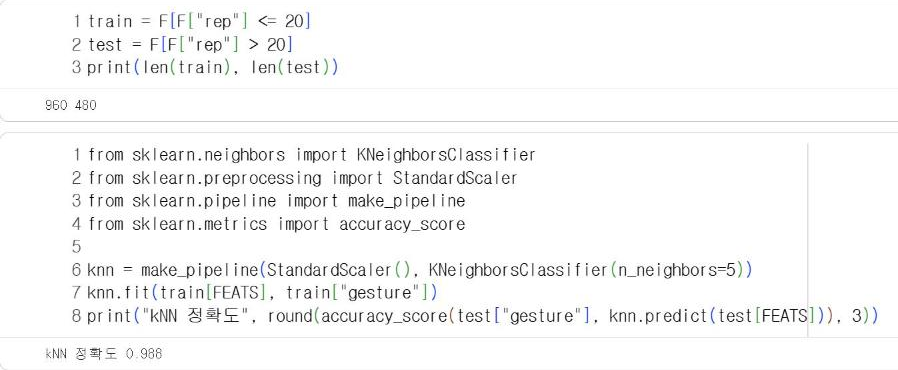
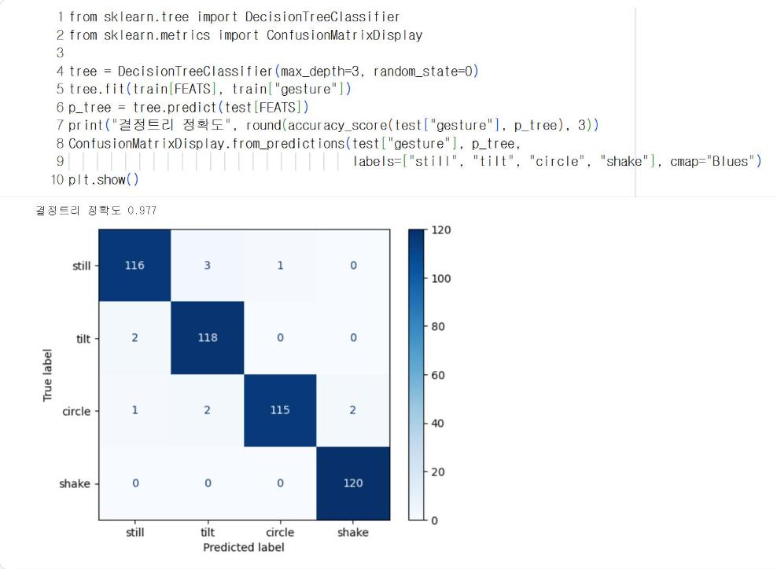

# 11.2 kNN과 결정트리 비교

이 절에서는 11.1절의 창별 특징으로 두 종류의 분류기를 학습하고 비교한다. kNN은 거리를 기준으로 분류하고, 결정트리는 규칙을 기준으로 분류한다. 정확도와 함께 판정 근거의 해석 가능성, 사이버파이 탑재 가능성을 비교한다.

## 학습 데이터와 평가 데이터

한 회차에서 추출한 창 3개는 측정값의 절반을 서로 공유한다. 같은 회차의 창이 학습 데이터와 평가 데이터에 나뉘어 들어가면, 모델은 평가 창과 거의 같은 자료로 학습한 셈이 되어 정확도가 실제보다 높게 산출된다. 9.3절의 정보 누출과 같은 문제다. 따라서 창 단위가 아니라 회차 단위로 분할한다. 1~20회는 학습 데이터, 21~30회는 평가 데이터로 사용한다.

```python
train = F[F["rep"] <= 20]
test = F[F["rep"] > 20]
print(len(train), len(test))
```

**실행 결과**

```text
960 480
```

## kNN 거리 기반 분류

kNN(k-Nearest Neighbors, k-최근접 이웃)은 새 자료와 가장 가까운 학습 자료 k개를 찾고, 그중 가장 많은 범주로 분류한다. 가깝다는 것은 특징 7개로 구성한 공간에서의 거리가 짧다는 의미다.

특징마다 값의 범위가 다르다는 점에 주의한다. `az_mean`은 9.8 부근의 값이고 `ax_std`는 0.1~8 범위의 값이다. 범위가 넓은 특징이 거리를 좌우하지 않도록, `StandardScaler`로 특징마다 평균 0, 표준편차 1이 되도록 변환한 뒤 거리를 산출한다. 7.2절의 표준화와 같은 변환이다. `make_pipeline`은 변환과 분류를 하나의 모델로 묶는다.

```python
from sklearn.neighbors import KNeighborsClassifier
from sklearn.preprocessing import StandardScaler
from sklearn.pipeline import make_pipeline
from sklearn.metrics import accuracy_score

knn = make_pipeline(StandardScaler(), KNeighborsClassifier(n_neighbors=5))
knn.fit(train[FEATS], train["gesture"])
print("kNN 정확도", round(accuracy_score(test["gesture"], knn.predict(test[FEATS])), 3))
```

**실행 결과**

```text
kNN 정확도 0.988
```

<figure markdown="span">
  
  <figcaption>그림 11-6 Colab에서 실행한 kNN(k=5) 학습과 평가</figcaption>
</figure>

## 결정트리 규칙 기반 분류

10장과 같은 방법으로 깊이 3의 결정트리를 학습한다.

```python
from sklearn.tree import DecisionTreeClassifier
from sklearn.metrics import ConfusionMatrixDisplay

tree = DecisionTreeClassifier(max_depth=3, random_state=0)
tree.fit(train[FEATS], train["gesture"])
p_tree = tree.predict(test[FEATS])
print("결정트리 정확도", round(accuracy_score(test["gesture"], p_tree), 3))
ConfusionMatrixDisplay.from_predictions(test["gesture"], p_tree,
                                        labels=["still", "tilt", "circle", "shake"], cmap="Blues")
plt.show()
```

**실행 결과**

```text
결정트리 정확도 0.977
```

<figure markdown="span">
  
  <figcaption>그림 11-7 Colab에서 출력한 깊이 3 결정트리의 정확도와 혼동행렬</figcaption>
</figure>

평가 창 480개 중 오류는 11개다. 대부분 정지와 기울이기 사이(정지 → 기울이기 3개, 기울이기 → 정지 2개)와 원 그리기(원 → 기울이기 2개, 원 → 흔들기 2개, 원 → 정지 1개)에서 발생했고, 흔들기 120개는 모두 맞혔다. 약하게 기울인 회차는 정지와, 작게 그린 원은 정지·기울이기와 특징이 비슷해지기 때문이다.

## 두 분류기의 비교

| 항목 | kNN(k=5) | 결정트리(깊이 3) |
|---|---|---|
| 평가 정확도 | 0.988 | 0.977 |
| 판정 근거 | 가까운 학습 창 5개의 다수결, 규칙으로 설명하기 어려움 | `ax_std <= 0.60`처럼 사람이 읽을 수 있는 규칙 |
| 판정에 필요한 자료 | 학습 창 960개의 특징 전체(960 × 7 = 6,720개 값) | 기준값 몇 개 |
| 판정 1회의 계산 | 학습 창 960개와의 거리 계산 | 비교 연산 최대 3회 |
| 사이버파이 탑재 | 메모리·계산량 부담이 크고 외부 라이브러리 필요 | if 문으로 변환해 그대로 탑재 가능(11.3절) |

이 자료에서는 kNN의 정확도가 약간 높다. 그러나 기기에서 0.5초마다 판정해야 하는 조건에서는 학습 자료 전체를 저장하고 매번 거리를 계산하는 kNN보다, 비교 몇 번으로 판정하는 결정트리가 적합하다. 정확도 차이가 작다면 해석 가능성과 탑재 비용을 함께 고려해 모델을 선택한다.

## 확인 문제

1. kNN의 `n_neighbors`를 1, 3, 15로 변경하고 평가 정확도를 비교하시오.
2. `StandardScaler`를 제거한 kNN(`KNeighborsClassifier(n_neighbors=5)`만 사용)의 정확도를 산출하고, 이 자료에서 표준화의 효과가 어떻게 나타나는지 설명하시오.
3. 회차 단위가 아니라 창 단위로 무작위 분할(`train_test_split`)하면 정확도가 어떻게 변화하는지 확인하고, 그 이유를 설명하시오.
