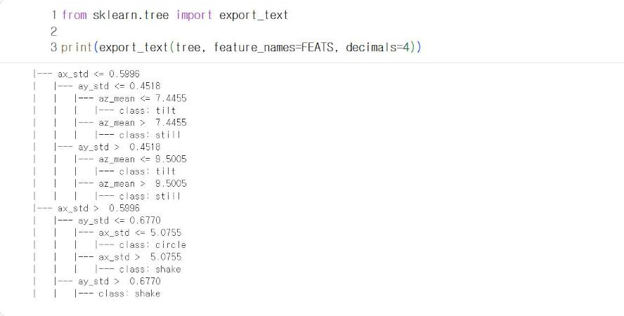
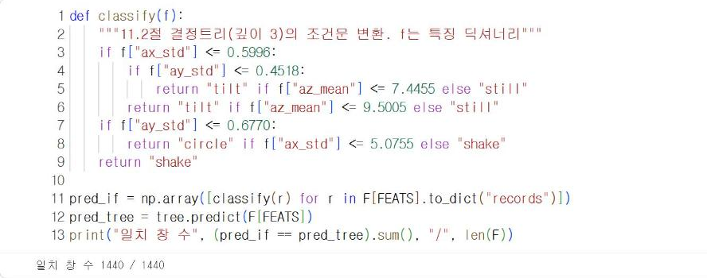

# 11.3 결정트리의 조건문 변환

사이버파이의 MicroPython에서는 scikit-learn을 사용할 수 없다. 학습한 결정트리를 기기에서 실행하려면 분기 규칙을 if 문으로 변환해야 한다. 12.1절에서 날씨 모델을 변환한 방법을 동작 분류 모델에 적용한다.

## export_text 출력 해석

조건문에는 정확한 기준값이 필요하므로 `decimals=4`로 소수 넷째 자리까지 출력한다.

```python
from sklearn.tree import export_text

print(export_text(tree, feature_names=FEATS, decimals=4))
```

**실행 결과**

```text
|--- ax_std <= 0.5996
|   |--- ay_std <= 0.4518
|   |   |--- az_mean <= 7.4455
|   |   |   |--- class: tilt
|   |   |--- az_mean >  7.4455
|   |   |   |--- class: still
|   |--- ay_std >  0.4518
|   |   |--- az_mean <= 9.5005
|   |   |   |--- class: tilt
|   |   |--- az_mean >  9.5005
|   |   |   |--- class: still
|--- ax_std >  0.5996
|   |--- ay_std <= 0.6770
|   |   |--- ax_std <= 5.0755
|   |   |   |--- class: circle
|   |   |--- ax_std >  5.0755
|   |   |   |--- class: shake
|   |--- ay_std >  0.6770
|   |   |--- class: shake
```

<figure markdown="span">
  
  <figcaption>그림 11-8 Colab에서 출력한 깊이 3 결정트리의 규칙</figcaption>
</figure>

첫 분기 `ax_std <= 0.5996`은 좌우 방향 변동의 크기로 동작을 둘로 나눈다. 왼쪽 가지(변동이 작음)는 정지와 기울이기, 오른쪽 가지(변동이 큼)는 원 그리기와 흔들기다.

| 경로 | 조건 | 판정 |
|---|---|---|
| 좌우 변동 작음, `ay_std` ≤ 0.4518 | `az_mean` ≤ 7.4455 | 기울이기, 아니면 정지 |
| 좌우 변동 작음, `ay_std` > 0.4518 | `az_mean` ≤ 9.5005 | 기울이기, 아니면 정지 |
| 좌우 변동 큼, `ay_std` ≤ 0.6770 | `ax_std` ≤ 5.0755 | 원 그리기, 아니면 흔들기 |
| 좌우 변동 큼, `ay_std` > 0.6770 | | 흔들기 |

왼쪽 가지의 두 경로는 모두 `az_mean`으로 기울이기와 정지를 구분하지만 기준값이 다르다. 앞뒤 방향 변동(`ay_std`)이 작으면 `az_mean`이 7.45 이하로 크게 감소해야 기울이기로 판정하고, 변동이 크면 9.50 이하에서도 기울이기로 판정한다. 기울이는 동작은 `ay`를 변화시키므로 두 특징을 함께 사용하는 것이다.

## if 문 변환

규칙을 위에서부터 차례로 if 문으로 옮긴다. 들여쓰기 깊이가 트리의 깊이와 같다.

```python
def classify(f):
    """11.2절 결정트리(깊이 3)의 조건문 변환. f는 특징 딕셔너리"""
    if f["ax_std"] <= 0.5996:
        if f["ay_std"] <= 0.4518:
            return "tilt" if f["az_mean"] <= 7.4455 else "still"
        return "tilt" if f["az_mean"] <= 9.5005 else "still"
    if f["ay_std"] <= 0.6770:
        return "circle" if f["ax_std"] <= 5.0755 else "shake"
    return "shake"

pred_if = np.array([classify(r) for r in F[FEATS].to_dict("records")])
pred_tree = tree.predict(F[FEATS])
print("일치 창 수", (pred_if == pred_tree).sum(), "/", len(F))
```

**실행 결과**

```text
일치 창 수 1440 / 1440
```

<figure markdown="span">
  
  <figcaption>그림 11-9 조건문 함수와 원래 결정트리의 판정 일치 검증</figcaption>
</figure>

`A if 조건 else B`는 조건이 참이면 A, 거짓이면 B를 반환하는 한 줄 조건식이다. `to_dict("records")`는 DataFrame의 각 행을 딕셔너리로 변환해 리스트로 반환한다. 1,440개 창 전체에서 조건문 함수와 원래 결정트리의 판정이 일치하면 변환이 정확하다는 의미다.

## MicroPython 특징 계산

기기에는 pandas도 없으므로 평균과 표준편차를 직접 계산하는 함수를 작성한다. pandas의 `std()`는 n − 1로 나누는 표본 표준편차이므로 같은 공식을 사용한다.

```python
def mean(v):
    return sum(v) / len(v)

def std(v):
    m = mean(v)
    return (sum((x - m) ** 2 for x in v) / (len(v) - 1)) ** 0.5

w = df[(df["student"] == "S01") & (df["gesture"] == "shake") & (df["rep"] == 1)].iloc[0:20]
print(round(std(list(w["ax"])), 4), round(w["ax"].std(), 4))
print(round(mean(list(w["az"])), 4), round(w["az"].mean(), 4))
```

**실행 결과**

```text
9.0837 9.0837
10.002 10.002
```

리스트로 계산한 값과 pandas로 계산한 값이 같으면, 기기에서 계산한 특징을 그대로 `classify` 함수에 입력할 수 있다. 이 두 함수와 `classify` 함수는 외부 라이브러리를 사용하지 않으므로 MicroPython에서 그대로 실행된다. 12.2절에서 이 코드를 사이버파이에 탑재한다.

## 확인 문제

1. `classify` 함수의 기준값을 소수 첫째 자리로 반올림(0.6, 0.5, 7.4, 9.5, 0.7, 5.1)하고 일치 창 수를 다시 확인하시오. 일치하지 않는 창이 생긴다면 그 이유를 설명하시오.
2. 깊이 2의 결정트리를 학습하고 if 문으로 변환하시오.
3. `std` 함수를 n으로 나누도록 바꾸면 결과가 어떻게 달라지는지 확인하시오.
