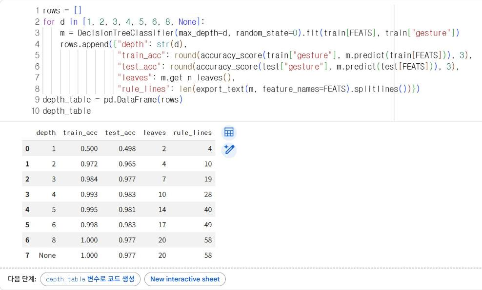
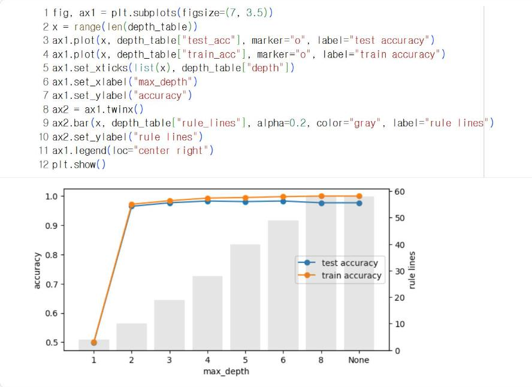

# 11.4 트리 깊이와 정확도의 상충

10.4절에서는 트리 깊이가 증가할수록 학습 정확도와 평가 정확도의 차이가 확대되는 과대적합을 확인했다. 기기에 탑재할 모델은 정확도 외에 코드 길이도 고려해야 한다. 깊이가 1 증가할 때마다 잎의 수와 if 문의 길이가 증가하기 때문이다.

## 깊이별 정확도와 코드 길이

`export_text` 출력의 줄 수를 조건문 코드 길이의 근사값으로 사용한다.

```python
rows = []
for d in [1, 2, 3, 4, 5, 6, 8, None]:
    m = DecisionTreeClassifier(max_depth=d, random_state=0).fit(train[FEATS], train["gesture"])
    rows.append({"depth": str(d),
                 "train_acc": round(accuracy_score(train["gesture"], m.predict(train[FEATS])), 3),
                 "test_acc": round(accuracy_score(test["gesture"], m.predict(test[FEATS])), 3),
                 "leaves": m.get_n_leaves(),
                 "rule_lines": len(export_text(m, feature_names=FEATS).splitlines())})
depth_table = pd.DataFrame(rows)
depth_table
```

**실행 결과**

```text
  depth  train_acc  test_acc  leaves  rule_lines
0     1      0.500     0.498       2           4
1     2      0.972     0.965       4          10
2     3      0.984     0.977       7          19
3     4      0.993     0.983      10          28
4     5      0.995     0.981      14          40
5     6      0.998     0.983      17          49
6     8      1.000     0.977      20          58
7  None      1.000     0.977      20          58
```

<figure markdown="span">
  
  <figcaption>그림 11-10 Colab에서 산출한 깊이별 정확도·잎 수·규칙 줄 수</figcaption>
</figure>

```python
fig, ax1 = plt.subplots(figsize=(7, 3.5))
x = range(len(depth_table))
ax1.plot(x, depth_table["test_acc"], marker="o", label="test accuracy")
ax1.plot(x, depth_table["train_acc"], marker="o", label="train accuracy")
ax1.set_xticks(list(x), depth_table["depth"])
ax1.set_xlabel("max_depth")
ax1.set_ylabel("accuracy")
ax2 = ax1.twinx()
ax2.bar(x, depth_table["rule_lines"], alpha=0.2, color="gray", label="rule lines")
ax2.set_ylabel("rule lines")
ax1.legend(loc="center right")
plt.show()
```

<figure markdown="span">
  
  <figcaption>그림 11-11 깊이별 정확도(선)와 규칙 줄 수(회색 막대)</figcaption>
</figure>

`twinx()`는 같은 가로축에 오른쪽 세로축을 하나 더 만든다. 정확도(왼쪽 축)와 규칙 줄 수(오른쪽 축)처럼 단위가 다른 두 값을 한 그래프에 표시할 때 사용한다.

깊이 1은 잎이 2개뿐이라 동작 4종을 구분할 수 없어 정확도가 0.498이다. 깊이 2(잎 4개)에서 0.965, 깊이 3(잎 7개, 규칙 19줄)에서 0.977, 깊이 4(잎 10개, 28줄)에서 0.983에 도달한 뒤 더 깊어져도 평가 정확도는 증가하지 않는다(0.977~0.983). 반면 학습 정확도는 1.000까지 증가하고 규칙은 58줄까지 길어진다. 깊이 4 이상에서는 코드만 길어지고 평가 정확도의 개선은 없다.

## 탑재 모델 결정

| 판단 기준 | 내용 |
|---|---|
| 정확도 | 평가 정확도가 충분히 높은 가장 작은 깊이 |
| 코드 길이 | 학생이 직접 if 문으로 옮기고 검토할 수 있는 길이 |
| 판정 속도 | 0.5초마다 판정하므로 비교 횟수(깊이)가 작을수록 유리 |
| 일반화 | 학습 정확도와 평가 정확도의 차이가 작은 깊이 |

이 예시 자료에서는 **깊이 3**을 탑재 모델로 결정한다. 깊이 4의 평가 정확도가 0.006 높지만, 평가 창 480개 중 3개 차이이고 규칙은 19줄에서 28줄로 약 1.5배 길어진다. 깊이 3의 학습 정확도(0.984)와 평가 정확도(0.977)의 차이도 0.007로 작다. 실측 자료에서는 결과가 달라질 수 있으므로, 같은 표를 다시 작성해 결정한다(확인 문제 3).

## 확인 문제

1. 깊이 4의 트리를 if 문으로 변환하고, 깊이 3의 `classify` 함수와 줄 수를 비교하시오.
2. 평가 정확도가 가장 높은 깊이가 학습 정확도도 가장 높은지 표에서 확인하고, 그렇지 않다면 이유를 설명하시오.
3. 본인의 실측 제스처 자료로 같은 표를 작성하고, 탑재할 깊이를 근거와 함께 결정하시오.
