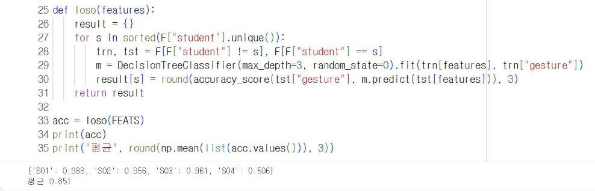
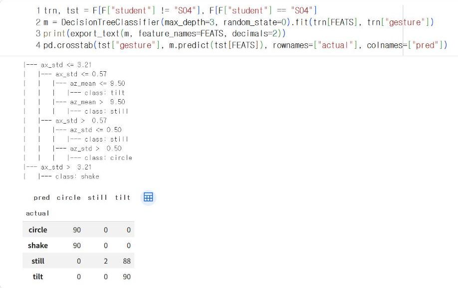
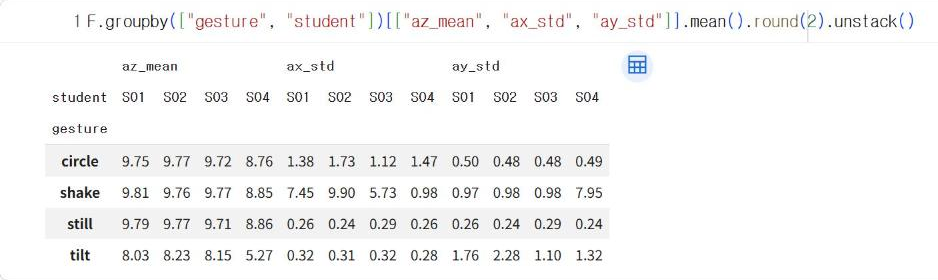
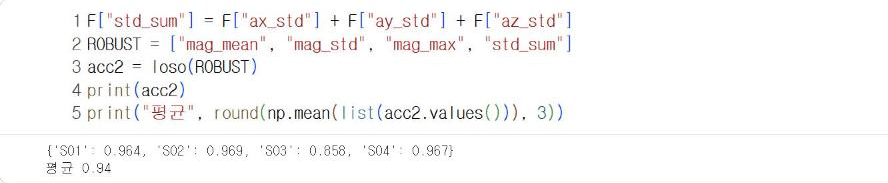

# 12.3 교차 평가

11장에서는 같은 학생들의 1~20회로 학습하고 21~30회로 평가했다. 평가 데이터에도 학습에 사용한 학생의 동작이 들어 있었다. 그러나 실제로 기기를 사용할 사람은 학습 자료에 없는 사람일 수 있다. 이 절에서는 한 학생을 평가용으로 남기고 나머지 학생으로 학습하는 교차 평가로, 처음 보는 사람의 동작에서도 모델이 동작하는지 확인한다.

!!! warning "예시 자료로 산출한 결과"
    이 절의 수치는 11장 예시 자료(가상 수강생 4명)로 산출했다. 예시 자료의 학생 S04는 다른 학생과 동작 습관이 다르도록 생성했다. 실측 자료에서는 수강생 10명으로 같은 절차를 실행한다.

## 교차 평가 절차

| 단계 | 내용 |
|---|---|
| 1 | 학생 한 명을 평가 학생으로 정한다 |
| 2 | 나머지 학생의 모든 창으로 결정트리(깊이 3)를 학습한다 |
| 3 | 평가 학생의 모든 창으로 정확도를 산출한다 |
| 4 | 모든 학생이 한 번씩 평가 학생이 되도록 1~3단계를 반복한다 |

한 명씩 빼고 학습하는 이 방법을 LOSO(Leave-One-Subject-Out) 교차 평가라고 한다. 다음 코드는 11.1절의 특징 추출 코드를 실행해 `F`를 준비한 뒤 실행한다.

```python
import numpy as np
import pandas as pd
from sklearn.tree import DecisionTreeClassifier, export_text
from sklearn.metrics import accuracy_score

df = pd.read_csv("gesture_example.csv")
W, STEP = 20, 10
FEATS = ["ax_mean", "ay_mean", "az_mean", "ax_std", "ay_std", "az_std", "mag_max"]

def window_features(w):
    mag = np.sqrt(w["ax"] ** 2 + w["ay"] ** 2 + w["az"] ** 2)
    return {"ax_mean": w["ax"].mean(), "ay_mean": w["ay"].mean(), "az_mean": w["az"].mean(),
            "ax_std": w["ax"].std(), "ay_std": w["ay"].std(), "az_std": w["az"].std(),
            "mag_max": mag.max(), "mag_mean": mag.mean(), "mag_std": mag.std()}

rows = []
for (student, gesture, rep), d in df.groupby(["student", "gesture", "rep"]):
    d = d.reset_index(drop=True)
    for start in range(0, len(d) - W + 1, STEP):
        f = window_features(d.iloc[start:start + W])
        f.update(student=student, gesture=gesture, rep=rep)
        rows.append(f)
F = pd.DataFrame(rows)

def loso(features):
    result = {}
    for s in sorted(F["student"].unique()):
        trn, tst = F[F["student"] != s], F[F["student"] == s]
        m = DecisionTreeClassifier(max_depth=3, random_state=0).fit(trn[features], trn["gesture"])
        result[s] = round(accuracy_score(tst["gesture"], m.predict(tst[features])), 3)
    return result

acc = loso(FEATS)
print(acc)
print("평균", round(np.mean(list(acc.values())), 3))
```

**실행 결과**

```text
{'S01': 0.983, 'S02': 0.956, 'S03': 0.961, 'S04': 0.506}
평균 0.851
```

<figure markdown="span">
  
  <figcaption>그림 12-1 Colab에서 실행한 학생별 LOSO 교차 평가 정확도</figcaption>
</figure>

이 장의 특징 계산 함수는 11.1절의 함수에 가속도 크기의 평균(`mag_mean`)과 표준편차(`mag_std`)를 추가했다. 아래의 개선 실험에서 사용한다.

S01·S02·S03의 정확도는 0.956~0.983으로 11.2절의 평가 정확도(0.977)와 비슷하다. 그러나 S04는 0.506으로 절반 수준이고, 평균도 0.851로 11.2절보다 0.126 낮다. 같은 학생의 다른 회차로 평가한 11.2절의 정확도는, 처음 보는 사람이 사용할 때의 성능을 실제보다 높게 나타낼 수 있다는 의미다.

## 정확도 하락 원인 분석

S04를 평가 학생으로 두고 학습한 트리의 규칙과 S04의 판정 결과를 확인한다.

```python
trn, tst = F[F["student"] != "S04"], F[F["student"] == "S04"]
m = DecisionTreeClassifier(max_depth=3, random_state=0).fit(trn[FEATS], trn["gesture"])
print(export_text(m, feature_names=FEATS, decimals=2))
pd.crosstab(tst["gesture"], m.predict(tst[FEATS]), rownames=["actual"], colnames=["pred"])
```

**실행 결과**

```text
|--- ax_std <= 3.21
|   |--- ax_std <= 0.57
|   |   |--- az_mean <= 9.50
|   |   |   |--- class: tilt
|   |   |--- az_mean >  9.50
|   |   |   |--- class: still
|   |--- ax_std >  0.57
|   |   |--- az_std <= 0.50
|   |   |   |--- class: still
|   |   |--- az_std >  0.50
|   |   |   |--- class: circle
|--- ax_std >  3.21
|   |--- class: shake

pred    circle  still  tilt
actual                     
circle      90      0     0
shake       90      0     0
still        0      2    88
tilt         0      0    90
```

<figure markdown="span">
  
  <figcaption>그림 12-2 S04를 제외하고 학습한 트리의 규칙과 S04의 판정 결과</figcaption>
</figure>

S04를 제외하고 학습한 트리는 `ax_std > 3.21`을 흔들기의 조건으로 학습했다. 학습에 사용한 S01~S03이 모두 좌우(x축)로 흔들었기 때문이다. S04의 판정 결과에는 두 종류의 오류가 나타난다. 흔들기 90개가 모두 원 그리기로, 정지 90개 중 88개가 기울이기로 판정되었다.

```python
F.groupby(["gesture", "student"])[["az_mean", "ax_std", "ay_std"]].mean().round(2).unstack()
```

**실행 결과**

```text
        az_mean                   ax_std                   ay_std                  
student     S01   S02   S03   S04    S01   S02   S03   S04    S01   S02   S03   S04
gesture                                                                            
circle     9.75  9.77  9.72  8.76   1.38  1.73  1.12  1.47   0.50  0.48  0.48  0.49
shake      9.81  9.76  9.77  8.85   7.45  9.90  5.73  0.98   0.97  0.98  0.98  7.95
still      9.79  9.77  9.71  8.86   0.26  0.24  0.29  0.26   0.26  0.24  0.29  0.24
tilt       8.03  8.23  8.15  5.27   0.32  0.31  0.32  0.28   1.76  2.28  1.10  1.32
```

<figure markdown="span">
  
  <figcaption>그림 12-3 동작·학생별 특징 평균</figcaption>
</figure>

학생별 평균을 비교하면 두 오류의 원인이 확인된다. 첫째, S04의 흔들기는 `ax_std`가 0.98로 작고 `ay_std`가 7.95로 크다. S04는 좌우가 아니라 앞뒤(y축)로 흔들었다. 따라서 `ax_std > 3.21` 조건을 만족하지 못하고 원 그리기 경로로 판정되었다. 둘째, S04는 모든 동작에서 `az_mean`이 8.76~8.86으로 다른 학생(9.71~9.81)보다 0.85~1.05 낮다. 기기를 약간 세워 쥐어 중력의 일부가 y축으로 분산되었기 때문이다. 그 결과 정지 자세도 `az_mean <= 9.50` 조건을 만족해 기울이기로 판정되었다. 예시 자료 생성기에서 S04에 부여한 설정(앞뒤 흔들기, 약 26° 세워 쥐기)이 분석 결과에서 그대로 확인된다. 모델의 규칙은 학습 자료에 없던 동작 방식과 쥐는 방향에서는 정확하게 판정하지 못한다.

## 방향에 무관한 특징

축별 특징은 기기를 쥐는 방향이 바뀌면 값이 달라진다. 가속도 크기 √(ax² + ay² + az²)는 기기의 방향과 관계없이 같은 값을 가진다. 축별 특징 대신 가속도 크기의 평균·표준편차·최댓값과 세 축 표준편차의 합으로 교차 평가를 다시 실행한다.

```python
F["std_sum"] = F["ax_std"] + F["ay_std"] + F["az_std"]
ROBUST = ["mag_mean", "mag_std", "mag_max", "std_sum"]
acc2 = loso(ROBUST)
print(acc2)
print("평균", round(np.mean(list(acc2.values())), 3))
```

**실행 결과**

```text
{'S01': 0.964, 'S02': 0.969, 'S03': 0.858, 'S04': 0.967}
평균 0.94
```

<figure markdown="span">
  
  <figcaption>그림 12-4 방향에 무관한 특징 4개로 실행한 LOSO 교차 평가</figcaption>
</figure>

S04의 정확도는 0.506에서 0.967로 증가하고, 평균도 0.851에서 0.940으로 증가했다. 반면 S03은 0.961에서 0.858로 감소했다. S03의 오류는 기울이기 26개가 정지로, 흔들기 20개가 원 그리기로 판정된 것이다. 방향에 무관한 특징은 동작의 「세기」로 동작을 구분하는데, S03은 다른 학생보다 동작을 약하게 수행했기 때문이다(세 축 표준편차의 합: S03의 기울이기 2.10, 다른 학생 3.07~3.68).

| 특징 | 장점 | 단점 |
|---|---|---|
| 축별 특징(11장) | 동작의 방향 정보를 사용 | 쥐는 방향·동작 방향이 다른 사람에게 취약 |
| 방향에 무관한 특징 | 쥐는 방향이 달라도 같은 값 | 동작의 세기 차이에 취약, 방향이 특징인 동작(기울이기) 구분력 감소 |

특징 선택에도 상충이 있다. 교차 평가는 이런 차이를 학습 단계에서 미리 발견하는 절차다. 실제 사용자 사이의 동작 차이가 클수록 학습 자료에도 여러 사용자의 자료를 포함해야 한다.

## 실습 과제

1. 수강생 10명의 실측 자료로 LOSO 교차 평가를 실행하고, 정확도가 가장 낮은 학생의 원인을 이 절의 방법으로 분석하시오.
2. 축별 특징과 방향에 무관한 특징을 함께 사용하면(`FEATS + ["mag_std", "std_sum"]`) 학생별 정확도가 어떻게 변화하는지 확인하시오.
3. 정확도가 낮은 학생의 자료 일부(예: 5회)를 학습 데이터에 추가하면 그 학생의 정확도가 어떻게 변화하는지 확인하시오. 사용자별 보정의 장단점을 설명하시오.
