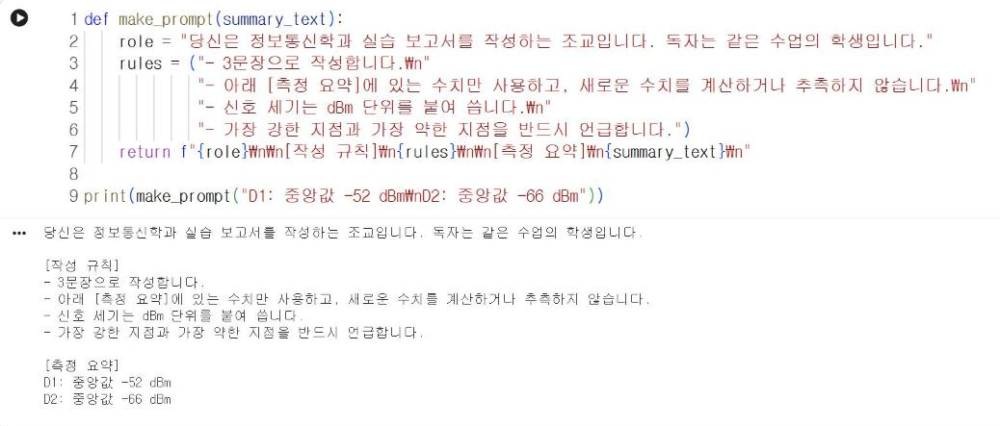

# 13.2 프롬프트 설계

프롬프트(prompt)는 생성형 AI 모델에 보내는 입력 문장이다. 「요약해 줘」처럼 짧은 프롬프트는 응답의 길이·형식·관점이 매번 달라진다. 보고 문장처럼 정해진 용도로 사용할 응답을 얻으려면 프롬프트에 다음 네 가지를 명시한다.

| 요소 | 내용 | 예 |
|---|---|---|
| 역할 | 모델이 수행할 역할과 독자 | 「정보통신학과 실습 보고서를 작성하는 조교」 |
| 입력 | 판단의 근거가 되는 자료 | 지점별 측정 요약값 |
| 출력 형식 | 문장 수, 구성, 표기 방법 | 「3문장, 수치는 dBm 단위로」 |
| 제약 | 하지 말아야 할 것 | 「입력에 없는 수치를 쓰지 말 것」 |

## 프롬프트 구성 함수

프롬프트를 문자열 하나로 작성하지 않고 함수로 구성하면, 입력 자료만 바꿔 같은 형식의 프롬프트를 반복해서 생성할 수 있다.

```python
def make_prompt(summary_text):
    role = "당신은 정보통신학과 실습 보고서를 작성하는 조교입니다. 독자는 같은 수업의 학생입니다."
    rules = ("- 3문장으로 작성합니다.\n"
             "- 아래 [측정 요약]에 있는 수치만 사용하고, 새로운 수치를 계산하거나 추측하지 않습니다.\n"
             "- 신호 세기는 dBm 단위를 붙여 씁니다.\n"
             "- 가장 강한 지점과 가장 약한 지점을 반드시 언급합니다.")
    return f"{role}\n\n[작성 규칙]\n{rules}\n\n[측정 요약]\n{summary_text}\n"

print(make_prompt("D1: 중앙값 -52 dBm\nD2: 중앙값 -66 dBm"))
```

**실행 결과**

```text
당신은 정보통신학과 실습 보고서를 작성하는 조교입니다. 독자는 같은 수업의 학생입니다.

[작성 규칙]
- 3문장으로 작성합니다.
- 아래 [측정 요약]에 있는 수치만 사용하고, 새로운 수치를 계산하거나 추측하지 않습니다.
- 신호 세기는 dBm 단위를 붙여 씁니다.
- 가장 강한 지점과 가장 약한 지점을 반드시 언급합니다.

[측정 요약]
D1: 중앙값 -52 dBm
D2: 중앙값 -66 dBm
```

<figure markdown="span">
  
  <figcaption>그림 13-1 Colab에서 실행한 프롬프트 구성 함수</figcaption>
</figure>

`f"…{변수}…"`는 문자열 안에 변수 값을 삽입하는 f-문자열이고, `\n`은 줄바꿈 문자다. 역할·규칙·자료를 대괄호 제목으로 구분하면 모델이 각 부분의 역할을 구별하기 쉽다.

## 예시 제시

원하는 문장의 예시를 프롬프트에 포함하면 응답의 형식이 예시에 가까워진다. 예시를 하나 이상 제시하는 방법을 퓨샷(few-shot) 프롬프트라고 한다.

```python
EXAMPLE = ("[예시]\n"
           "조도 측정 결과 창가가 중앙값 82로 가장 밝고, 복도 쪽이 중앙값 35로 가장 어두웠습니다. "
           "두 지점의 차이는 47입니다. 복도 쪽 자리는 조명 보강이 필요합니다.\n")

def make_prompt_fewshot(summary_text):
    return make_prompt(summary_text) + "\n" + EXAMPLE

if key:
    r = client.models.generate_content(model=MODEL, contents=make_prompt_fewshot(
        "D1: 중앙값 -52 dBm\nD2: 중앙값 -66 dBm\nD3: 중앙값 -62 dBm\nD4: 중앙값 -65.5 dBm"))
    print(r.text)
else:
    print("API 키가 없어 호출을 건너뜁니다.")
```

!!! note "실행 결과"
    수업용 API 키를 확인한 뒤 예시를 제시하지 않은 프롬프트와 제시한 프롬프트의 응답을 비교해 기입한다.

<!-- DATA: ch13_run_fewshot — make_prompt와 make_prompt_fewshot 응답 각 1회, 형식 차이 비교용 -->

예시의 수치(82, 35, 47)는 형식을 보여 주기 위한 가상의 값이다. 모델이 예시의 수치를 응답에 옮겨 쓰지 않는지 13.4절의 검증으로 확인한다.

## 확인 문제

1. `make_prompt`의 규칙에서 「3문장」을 「표 형식」으로 바꾸고 응답 형식이 어떻게 달라지는지 확인하시오.
2. 제약 「새로운 수치를 계산하거나 추측하지 않습니다」를 삭제하고 응답을 비교하시오. 입력에 없는 수치가 나타나는지 확인한다.
3. 본인의 프로젝트 주제(12.4절)에 맞게 역할과 규칙을 바꾼 프롬프트 함수를 작성하시오.
