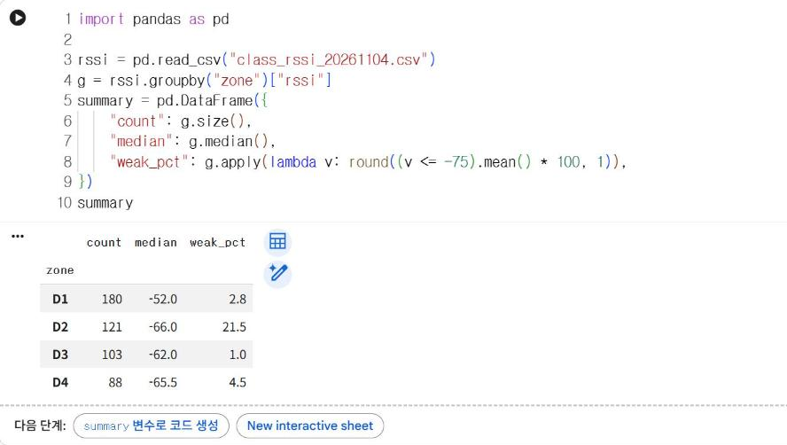
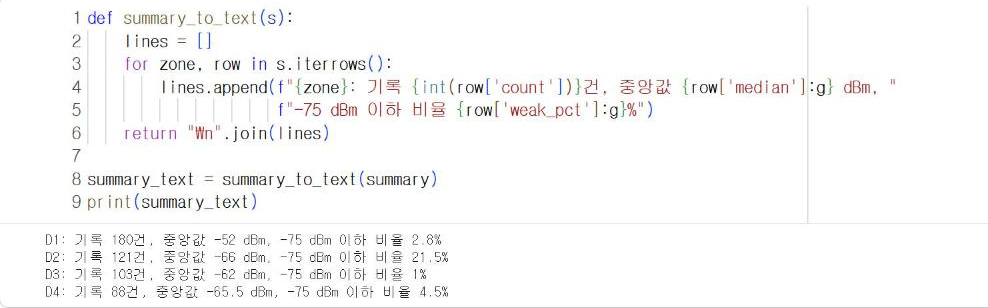

# 13.3 수치 계산과 문장 생성의 분리

생성형 AI 모델은 문장을 자연스럽게 작성하지만, 많은 수의 측정값에서 중앙값이나 비율을 정확히 계산하는 일에는 적합하지 않다. 모델은 계산하지 않고 그럴듯한 다음 토큰을 선택해 문장을 생성하기 때문이다. 따라서 수치 계산은 코드로 하고, 계산 결과인 요약값만 모델에 입력해 문장 작성을 위임한다.

| 단계 | 담당 | 내용 |
|---|---|---|
| 1. 요약 통계 산출 | 파이썬 코드(pandas) | 원자료 492건에서 지점별 중앙값·기록 수·약한 신호 비율 산출 |
| 2. 요약값 문자열 구성 | 파이썬 코드 | 요약 표를 프롬프트에 넣을 문자열로 변환 |
| 3. 문장 생성 | 생성형 AI | 요약값을 근거로 보고 문장 작성 |
| 4. 검증 | 파이썬 코드 | 문장의 수치가 요약값과 일치하는지 점검(13.4절) |

## 측정 요약 통계 산출

11/4 수업 신호 세기 기록에서 지점별 요약 통계를 산출한다. 약한 신호 비율은 −75 dBm 이하인 기록의 비율이다. −75 dBm은 수업에서 사용한 장비의 음영 기준이다(8.3절).

```python
import pandas as pd

rssi = pd.read_csv("class_rssi_20261104.csv")
g = rssi.groupby("zone")["rssi"]
summary = pd.DataFrame({
    "count": g.size(),
    "median": g.median(),
    "weak_pct": g.apply(lambda v: round((v <= -75).mean() * 100, 1)),
})
summary
```

**실행 결과**

```text
      count  median  weak_pct
zone                         
D1      180   -52.0       2.8
D2      121   -66.0      21.5
D3      103   -62.0       1.0
D4       88   -65.5       4.5
```

<figure markdown="span">
  
  <figcaption>그림 13-2 Colab에서 산출한 지점별 요약 통계</figcaption>
</figure>

## 요약값만 AI에 입력

요약 표를 프롬프트에 넣을 문자열로 변환한다. 원자료 492건이 아니라 요약값 12개만 모델에 전달된다.

```python
def summary_to_text(s):
    lines = []
    for zone, row in s.iterrows():
        lines.append(f"{zone}: 기록 {int(row['count'])}건, 중앙값 {row['median']:g} dBm, "
                     f"-75 dBm 이하 비율 {row['weak_pct']:g}%")
    return "\n".join(lines)

summary_text = summary_to_text(summary)
print(summary_text)
```

**실행 결과**

```text
D1: 기록 180건, 중앙값 -52 dBm, -75 dBm 이하 비율 2.8%
D2: 기록 121건, 중앙값 -66 dBm, -75 dBm 이하 비율 21.5%
D3: 기록 103건, 중앙값 -62 dBm, -75 dBm 이하 비율 1%
D4: 기록 88건, 중앙값 -65.5 dBm, -75 dBm 이하 비율 4.5%
```

<figure markdown="span">
  
  <figcaption>그림 13-3 프롬프트에 입력할 요약 문자열</figcaption>
</figure>

`iterrows()`는 DataFrame의 행을 (인덱스, 행) 순서로 하나씩 반환한다. `{값:g}`는 불필요한 소수점 0을 표시하지 않는 서식이다(−52.0 → −52, −65.5 → −65.5).

```python
if key:
    report = client.models.generate_content(model=MODEL, contents=make_prompt(summary_text)).text
    print(report)
else:
    report = None
    print("API 키가 없어 호출을 건너뜁니다.")
```

!!! note "실행 결과"
    수업용 API 키를 확인한 뒤 실제 보고 문장을 기입한다.

<!-- DATA: ch13_run_report — summary_text로 생성한 보고 문장(13.4절 검증 입력으로도 사용) -->

| 방식 | 모델에 입력하는 자료 | 위험 |
|---|---|---|
| 원자료 전체 입력 | 492건의 측정값 | 계산 오류, 입력 길이와 사용량 증가 |
| 요약값만 입력(이 절) | 코드로 산출한 12개 값 | 문장 작성 단계의 수치 옮겨 쓰기 오류만 남음 → 13.4절에서 점검 |

## 확인 문제

1. `summary`에 지점별 10% 분위수 열을 추가하고 `summary_to_text`가 이 값도 출력하도록 수정하시오.
2. 원자료 일부(예: 30행)를 그대로 프롬프트에 넣고 「지점별 중앙값을 계산하라」고 요청한 뒤, 응답의 값을 `summary`와 비교하시오.
3. 본인 프로젝트의 측정 자료로 요약 통계 표와 요약 문자열을 작성하시오.
