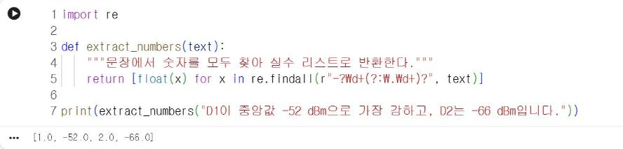
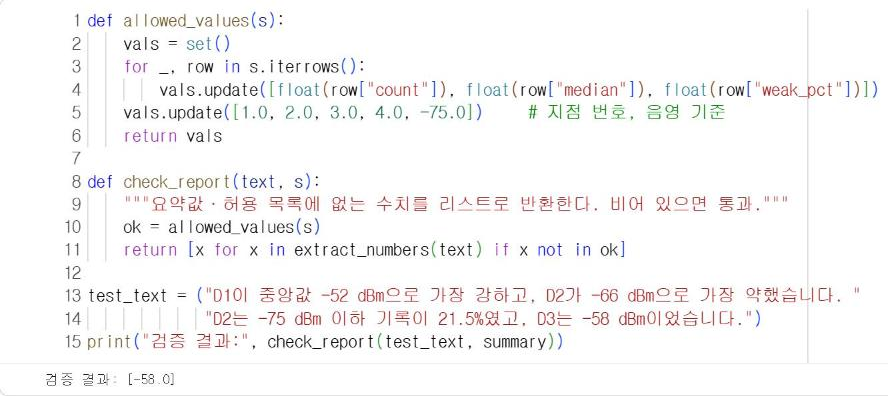
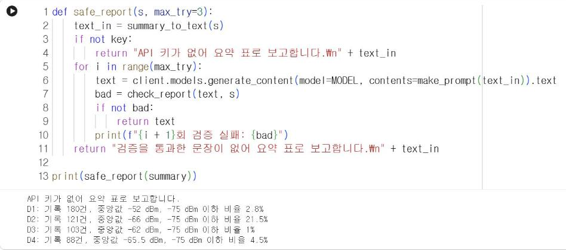

# 13.4 출력 검증

13.3절처럼 요약값만 입력해도, 모델이 문장을 작성하면서 수치를 잘못 옮겨 쓰거나 입력에 없는 수치를 생성할 수 있다. 보고 문장을 그대로 사용하기 전에, 문장에 포함된 수치가 모두 입력한 요약값에 있는지 코드로 점검한다.

## 정규식 수치 추출

정규식(regular expression)은 문자열에서 특정 형태의 부분을 찾는 패턴 표기법이다. 다음 패턴은 부호와 소수점을 포함한 숫자를 찾는다.

| 패턴 | 의미 |
|---|---|
| `-?` | 마이너스 부호가 있거나 없음 |
| `\d+` | 숫자 한 개 이상 |
| `(?:\.\d+)?` | 소수점과 숫자가 있거나 없음 |

```python
import re

def extract_numbers(text):
    """문장에서 숫자를 모두 찾아 실수 리스트로 반환한다."""
    return [float(x) for x in re.findall(r"-?\d+(?:\.\d+)?", text)]

print(extract_numbers("D1이 중앙값 -52 dBm으로 가장 강하고, D2는 -66 dBm입니다."))
```

**실행 결과**

```text
[1.0, -52.0, 2.0, -66.0]
```

<figure markdown="span">
  
  <figcaption>그림 13-4 Colab에서 실행한 정규식 숫자 추출</figcaption>
</figure>

추출 결과에 1과 2가 포함된 이유는 지점 이름 `D1`, `D2`의 숫자도 추출되기 때문이다. 검증할 때는 지점 이름의 번호처럼 수치가 아닌 숫자를 허용 목록에 추가한다.

## 원자료 대조

검증 함수는 문장에서 추출한 수치 중 요약값에도, 허용 목록에도 없는 수치를 반환한다. 반환된 리스트가 비어 있으면 통과다.

```python
def allowed_values(s):
    vals = set()
    for _, row in s.iterrows():
        vals.update([float(row["count"]), float(row["median"]), float(row["weak_pct"])])
    vals.update([1.0, 2.0, 3.0, 4.0, -75.0])     # 지점 번호, 음영 기준
    return vals

def check_report(text, s):
    """요약값·허용 목록에 없는 수치를 리스트로 반환한다. 비어 있으면 통과."""
    ok = allowed_values(s)
    return [x for x in extract_numbers(text) if x not in ok]

test_text = ("D1이 중앙값 -52 dBm으로 가장 강하고, D2가 -66 dBm으로 가장 약했습니다. "
             "D2는 -75 dBm 이하 기록이 21.5%였고, D3는 -58 dBm이었습니다.")
print("검증 결과:", check_report(test_text, summary))
```

**실행 결과**

```text
검증 결과: [-58.0]
```

<figure markdown="span">
  
  <figcaption>그림 13-5 Colab에서 실행한 수치 검증: 요약값에 없는 −58을 검출</figcaption>
</figure>

`test_text`는 검증 함수를 시험하기 위해 작성한 문장이다. D3의 중앙값을 실제 값 −62 대신 −58로 잘못 적었다. 검증 함수는 요약값에 없는 −58을 검출한다. 한편 「D2가 가장 약했다」는 서술은 수치 대조로 검출되지 않는다. D2(−66)와 D4(−65.5)의 중앙값 차이가 0.5 dB에 불과해 가장 약한 지점이라는 판단은 맞지만, 순위나 비교처럼 수치가 없는 서술은 사람이 확인해야 한다.

## 검증 후 재생성

검증에 실패하면 응답을 다시 생성한다. 무한히 반복하지 않도록 재시도 횟수를 제한하고, 모두 실패하면 요약 표를 그대로 보고하는 대체 문장을 사용한다.

```python
def safe_report(s, max_try=3):
    text_in = summary_to_text(s)
    if not key:
        return "API 키가 없어 요약 표로 보고합니다.\n" + text_in
    for i in range(max_try):
        text = client.models.generate_content(model=MODEL, contents=make_prompt(text_in)).text
        bad = check_report(text, s)
        if not bad:
            return text
        print(f"{i + 1}회 검증 실패: {bad}")
    return "검증을 통과한 문장이 없어 요약 표로 보고합니다.\n" + text_in

print(safe_report(summary))
```

**실행 결과**

```text
API 키가 없어 요약 표로 보고합니다.
D1: 기록 180건, 중앙값 -52 dBm, -75 dBm 이하 비율 2.8%
D2: 기록 121건, 중앙값 -66 dBm, -75 dBm 이하 비율 21.5%
D3: 기록 103건, 중앙값 -62 dBm, -75 dBm 이하 비율 1%
D4: 기록 88건, 중앙값 -65.5 dBm, -75 dBm 이하 비율 4.5%
```

<figure markdown="span">
  
  <figcaption>그림 13-6 Colab에서 실행한 safe_report(키가 없어 요약 표로 보고)</figcaption>
</figure>

API 키가 없거나 3회 모두 검증에 실패하면 요약 표 자체를 보고한다. 보고 문장이 없어도 측정 결과는 정확하게 전달된다. 15.2절에서 이 구조를 통신 실패 처리에 확장한다.

<!-- DATA: ch13_run_safe — 유효한 API 키로 safe_report를 실행한 결과(재시도 발생 여부 포함)와 Colab 캡처 -->

## 확인 문제

1. `test_text`에 「총 492건」이라는 표현을 추가하면 검증 결과가 어떻게 되는지 확인하고, 필요하면 허용 목록을 수정하시오.
2. 13.3절에서 생성한 실제 보고 문장을 `check_report`로 검증하시오.
3. 「가장 강한 지점」 서술이 요약 표와 일치하는지 점검하는 코드를 작성하시오(`summary["median"].idxmax()` 사용).
