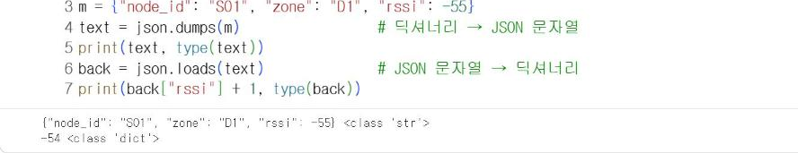

# 14.1 웹 API의 구조

웹 API는 네트워크로 프로그램끼리 자료를 주고받는 규칙이다. 자료를 요청하는 쪽을 클라이언트(client), 요청을 처리하고 응답하는 쪽을 서버(server)라고 한다. 8장의 사이버파이와 수업 서버, 13장의 파이썬 코드와 Gemini API가 모두 클라이언트와 서버의 관계다.

| 구성 요소 | 의미 | 8장 수업 서버의 예 |
|---|---|---|
| 요청(request) | 클라이언트가 서버에 보내는 메시지 | 사이버파이가 보낸 측정값 |
| 응답(response) | 서버가 요청을 처리하고 돌려보내는 메시지 | `{"ok": true}` |
| 엔드포인트(endpoint) | 요청을 받는 주소의 경로 | `/api/measure` |
| 본문(body) | 요청·응답에 포함된 자료 | JSON 형식 측정값 |

## HTTP 메서드

HTTP 요청은 무엇을 할지를 메서드로 지정한다.

| 메서드 | 용도 | 예 |
|---|---|---|
| GET | 자료 조회 | `GET /summary` 지점별 요약 조회 |
| POST | 자료 전송·생성 | `POST /measure` 측정값 전송 |
| PUT | 자료 전체 수정 | 설정값 변경 |
| DELETE | 자료 삭제 | 시험 기록 삭제 |

브라우저 주소창에 주소를 입력하면 GET 요청이 전송된다. 측정값처럼 본문이 있는 자료는 POST로 전송한다.

## 상태 코드

서버는 응답에 처리 결과를 세 자리 상태 코드로 표시한다.

| 상태 코드 | 의미 | 발생 상황 |
|---|---|---|
| 200 | 성공 | 정상 처리 |
| 404 | 찾을 수 없음 | 없는 엔드포인트로 요청 |
| 422 | 처리할 수 없는 자료 | 형식이 맞지 않는 본문(예: 신호 세기에 문자열) |
| 500 | 서버 내부 오류 | 서버 코드의 오류 |

8.3절 그림 8-3의 시험 전송에서 응답 코드 200을 확인했다. 14.2절에서는 잘못된 측정값을 보내 422 응답을 확인한다.

## JSON 형식

JSON은 웹 API에서 가장 널리 사용하는 자료 형식이다. 파이썬의 딕셔너리·리스트와 구조가 같아 쉽게 변환할 수 있다.

```python
import json

m = {"node_id": "S01", "zone": "D1", "rssi": -55}
text = json.dumps(m)                 # 딕셔너리 → JSON 문자열
print(text, type(text))
back = json.loads(text)              # JSON 문자열 → 딕셔너리
print(back["rssi"] + 1, type(back))
```

**실행 결과**

```text
{"node_id": "S01", "zone": "D1", "rssi": -55} <class 'str'>
-54 <class 'dict'>
```

<figure markdown="span">
  
  <figcaption>그림 14-1 Colab에서 실행한 JSON 변환</figcaption>
</figure>

| 파이썬 | JSON |
|---|---|
| `dict` | 객체 `{…}` |
| `list` | 배열 `[…]` |
| `str` | 문자열 `"…"` |
| `int`, `float` | 숫자 |
| `True`, `False`, `None` | `true`, `false`, `null` |

## 확인 문제

1. 8.3절 그림 8-2의 수업 서버 문서에서 GET 메서드 엔드포인트를 세 개 찾아 쓰시오.
2. `json.dumps`의 결과와 원래 딕셔너리를 `print`로 출력했을 때 따옴표 모양이 어떻게 다른지 비교하시오.
3. 신호 세기 값을 문자열 `"-55"`로 보내면 서버에서 어떤 문제가 발생할 수 있는지 설명하시오.
