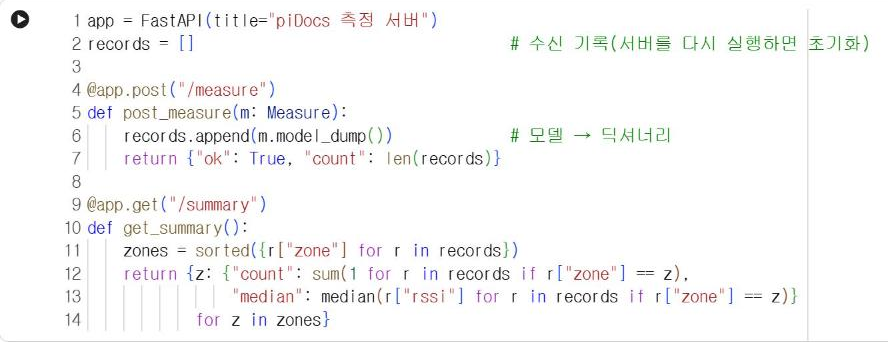
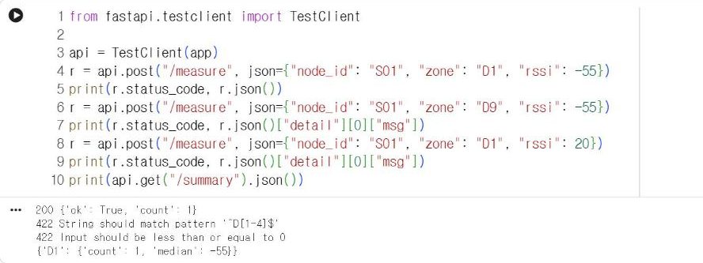
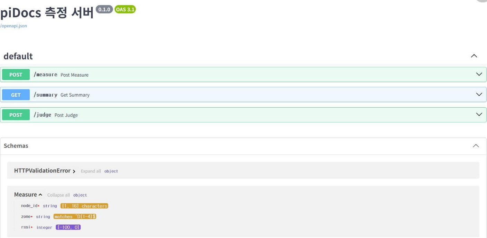

# 14.2 FastAPI 엔드포인트

FastAPI는 파이썬으로 웹 API 서버를 작성하는 프레임워크다. 함수 위에 경로와 메서드를 지정하는 데코레이터를 붙이면 그 함수가 엔드포인트가 된다. 8.3절의 수업 서버도 FastAPI로 작성했다.

## 준비

Colab에 FastAPI가 설치되어 있지 않으면 다음 코드가 설치한다. PC에서는 `pip install fastapi uvicorn httpx`로 설치한다.

```python
import importlib.util, subprocess, sys

if importlib.util.find_spec("fastapi") is None:
    subprocess.run([sys.executable, "-m", "pip", "install", "-q", "fastapi", "httpx"])
print("fastapi 준비:", importlib.util.find_spec("fastapi") is not None)
```

## 자료 검증 모델

측정값의 형식을 pydantic 모델로 정의한다. 형식에 맞지 않는 요청은 FastAPI가 자동으로 거부하고 422 응답을 보낸다.

```python
from fastapi import FastAPI
from pydantic import BaseModel, Field
from statistics import median

class Measure(BaseModel):
    node_id: str = Field(min_length=1, max_length=16)   # 기기 번호
    zone: str = Field(pattern=r"^D[1-4]$")              # 측정 지점 D1~D4
    rssi: int = Field(ge=-100, le=0)                    # 신호 세기(dBm)
```

| 제약 | 의미 |
|---|---|
| `min_length`, `max_length` | 문자열 길이 범위 |
| `pattern=r"^D[1-4]$"` | 정규식(13.4절)으로 D1~D4만 허용 |
| `ge=-100, le=0` | −100 이상 0 이하(greater or equal, less or equal) |

## 엔드포인트 작성

```python
app = FastAPI(title="piDocs 측정 서버")
records = []                                   # 수신 기록(서버를 다시 실행하면 초기화)

@app.post("/measure")
def post_measure(m: Measure):
    records.append(m.model_dump())             # 모델 → 딕셔너리
    return {"ok": True, "count": len(records)}

@app.get("/summary")
def get_summary():
    zones = sorted({r["zone"] for r in records})
    return {z: {"count": sum(1 for r in records if r["zone"] == z),
                "median": median(r["rssi"] for r in records if r["zone"] == z)}
            for z in zones}
```

<figure markdown="span">
  
  <figcaption>그림 14-2 Colab에서 실행한 FastAPI 앱과 엔드포인트 정의</figcaption>
</figure>

`@app.post("/measure")`는 `/measure` 경로의 POST 요청을 `post_measure` 함수로 처리하라는 의미다. 함수의 인자 `m: Measure`는 요청 본문을 `Measure` 모델로 검증해 전달받는다는 선언이다. 함수가 반환한 딕셔너리는 FastAPI가 JSON으로 변환해 응답한다.

## TestClient로 요청 보내기

서버를 실행하지 않고도 `TestClient`로 엔드포인트에 요청을 보내 동작을 확인할 수 있다.

```python
from fastapi.testclient import TestClient

api = TestClient(app)
r = api.post("/measure", json={"node_id": "S01", "zone": "D1", "rssi": -55})
print(r.status_code, r.json())
r = api.post("/measure", json={"node_id": "S01", "zone": "D9", "rssi": -55})
print(r.status_code, r.json()["detail"][0]["msg"])
r = api.post("/measure", json={"node_id": "S01", "zone": "D1", "rssi": 20})
print(r.status_code, r.json()["detail"][0]["msg"])
print(api.get("/summary").json())
```

**실행 결과**

```text
200 {'ok': True, 'count': 1}
422 String should match pattern '^D[1-4]$'
422 Input should be less than or equal to 0
{'D1': {'count': 1, 'median': -55}}
```

<figure markdown="span">
  
  <figcaption>그림 14-3 Colab에서 TestClient로 보낸 정상 요청과 잘못된 요청의 응답</figcaption>
</figure>

정상 측정값은 200과 함께 저장 건수를 응답한다. 지점이 `D9`인 요청과 신호 세기가 20인 요청은 422로 거부되고, `detail`에 거부 이유가 담긴다. 거부된 요청은 `records`에 저장되지 않으므로 요약에는 정상 측정값 1건만 반영된다.

## PC에서 서버 실행

같은 코드를 `main.py` 파일로 저장하고 PC의 명령 창에서 다음 명령을 실행하면 실제 서버가 동작한다.

```text
pip install fastapi uvicorn
uvicorn main:app --reload --port 8620
```

브라우저로 `http://127.0.0.1:8620/docs`에 접속하면 FastAPI가 자동으로 생성한 문서 화면이 표시된다. 그림은 14.3절의 `/judge` 엔드포인트까지 추가한 상태다. 「Schemas」의 `Measure`를 펼치면 길이 범위 `[1, 16]`, 정규식 `^D[1-4]$`, 값 범위 `[-100, 0]` 같은 제약이 표시된다.

<figure markdown="span">
  
  <figcaption>그림 14-4 PC에서 실행한 측정 서버의 자동 문서(/docs): 엔드포인트 3개와 Measure 모델의 제약</figcaption>
</figure>

`--reload`는 코드 파일을 수정하면 서버를 자동으로 다시 시작하는 옵션이다. 8장의 사이버파이가 이 서버에 전송하려면 PC와 기기가 같은 Wi-Fi에 연결되어 있어야 하고, 서버를 `--host 0.0.0.0`으로 실행해 외부 접속을 허용해야 한다.

## 확인 문제

1. `Measure` 모델에 선택 항목 `battery: int | None = None`을 추가하고, 배터리 값이 있는 요청과 없는 요청을 모두 보내 보시오.
2. 지점별 최솟값·최댓값도 반환하도록 `/summary`를 수정하시오.
3. `/records` GET 엔드포인트를 추가해 최근 5건의 기록을 반환하시오.
