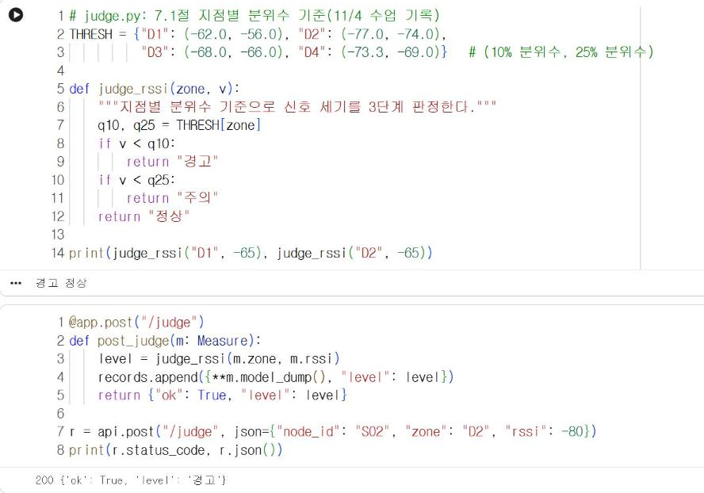

# 14.3 판정 모듈 연결

7.1절에서 작성한 지점별 3단계 판정 함수를 서버에 연결한다. 서버는 측정값을 저장하는 동시에 판정 결과를 응답에 포함한다. 기기는 응답의 판정 결과를 받아 LED 색으로 표시할 수 있다.

## 모듈 분리

판정 함수를 서버 코드와 같은 파일에 작성하면 서버 코드가 길어지고, 판정 기준을 바꿀 때 서버 코드 전체를 수정해야 한다. 판정 함수는 별도 파일(모듈)로 분리한다.

| 파일 | 내용 |
|---|---|
| `judge.py` | 판정 기준값과 판정 함수 |
| `main.py` | FastAPI 앱, 엔드포인트, `from judge import judge_rssi` |

`judge.py`의 내용은 다음과 같다. 기준값은 7.1절에서 11/4 수업 기록으로 산출한 지점별 10%·25% 분위수다. Colab 노트북에서는 같은 셀에 정의해 사용한다.

```python
# judge.py: 7.1절 지점별 분위수 기준(11/4 수업 기록)
THRESH = {"D1": (-62.0, -56.0), "D2": (-77.0, -74.0),
          "D3": (-68.0, -66.0), "D4": (-73.3, -69.0)}   # (10% 분위수, 25% 분위수)

def judge_rssi(zone, v):
    """지점별 분위수 기준으로 신호 세기를 3단계 판정한다."""
    q10, q25 = THRESH[zone]
    if v < q10:
        return "경고"
    if v < q25:
        return "주의"
    return "정상"

print(judge_rssi("D1", -65), judge_rssi("D2", -65))
```

**실행 결과**

```text
경고 정상
```

7.1절과 같은 결과다. 같은 −65 dBm이 D1에서는 「경고」, D2에서는 「정상」으로 판정된다.

## 판정 결과 반환

판정 결과를 응답에 포함하는 엔드포인트 `/judge`를 추가한다.

```python
@app.post("/judge")
def post_judge(m: Measure):
    level = judge_rssi(m.zone, m.rssi)
    records.append({**m.model_dump(), "level": level})
    return {"ok": True, "level": level}

r = api.post("/judge", json={"node_id": "S02", "zone": "D2", "rssi": -80})
print(r.status_code, r.json())
```

**실행 결과**

```text
200 {'ok': True, 'level': '경고'}
```

<figure markdown="span">
  
  <figcaption>그림 14-5 Colab에서 실행한 판정 함수와 /judge 엔드포인트</figcaption>
</figure>

`{**m.model_dump(), "level": level}`은 측정값 딕셔너리의 항목을 모두 펼치고 `level` 항목을 추가한 새 딕셔너리를 만든다. D2의 −80 dBm은 D2의 10% 분위수(−77 dBm)보다 약하므로 「경고」로 판정된다.

## 기준값을 바꾸는 방법

판정 기준을 4주차에 수집한 새 자료로 다시 산출하면 `judge.py`의 `THRESH`만 수정한다. 서버 코드(`main.py`)는 수정하지 않는다. 10장의 강수 판정 모델이나 11장의 동작 분류 모델도 같은 방법으로 별도 모듈에 두고 엔드포인트에서 호출한다.

| 판정 모듈 | 입력 | 출력 | 근거 |
|---|---|---|---|
| `judge_rssi` | 지점, 신호 세기 | 정상·주의·경고 | 7.1절 분위수 |
| `my_model` | 오늘 강수량, 계절 위치 | 다음 날 강수 여부 | 12.1절 조건문 변환 |
| `classify` | 가속도 특징 | 동작 이름 | 11.3절 조건문 변환 |

## 확인 문제

1. `judge.py`에 12.1절의 `my_model` 함수를 추가하고, 오늘 강수량과 날짜를 받아 다음 날 강수 여부를 반환하는 엔드포인트를 작성하시오.
2. `THRESH`에 없는 지점(예: `D5`)으로 판정을 요청하면 어떤 오류가 발생하는지 확인하고, `Measure` 모델의 `pattern` 제약이 이 오류를 어떻게 예방하는지 설명하시오.
3. 응답에 판정 기준값(`q10`, `q25`)도 포함하도록 수정하시오.
