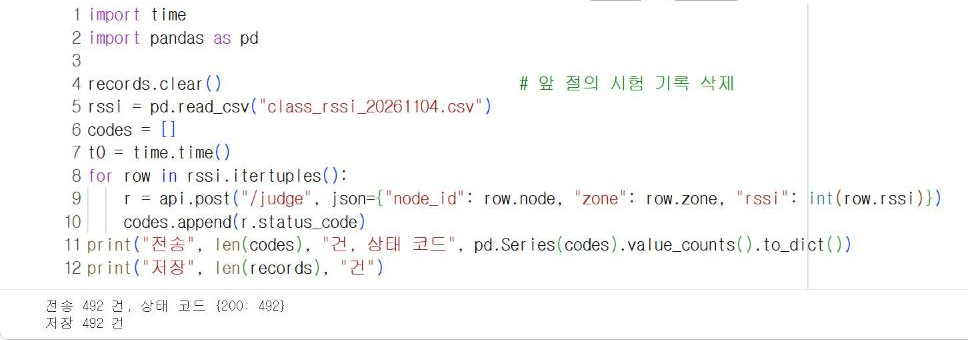
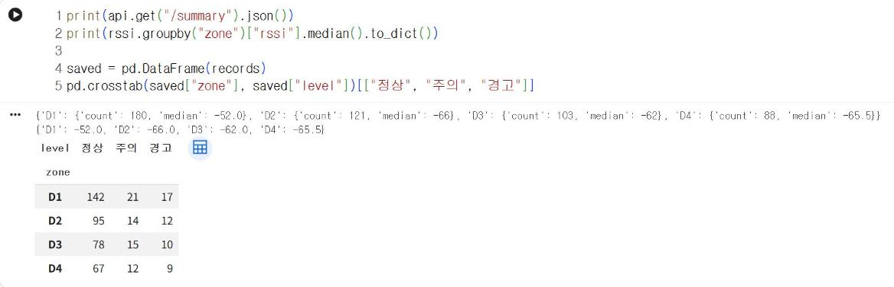

# 14.4 가상 노드로 서버 시험

서버를 기기와 연결하기 전에, 이미 기록된 측정 자료를 서버에 다시 전송해 서버가 정상적으로 동작하는지 확인한다. 실제 기기 대신 기록 자료를 전송하는 프로그램을 가상 노드라고 한다. 8.3절의 실시간 화면도 이 방법으로 11/4 수업 기록 492건을 다시 전송해 재현했다.

## 기록 자료 재생

```python
import time
import pandas as pd

records.clear()                                 # 앞 절의 시험 기록 삭제
rssi = pd.read_csv("class_rssi_20261104.csv")
codes = []
t0 = time.time()
for row in rssi.itertuples():
    r = api.post("/judge", json={"node_id": row.node, "zone": row.zone, "rssi": int(row.rssi)})
    codes.append(r.status_code)
print("전송", len(codes), "건, 상태 코드", pd.Series(codes).value_counts().to_dict())
print("저장", len(records), "건")
```

**실행 결과**

```text
전송 492 건, 상태 코드 {200: 492}
저장 492 건
```

<figure markdown="span">
  
  <figcaption>그림 14-4 Colab에서 11/4 수업 기록 492건을 /judge로 재생한 결과</figcaption>
</figure>

`itertuples()`는 DataFrame의 각 행을 속성으로 접근할 수 있는 형태(`row.zone`)로 하나씩 반환한다. 492건이 모두 200으로 처리되고 저장되면 수신·검증·저장 단계가 정상이다.

## 서버 결과와 분석 결과 대조

서버가 산출한 요약과 판정 결과가 pandas로 직접 산출한 결과와 같은지 확인한다.

```python
print(api.get("/summary").json())
print(rssi.groupby("zone")["rssi"].median().to_dict())

saved = pd.DataFrame(records)
pd.crosstab(saved["zone"], saved["level"])[["정상", "주의", "경고"]]
```

**실행 결과**

```text
{'D1': {'count': 180, 'median': -52.0}, 'D2': {'count': 121, 'median': -66}, 'D3': {'count': 103, 'median': -62}, 'D4': {'count': 88, 'median': -65.5}}
{'D1': -52.0, 'D2': -66.0, 'D3': -62.0, 'D4': -65.5}
level   정상  주의  경고
zone              
D1     142  21  17
D2      95  14  12
D3      78  15  10
D4      67  12   9
```

<figure markdown="span">
  
  <figcaption>그림 14-5 서버의 지점별 중앙값·판정 집계와 pandas 산출값 대조</figcaption>
</figure>

서버가 산출한 지점별 중앙값(−52, −66, −62, −65.5 dBm)은 pandas 산출값과 같고, 판정 집계도 7.1절의 교차표(D1 정상 142·주의 21·경고 17 등)와 모두 일치한다. 서버의 중앙값이 `-52.0`과 `-66`처럼 실수와 정수로 다르게 표시되는 것은 `statistics.median`이 자료 개수가 짝수(D1 180건)이면 가운데 두 값의 평균(실수)을, 홀수(D2 121건)이면 가운데 값 자체(정수)를 반환하기 때문이다. 값은 같으므로 대조 결과에는 영향이 없다.

## 시험 결과 기록

서버를 수정할 때마다 같은 재생 시험을 실행하고 다음 표에 기록한다. 결과가 이전과 달라지면 수정한 부분에서 오류가 발생했다는 신호다.

| 시험 항목 | 기대 결과 | 확인 |
|---|---|---|
| 전송 건수와 상태 코드 | 492건, 모두 200 | |
| 저장 건수 | 492건 | |
| 지점별 중앙값 | pandas 산출값과 일치 | |
| 판정 집계 | 7.1절 교차표와 일치 | |
| 잘못된 요청 | 422 응답, 저장되지 않음 | |

## 확인 문제

1. 재생 자료에 일부러 잘못된 행(지점 `D9`, 신호 세기 `10`)을 3건 추가하고, 상태 코드 집계와 저장 건수가 어떻게 변화하는지 확인하시오.
2. 492건 재생에 걸린 시간을 `time.time()`으로 측정하고, 1건당 처리 시간을 계산하시오.
3. 본인 프로젝트의 측정 자료로 같은 재생 시험을 작성하시오.
