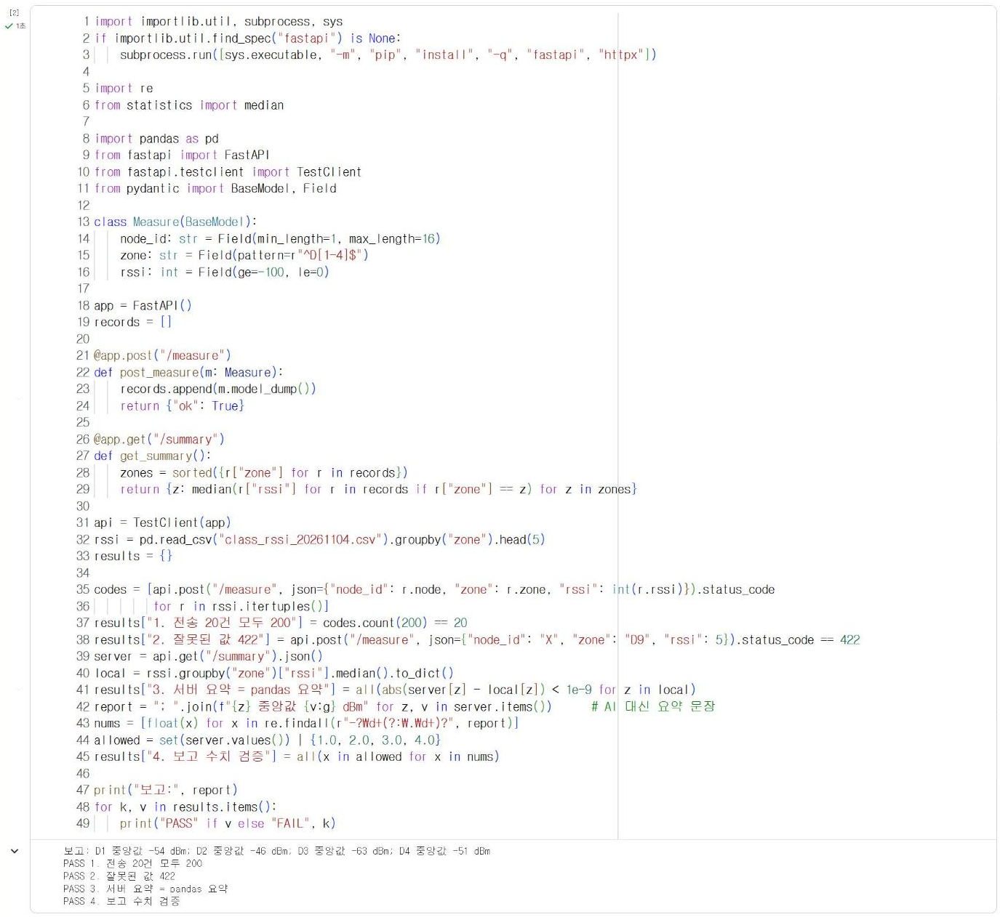
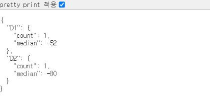

# 15.1 시스템 통합 점검표

팀 프로젝트는 여러 구성 요소가 차례로 자료를 넘기는 구조다. 각 구성 요소가 혼자서는 정상이어도, 연결 지점에서 형식이 맞지 않거나 한쪽이 응답하지 않으면 시스템 전체가 동작하지 않는다. 통합 점검은 자료가 흐르는 순서대로 연결 지점을 하나씩 확인하는 절차다.

## 구성 요소와 연결 지점

| 순서 | 구성 요소 | 넘기는 자료 | 다음 구성 요소 | 관련 장 |
|---|---|---|---|---|
| 1 | 사이버파이 센서 | 측정값 | 기기 판정 함수 | 4·7장 |
| 2 | 기기 판정·표시 | 판정 결과, JSON 측정값 | Wi-Fi 전송 | 7·8장 |
| 3 | Wi-Fi 전송 | UDP 데이터그램(JSON 측정값) | 수신 서버 | 8·15장 |
| 4 | 수신 서버 | 저장 기록, 판정 결과 | 요약 통계 | 14장 |
| 5 | 요약 통계 | 요약값 | 생성형 AI 보고 | 13장 |
| 6 | 생성형 AI 보고 | 보고 문장 | 출력 검증 | 13장 |

## 구성 요소별 점검 항목

| 구성 요소 | 점검 항목 | 확인 방법 | 기대 결과 |
|---|---|---|---|
| 센서 | 측정값 범위 | 기기 화면 출력(4.6절) | 조도·소리 0~100, 정지 시 가속도 값 거의 일정 |
| 기기 판정 | 경계값 판정 | 2.4절 방식의 경계값 시험 | 임계값 바로 위·아래에서 단계가 바뀜 |
| 기기 표시 | LED 색과 화면 | 단계별 조작(7.4절) | 단계와 색이 일치 |
| Wi-Fi | 접속과 IP | 기기 화면 「WiFi OK」, IP 표시(8.2절) | 교내망 IP 배정 |
| 전송 | 서버 응답 | 기기 화면 「send OK」 | 서버 응답 수신 |
| 서버 수신 | 형식 검증 | `/docs` 시험 전송(8.3·14.2절) | 정상 200, 잘못된 값 422 |
| 서버 판정 | 기록 재생 | 14.4절 재생 시험 | 판정 집계가 분석 결과와 일치 |
| 요약 | 요약 통계 | pandas 산출값과 대조 | 일치 |
| AI 보고 | 수치 검증 | `check_report`(13.4절) | 요약값에 없는 수치 없음 |
| 대체 보고 | AI 불통 시 | API 키를 지우고 실행 | 요약 표로 보고 |

## 통합 점검 코드

서버 수신부터 보고까지의 연결은 기기 없이 Colab에서 한 번에 점검할 수 있다. 다음 코드는 14장의 수신 서버와 13.4절의 검증 함수를 간단히 다시 정의하고, 지점마다 기록 5건씩 모두 20건을 전송한 뒤 각 연결 지점의 결과를 PASS·FAIL로 출력한다.

```python
import importlib.util, subprocess, sys
if importlib.util.find_spec("fastapi") is None:
    subprocess.run([sys.executable, "-m", "pip", "install", "-q", "fastapi", "httpx"])

import re
from statistics import median

import pandas as pd
from fastapi import FastAPI
from fastapi.testclient import TestClient
from pydantic import BaseModel, Field

class Measure(BaseModel):
    node_id: str = Field(min_length=1, max_length=16)
    zone: str = Field(pattern=r"^D[1-4]$")
    rssi: int = Field(ge=-100, le=0)

app = FastAPI()
records = []

@app.post("/measure")
def post_measure(m: Measure):
    records.append(m.model_dump())
    return {"ok": True}

@app.get("/summary")
def get_summary():
    zones = sorted({r["zone"] for r in records})
    return {z: median(r["rssi"] for r in records if r["zone"] == z) for z in zones}

api = TestClient(app)
rssi = pd.read_csv("class_rssi_20261104.csv").groupby("zone").head(5)
results = {}

codes = [api.post("/measure", json={"node_id": r.node, "zone": r.zone, "rssi": int(r.rssi)}).status_code
         for r in rssi.itertuples()]
results["1. 전송 20건 모두 200"] = codes.count(200) == 20
results["2. 잘못된 값 422"] = api.post("/measure", json={"node_id": "X", "zone": "D9", "rssi": 5}).status_code == 422
server = api.get("/summary").json()
local = rssi.groupby("zone")["rssi"].median().to_dict()
results["3. 서버 요약 = pandas 요약"] = all(abs(server[z] - local[z]) < 1e-9 for z in local)
report = "; ".join(f"{z} 중앙값 {v:g} dBm" for z, v in server.items())      # AI 대신 요약 문장
nums = [float(x) for x in re.findall(r"-?\d+(?:\.\d+)?", report)]
allowed = set(server.values()) | {1.0, 2.0, 3.0, 4.0}
results["4. 보고 수치 검증"] = all(x in allowed for x in nums)

print("보고:", report)
for k, v in results.items():
    print("PASS" if v else "FAIL", k)
```

**실행 결과**

```text
보고: D1 중앙값 -54 dBm; D2 중앙값 -46 dBm; D3 중앙값 -63 dBm; D4 중앙값 -51 dBm
PASS 1. 전송 20건 모두 200
PASS 2. 잘못된 값 422
PASS 3. 서버 요약 = pandas 요약
PASS 4. 보고 수치 검증
```

<figure markdown="span">
  
  <figcaption>그림 15-? Colab에서 실행한 서버-요약-보고 통합 점검</figcaption>
</figure>

네 항목이 모두 PASS이면 서버 수신부터 보고까지의 연결이 정상이다. 이 코드에서는 API 키 없이 실행되도록 AI 보고 대신 요약 문장을 코드로 생성했다. 팀 프로젝트에서는 이 자리에 13.4절의 `safe_report`를 연결하고, 생성된 문장을 같은 방법으로 검증한다. 하나라도 FAIL이면 해당 번호의 연결 지점부터 확인한다.

## 기기와 팀 서버의 연결

8.2절의 기기 프로그램은 측정값을 UDP로 전송한다. 14장에서 작성한 팀 서버는 HTTP 요청만 수신하므로, 기기의 측정값을 받으려면 UDP 수신부를 추가해야 한다. 수업 서버도 같은 구조로 UDP를 수신한다. 다음 코드를 14.3절까지 작성한 `main.py`의 끝에 추가한다.

```python
# PC 전용: main.py 끝에 추가하는 사이버파이 UDP 수신부
import json
import socket
import threading

UDP_PORT = 8611                                   # 8.2절 기기 코드의 UDP_PORT와 같은 값

def udp_listener():
    s = socket.socket(socket.AF_INET, socket.SOCK_DGRAM)
    s.bind(("0.0.0.0", UDP_PORT))                 # PC의 모든 네트워크 장치에서 수신
    print("UDP 수신 대기:", UDP_PORT)
    while True:
        data, addr = s.recvfrom(512)
        try:
            m = Measure(**json.loads(data))       # 14.2절 모델로 형식 검증
            level = judge_rssi(m.zone, m.rssi)    # 14.3절 판정 함수
            records.append({**m.model_dump(), "level": level})
            s.sendto(b"200 ok", addr)             # 8.2절 send_udp가 b"200" 포함 여부를 확인
            print("UDP", m.node_id, m.zone, m.rssi, level, "from", addr[0])
        except Exception as e:
            s.sendto(b"err", addr)
            print("UDP 거부:", type(e).__name__)

threading.Thread(target=udp_listener, daemon=True).start()
```

| 코드 | 기능 |
|---|---|
| `socket.SOCK_DGRAM` | UDP 소켓 생성(8.2절 기기 코드와 같은 방식) |
| `s.bind(("0.0.0.0", UDP_PORT))` | 지정한 포트로 들어오는 데이터그램을 수신 |
| `s.recvfrom(512)` | 데이터그램 하나와 보낸 기기의 주소를 반환할 때까지 대기 |
| `Measure(**json.loads(data))` | JSON 문자열을 딕셔너리로 변환한 뒤 14.2절 모델로 검증. 형식이 틀리면 예외 발생 |
| `threading.Thread(…, daemon=True)` | UDP 수신을 별도 실행 흐름(스레드)으로 실행. HTTP 서버와 동시에 동작 |

`recvfrom`은 데이터그램이 도착할 때까지 대기하므로, 서버의 주 실행 흐름에서 호출하면 HTTP 요청을 처리하지 못한다. 그래서 별도 스레드에서 실행한다. 서버는 기기가 PC에 접속할 수 있도록 `--host 0.0.0.0`으로 실행한다.

```text
uvicorn main:app --host 0.0.0.0 --port 8620
```

기기를 연결하기 전에 같은 PC에서 기기 대신 UDP 측정값을 전송해 수신부를 시험한다. 다음 `fake_node.py`는 8.2절 `send_udp`와 같은 구조로 정상 측정값 2건과 잘못된 측정값 2건을 전송하고, 서버의 응답을 출력한다. 서버를 실행한 명령 창은 그대로 두고, 다른 명령 창에서 `python fake_node.py`로 실행한다.

```python
# PC 전용: fake_node.py — 기기 대신 UDP 측정값을 전송하는 시험 프로그램
import json
import socket

SERVER_IP = "127.0.0.1"                         # 같은 PC에서 시험
UDP_PORT = 8611

def send_udp(body):
    s = socket.socket(socket.AF_INET, socket.SOCK_DGRAM)
    s.settimeout(3)
    try:
        s.sendto(body.encode(), (SERVER_IP, UDP_PORT))
        return s.recv(64)
    except OSError as e:                        # 응답 없음(시간 초과) 포함
        return type(e).__name__
    finally:
        s.close()

tests = [{"node_id": "CP-01", "zone": "D1", "rssi": -52},
         {"node_id": "CP-02", "zone": "D2", "rssi": -80},
         {"node_id": "CP-03", "zone": "D9", "rssi": -60}]
for t in tests:
    print(t, "->", send_udp(json.dumps(t)))
print("not json ->", send_udp("not json"))
```

**fake_node.py 실행 결과**

```text
{'node_id': 'CP-01', 'zone': 'D1', 'rssi': -52} -> b'200 ok'
{'node_id': 'CP-02', 'zone': 'D2', 'rssi': -80} -> b'200 ok'
{'node_id': 'CP-03', 'zone': 'D9', 'rssi': -60} -> b'err'
not json -> b'err'
```

**서버 명령 창 출력**

```text
UDP 수신 대기: 8611
INFO:     Started server process [9060]
INFO:     Waiting for application startup.
INFO:     Application startup complete.
INFO:     Uvicorn running on http://0.0.0.0:8620 (Press CTRL+C to quit)
UDP CP-01 D1 -52 정상 from 127.0.0.1
UDP CP-02 D2 -80 경고 from 127.0.0.1
UDP 거부: ValidationError
UDP 거부: JSONDecodeError
INFO:     127.0.0.1:64696 - "GET /summary HTTP/1.1" 200 OK
```

<figure markdown="span">
  
  <figcaption>그림 15-? UDP로 수신한 측정값이 반영된 팀 서버의 /summary 응답</figcaption>
</figure>

정상 측정값 2건은 `200 ok` 응답과 함께 저장·판정되었다. D2의 −80 dBm은 D2의 10% 분위수 −77 dBm보다 낮으므로 경고로 판정되었다. 지점이 `D9`인 측정값은 14.2절 모델의 검증에서 `ValidationError`로, JSON 형식이 아닌 문자열은 `JSONDecodeError`로 거부되고 `err`가 응답되었다. 8.2절의 `send_udp`는 응답에 `200`이 없으면 실패로 처리하므로, 기기 화면에는 「send FAIL」이 표시된다.

!!! warning "기기 연결 확인 범위"
    UDP 수신부와 `fake_node.py`의 동작은 PC에서 확인했다. 실제 사이버파이에서 팀 서버로 전송하는 시험은 기기 대여 시 8.2절 코드의 `SERVER_IP`를 팀 서버 PC의 IP 주소로 변경해 진행한다. PC의 IP 주소는 Windows 명령 창의 `ipconfig`에서 「IPv4 주소」로 확인한다. Windows 방화벽이 Python의 네트워크 접근 허용을 물으면 허용해야 기기의 데이터그램이 수신된다(부록 C).

## 점검 기록

통합 점검은 코드를 수정할 때마다 반복한다. 팀은 다음 표를 복사해 날짜별로 기록한다.

| 날짜 | 점검 항목 | 결과 | 문제와 조치 |
|---|---|---|---|
| | 센서·기기 판정·표시 | | |
| | Wi-Fi·전송 | | |
| | 서버 수신·판정 | | |
| | 요약·AI 보고·검증 | | |

<!-- PHOTO: ch15_photo_integration — 팀 통합 점검 장면 예시(기기 화면 send OK + 노트북의 서버 /docs 화면을 함께), 학생 얼굴 제외 -->

## 확인 문제

1. 본인 팀 프로젝트의 구성 요소와 연결 지점을 위 표 형식으로 작성하시오.
2. 통합 점검 코드에 「판정 결과가 정상·주의·경고 중 하나인가」를 점검하는 항목을 추가하시오(14.3절 `/judge` 사용).
3. 기기 쪽 연결 지점(센서~전송)을 기기 화면만으로 점검하는 순서를 작성하시오.
